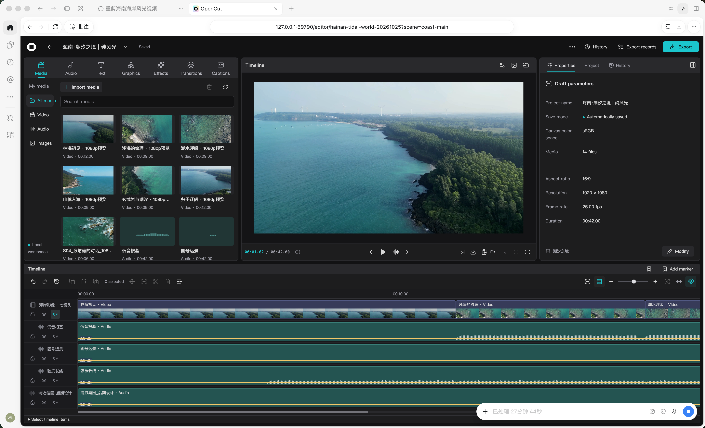
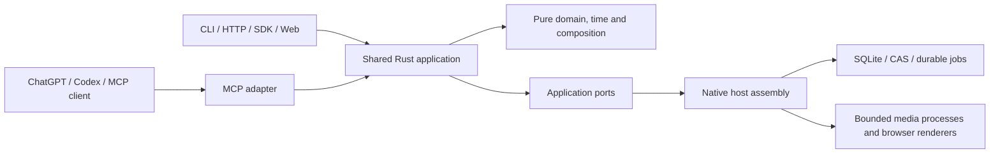

# OpenCut Plugin

[English](README.md) | [简体中文](README.zh-CN.md)

Local video editing for ChatGPT/Codex and other MCP clients, backed by a shared Rust engine, CLI, HTTP service and Web workbench.

**Development prerelease.** The first downloadable runtime targets **macOS Intel (`x86_64`)**. Apple Silicon, Windows and Linux release packages are not yet qualified. The plugin format does not impose a permanent OS restriction. This project is distributed through GitHub, not the official OpenAI plugin directory.

## Relationship to OpenCut

OpenCut Plugin is a community fork derived from [OpenCut](https://github.com/OpenCut-app/OpenCut), maintained independently by [miracle-ai-studio](https://github.com/miracle-ai-studio). It is not an official OpenCut release and is not affiliated with or endorsed by the upstream maintainers.

This fork adds a Rust application/contract layer and agent-oriented CLI, HTTP, MCP and SDK adapters. It retains selected Classic rendering behavior, shaders, font metadata and licensed dependencies with their recorded provenance. Its project formats and feature coverage should not be assumed identical to the upstream editor. The engine executable and public operation names remain `opencut` / `opencut_*` for compatibility. Upstream copyright notices remain intact; see [LICENSE](LICENSE) and the bundled third-party notices. Individual dependencies retain their own licenses, including LGPL components.

## What it does

- Inspect projects, fixed revisions, media, timelines and available runtime capabilities.
- Plan and atomically apply timeline edits, undo/redo, text, subtitles, graphics, masks, transitions and audio adjustments.
- Choose a project cover from a source-video frame or an imported image.
- Run source analysis and optional local transcription; manage previews, renders, jobs, cancellation and published artifacts.
- Exchange project packages, retain revision history and enforce resource permissions.
- Use the Web workbench for direct editing and inspection.

The external agent interprets creative requests. OpenCut executes typed operations; it does not bundle an LLM, promise automatic editorial quality, or treat an accepted render job as a completed export.

## Interface screenshots

### English



User-supplied English workbench capture with a coastline preview.

### 简体中文


User-supplied Chinese workbench capture.

## Install the local plugin

Download the matching ZIP and `.sha256` from [GitHub Releases](https://github.com/miracle-ai-studio/OpenCut-Plugin/releases). The ZIP contains a portable plugin and a checksummed host archive; it contains no workspace databases, credentials or original media files. Documentation screenshots were supplied for publication.

Prerequisites for this prerelease:

- macOS Intel for the supplied executable; Node.js **22.12+** and FFmpeg/ffprobe on PATH.
- Chromium matching the delivered Playwright **1.63.0** runtime. It can be installed with `npx playwright@1.63.0 install chromium`.
- A desktop client supporting local stdio MCP plugins. Web/mobile chats cannot execute this local runtime.
- Optional font derivation additionally needs the exact Python/fontTools environment declared by the runtime locks. It is not bundled or enabled by this base installation. Optional transcription needs a local model and executable.

For example, after installing Node and FFmpeg with your package manager:

```sh
shasum -a 256 -c opencut-plugin-0.5.0-beta.1-x86_64-apple-darwin.zip.sha256
unzip opencut-plugin-0.5.0-beta.1-x86_64-apple-darwin.zip
cd opencut
node scripts/install.mjs
```

The installer verifies archive/file identities, checks the current CPU and required executables, and installs a versioned runtime. It does not download dependencies or change client configuration automatically. Missing dependencies cause an explicit error. Automatic output budgets follow available storage while retaining database headroom; no fixed 512 MiB file cap is imposed. Existing explicit user quotas are preserved.

Register the marketplace path printed by the installer:

```sh
codex plugin marketplace add "<marketplace path printed by the installer>"
codex plugin add opencut@opencut-plugin
```

Restart the desktop client, select **OpenCut Plugin** in a new local chat and ask it to inspect capabilities and list projects. This installs MCP tools plus the editing skill; adding only a bare MCP connection does not install the skill.

For a Git-backed marketplace, install the release runtime first, then use `codex plugin marketplace add miracle-ai-studio/OpenCut-Plugin`. The source marketplace contains plugin metadata and scripts, not prebuilt executable files.

Run `node scripts/doctor.mjs` from the installed plugin directory to check file integrity and basic prerequisites. This is not a complete rendering or physical audio acceptance test. Custom locations use `OPENCUT_PLUGIN_INSTALL_DIR` and `OPENCUT_PLUGIN_DATA_DIR`; configure the latter in the client environment too when using a non-default workspace.

To start the packaged Web workbench from the installed plugin directory:

```sh
node scripts/web.mjs start
node scripts/web.mjs status
node scripts/web.mjs stop
```

Open the returned `web_url`; it binds to loopback on an available port and uses the same private workspace. Stopping an MCP chat does not stop a separately started Web service.

## MCP and CLI capabilities

The current shared registry declares **184 named operations in 12 logical domains**. Default MCP discovery groups operations into domain tools; the administrative `workspace` domain is not included in the compact default list. `--tool-surface legacy` exposes the existing named operation surface. Both resolve to the same Rust application operations and permission checks.

| Domain | Current capability |
|---|---|
| `system` | Runtime capabilities and availability |
| `project` | Create/list/inspect, fixed revisions, timeline queries, history, branches and project packages |
| `edit` | Plans and atomic commits, undo/redo, timeline/geometry/keyframes, text/subtitles, graphics, masks and audio |
| `media` | Upload sessions, import plans, media inspection/repair/removal, thumbnails and display waveforms |
| `analysis` | Content search, shots/silence/waveforms, evidence and optional transcription/speaker turns |
| `render` | Preflight, visual/audio previews, render submission and quality evidence |
| `catalog` | Licensed font/brand/resource discovery and explicitly permitted imports |
| `task` | Job views, queries, changes, receipts, submission and cancellation requests |
| `observe` | Authorized artifact/resource retrieval, event changes and audit queries |
| `plugin` | OpenCut engine extension packages, presets and permission grants; distinct from ChatGPT plugin installation |
| `access` | Local caller access and permission management |
| `workspace` | Administrative storage, budget, worker and recovery controls; inspect schemas and permissions first |

[Complete operation inventory](https://github.com/miracle-ai-studio/OpenCut-Plugin/blob/main/docs/cli-mcp-capabilities.md) is generated from the same declared schemas. Optional providers, font downloads and transcription are usable only when configured and authorized. Large byte transfers use the dedicated upload/download transport or CLI commands, not arbitrary base64 blobs in MCP arguments.

```sh
opencut --json system capabilities
opencut --json system domains --domain edit --schemas
opencut --database /absolute/path/to/workspace.sqlite --json project list
opencut --database /absolute/path/to/workspace.sqlite mcp serve --with-worker
```

The plugin installer uses an isolated database under `~/.opencut-plugin/`. Use the installed executable path printed by the installer, or add its directory to your PATH. CLI `call <operation> --input request.json` and `domain <domain> <action> --input request.json` share semantics with MCP. For example, `opencut_edit` accepts `{"action":"plan","input":...}`; named tools expose `opencut_edit_plan`. Writes retain the fixed revision, original request and idempotency key.

## Design



Business operations have one implementation. Adapters preserve exact rational time, fixed revisions, atomic commits, authorization, cancellation and publication fences. The plugin launcher only assembles process configuration; it does not recreate editing rules or use the CLI as internal application RPC.

[Architecture](https://github.com/miracle-ai-studio/OpenCut-Plugin/blob/main/docs/architecture.md) · [Contracts](https://github.com/miracle-ai-studio/OpenCut-Plugin/blob/main/docs/contracts.md) · [Runtime configuration](https://github.com/miracle-ai-studio/OpenCut-Plugin/blob/main/docs/operations.md) · [Development](https://github.com/miracle-ai-studio/OpenCut-Plugin/blob/main/docs/development.md)

## Build from source

Install rustup, Node.js 22.12+, Python 3.11+, FFmpeg/ffprobe and the configured Chromium runtime. Rust is pinned by `rust-toolchain.toml`.

```sh
git clone https://github.com/miracle-ai-studio/OpenCut-Plugin.git
cd OpenCut-Plugin
npm ci --prefix packages/sdk-ts
npm ci --prefix apps/web
npm ci --prefix packages/classic-audio-renderer
npm ci --prefix packages/classic-visual-renderer
cargo build --locked --release -p opencut-cli
npm run build --prefix apps/web
```

See runtime configuration before starting a media service. A production Web build does not automatically update running services. Publishable binaries are built with remapped personal source paths; packaging checks the final archive rather than trusting the checkout alone.

## Data, updates and limitations

Media processing and workspace storage are local. MCP responses and resources explicitly returned to a connected agent enter that host's context; do not assume that local processing prevents every metadata or preview disclosure. Optional outbound resource providers require their existing configuration and permissions. The installer does not grant remote access or expose a public server.

Runtime versions are installed separately from workspace data. Stop active clients/jobs before removing a runtime. `codex plugin remove opencut@opencut-plugin` removes the client plugin; it does not delete project data. Preserve the workspace database and associated CAS/media when backing up or migrating. Optional downloads and font caches are not part of the GitHub package.

This is an unsigned development prerelease. Gatekeeper/notarization, clean-machine and cross-platform acceptance, full independent pixel/PCM equivalence, long-media resource limits and physical audio/IME/Finder interactions are not fully qualified. Read [delivery status](https://github.com/miracle-ai-studio/OpenCut-Plugin/blob/main/docs/status.md) and the release verification report for the exact tested scope. The release color probe on an untagged synthetic H264 source failed its unchanged red-pixel gate (RGB 254/23/0; green must be below 15). Package/workflow validation is reported separately from this failed pixel check. The initial export check exposed automatic output reservations starving database heartbeat headroom; reservation calculation now retains control space and accounts for actual file growth. Explicit workspace quotas remain effective. No GitHub Actions pipelines are included.

## Keywords

`opencut` · `video-editing` · `video-editor` · `mcp` · `mcp-server` · `model-context-protocol` · `chatgpt` · `chatgpt-plugin` · `codex` · `codex-plugin` · `cli` · `rust` · `local-first` · `open-source` · `plugin`
