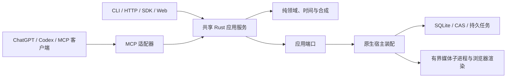

# OpenCut Plugin

[English](README.md) | [简体中文](README.zh-CN.md)

面向 ChatGPT/Codex 等 MCP 客户端的本地视频剪辑插件，共用 Rust 引擎、CLI、HTTP 服务、SDK 与 Web 工作台。

**当前为开发预发布版。** 首个下载运行包面向 **macOS Intel（`x86_64`）**；Apple Silicon、Windows 和 Linux 的发行包尚未完成验证。插件格式本身不锁定操作系统。本项目通过 GitHub 分发，暂不上架 OpenAI 官方插件目录。

## 与 OpenCut 的关系

OpenCut Plugin 是基于 [OpenCut](https://github.com/OpenCut-app/OpenCut) 衍生的社区分支，由 [miracle-ai-studio](https://github.com/miracle-ai-studio) 独立维护。它不是 OpenCut 官方发行版，与上游维护团队没有隶属或背书关系。

本分支新增 Rust 应用/契约层，以及面向 Agent 的 CLI、HTTP、MCP、SDK 接口；保留部分 Classic 渲染行为、着色器、字体元数据和依赖，并记录许可及来源。不应假设本分支的工程格式和功能与上游完全一致。为保持兼容，可执行程序和公开操作仍使用 `opencut` / `opencut_*` 名称。原有版权声明保留，见 [LICENSE](LICENSE) 和运行包中的第三方声明；LGPL 等第三方组件继续适用各自许可。

## 当前功能

- 查询工程、固定修订、素材、时间线和运行环境能力。
- 规划并原子提交剪辑，支持撤销/重做、文字字幕、图形、蒙版、转场与音频调整。
- 从源视频选择帧或导入图片作为工程封面。
- 执行素材分析、可选本地转写，管理预览、渲染、任务取消和发布产物。
- 交换工程包，保留历史与资源权限。
- 使用 Web 工作台直接剪辑和检查。

外部 Agent 负责理解创作要求，OpenCut 执行类型化操作。本项目不内置大模型，不承诺自动达到特定审片质量；任务已提交也不代表导出成功。

## 界面截图

### 中文界面


用户提供的中文工作台截图。

### English interface


用户提供的英文工作台截图，展示海岸画面预览。

## 安装本地插件

从 [GitHub Releases](https://github.com/miracle-ai-studio/OpenCut-Plugin/releases) 下载对应 ZIP 和 `.sha256`。ZIP 中包含标准插件和带校验清单的宿主运行包，不包含工作区数据库、凭据和原始素材，仅包含明确提供用于展示的文档截图。

本次预发布需要：

- 对应的 macOS Intel 环境，以及 PATH 中的 Node.js **22.12+**、FFmpeg/ffprobe。
- 与已交付 Playwright **1.63.0** 匹配的 Chromium，可执行 `npx playwright@1.63.0 install chromium` 安装。
- 支持本地 stdio MCP 插件的桌面客户端；网页/手机会话不能直接执行该本机运行时。
- 可选字体派生另需锁文件指定的 Python/fontTools 环境，本次基础安装不内置或启用；可选转写需要本地模型及程序。

使用自己的包管理器安装 Node 和 FFmpeg 后：

```sh
shasum -a 256 -c opencut-plugin-0.5.0-beta.1-x86_64-apple-darwin.zip.sha256
unzip opencut-plugin-0.5.0-beta.1-x86_64-apple-darwin.zip
cd opencut
node scripts/install.mjs
```

安装器核对压缩包及文件身份、CPU 与所需程序，将运行时放入独立版本目录；不自动下载依赖或修改客户端配置。依赖缺失会给出明确错误。自动输出预算随可用存储计算并保护数据库余量，不设置固定 512 MiB 文件上限；保留用户已有的显式配额。

使用安装器输出的 marketplace 路径：

```sh
codex plugin marketplace add "<安装器输出的 marketplace 路径>"
codex plugin add opencut@opencut-plugin
```

重启桌面客户端，在新的本地会话选择 **OpenCut Plugin**，先要求它查询能力和工程列表。这样同时安装 MCP 工具和剪辑 Skill；仅配置裸 MCP 连接不会安装工作流。

希望使用 Git 来源时，先完成运行包安装，再执行 `codex plugin marketplace add miracle-ai-studio/OpenCut-Plugin`。仓库 marketplace 只含插件元数据和脚本，不含预编译程序。

在已安装插件目录执行 `node scripts/doctor.mjs` 检查文件完整性与基础依赖；它不代表完整渲染或物理声画验收。自定义安装/数据目录使用 `OPENCUT_PLUGIN_INSTALL_DIR`、`OPENCUT_PLUGIN_DATA_DIR`；修改数据目录时，也要在客户端环境中配置同一变量。

在已安装插件目录启动随包 Web 工作台：

```sh
node scripts/web.mjs start
node scripts/web.mjs status
node scripts/web.mjs stop
```

打开返回的 `web_url`。服务绑定本机回环地址上的可用端口，与插件共用独立工作区；关闭 MCP 会话不会停止另行启动的 Web 服务。

## MCP / CLI 当前能力

同一份 Rust 注册表声明 **184 个具名操作、12 个逻辑领域**。MCP 默认按领域聚合工具；管理用 `workspace` 领域不进入默认紧凑列表。`--tool-surface legacy` 可以展开已有具名操作，业务实现和权限检查仍是同一套。

| 领域 | 已实现范围 |
|---|---|
| `system` | 运行能力与可用性查询 |
| `project` | 新建/查询、固定修订、时间线区间、历史、分支与工程包 |
| `edit` | 规划和原子提交、撤销重做、时间线/几何/关键帧、文字字幕、图形蒙版与音频 |
| `media` | 上传会话、导入规划、素材检查修复删除、缩略图与显示波形 |
| `analysis` | 内容检索、镜头/静音/波形、证据、可选转写与说话轮次 |
| `render` | 预检、视音频预览、渲染提交与质量证据 |
| `catalog` | 授权字体、品牌与资源目录，以及明确获准的导入 |
| `task` | 任务视图、查询、变化、回执、提交与取消请求 |
| `observe` | 授权产物/资源读取、事件变化与审计查询 |
| `plugin` | OpenCut 引擎扩展包、预设与授权，不等于 ChatGPT 插件安装目录 |
| `access` | 本机调用者访问与权限管理 |
| `workspace` | 存储、预算、Worker 和恢复管理；先检查合同与权限 |

[完整操作清单](https://github.com/miracle-ai-studio/OpenCut-Plugin/blob/main/docs/cli-mcp-capabilities.md)来自同一份声明。可选提供方、字体下载和转写必须先配置并获准。大文件通过专用上传/下载传输或 CLI 子命令搬运，不把任意大段 base64 塞进 MCP 参数。

```sh
opencut --json system capabilities
opencut --json system domains --domain edit --schemas
opencut --database /absolute/path/to/workspace.sqlite --json project list
opencut --database /absolute/path/to/workspace.sqlite mcp serve --with-worker
```

插件默认使用 `~/.opencut-plugin/` 下的独立数据库。使用安装器输出的程序路径，或将该目录加入 PATH。CLI 的 `call <operation> --input request.json`、`domain <domain> <action> --input request.json` 与 MCP 共用业务语义。例如 `opencut_edit` 接受 `{"action":"plan","input":...}`，具名入口为 `opencut_edit_plan`。写入保留固定修订、原请求及幂等键。

## 项目设计



每项业务操作只有一份实现。各适配器保留精确有理时间、固定修订、原子事务、授权、取消和发布围栏。插件启动器只配置进程，不重写剪辑规则，也不把 CLI 当成内部业务 RPC。

[架构](https://github.com/miracle-ai-studio/OpenCut-Plugin/blob/main/docs/architecture.md) · [接口合同](https://github.com/miracle-ai-studio/OpenCut-Plugin/blob/main/docs/contracts.md) · [运行配置](https://github.com/miracle-ai-studio/OpenCut-Plugin/blob/main/docs/operations.md) · [开发说明](https://github.com/miracle-ai-studio/OpenCut-Plugin/blob/main/docs/development.md)

## 从源码构建

安装 rustup、Node.js 22.12+、Python 3.11+、FFmpeg/ffprobe 与所需 Chromium。Rust 版本由 `rust-toolchain.toml` 固定。

```sh
git clone https://github.com/miracle-ai-studio/OpenCut-Plugin.git
cd OpenCut-Plugin
npm ci --prefix packages/sdk-ts
npm ci --prefix apps/web
npm ci --prefix packages/classic-audio-renderer
npm ci --prefix packages/classic-visual-renderer
cargo build --locked --release -p opencut-cli
npm run build --prefix apps/web
```

媒体服务启动前按运行文档配置依赖。构建网页不会自动更新已运行的服务。用于公开分发的程序会映射个人编译目录，打包时检查最终压缩包，而非只检查源码仓库。

## 数据、升级与限制

素材处理和工作区存储在本机执行；明确返回给 Agent 的 MCP 结果及资源会进入相应客户端上下文，不能将“本地处理”理解为所有元数据或预览都不会离开机器。可选外部资源提供方沿用其配置和权限。安装器不会授予远程访问权限，也不会开放公网服务。

运行版本与工程数据分离。移除运行版本前停止活动客户端和任务。`codex plugin remove opencut@opencut-plugin` 移除客户端插件，不删除工程数据。备份或迁移时共同保留数据库及关联 CAS/素材；可选模型、下载和字体缓存不进入 GitHub 安装包。

这是未签名的开发预发布版。Gatekeeper/公证、全新机器与跨平台安装、完整独立像素/PCM 等价、长素材资源限制、物理声画、IME/Finder 等尚未全部验收。以[交付状态](https://github.com/miracle-ai-studio/OpenCut-Plugin/blob/main/docs/status.md)和发行验证报告中的范围为准。本轮未标记颜色信息的合成 H264 素材未通过预设红色像素门槛（RGB 254/23/0，绿色通道要求小于 15）；安装包和工作流检查与该像素失败分开报告。首次导出检查发现自动输出预占会挤占数据库心跳空间；现已修正计算，保留控制写入余量并考虑实际文件增长。用户显式设置的工作区配额继续生效。仓库不包含 GitHub Actions 流水线。

## 关键词

`opencut` · `video-editing` · `video-editor` · `mcp` · `mcp-server` · `model-context-protocol` · `chatgpt` · `chatgpt-plugin` · `codex` · `codex-plugin` · `cli` · `rust` · `local-first` · `open-source` · `plugin`
