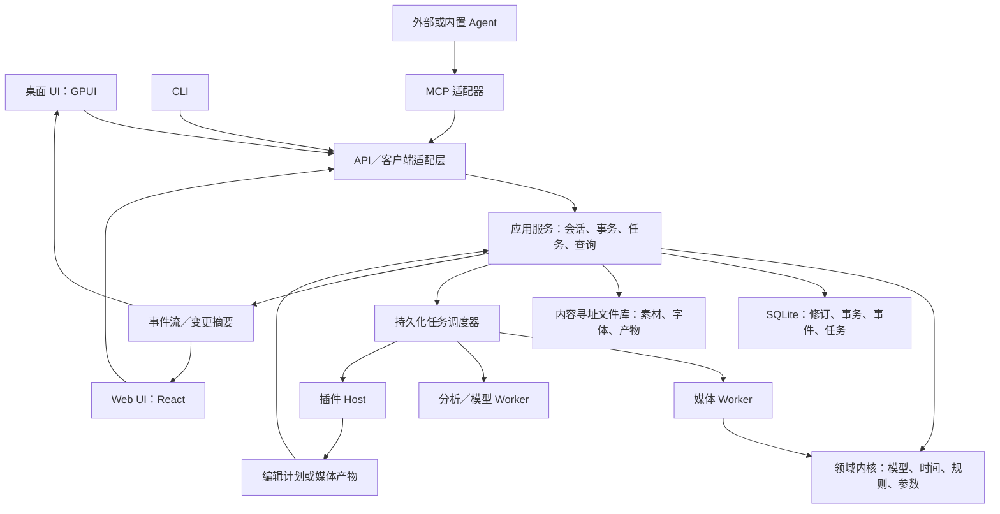
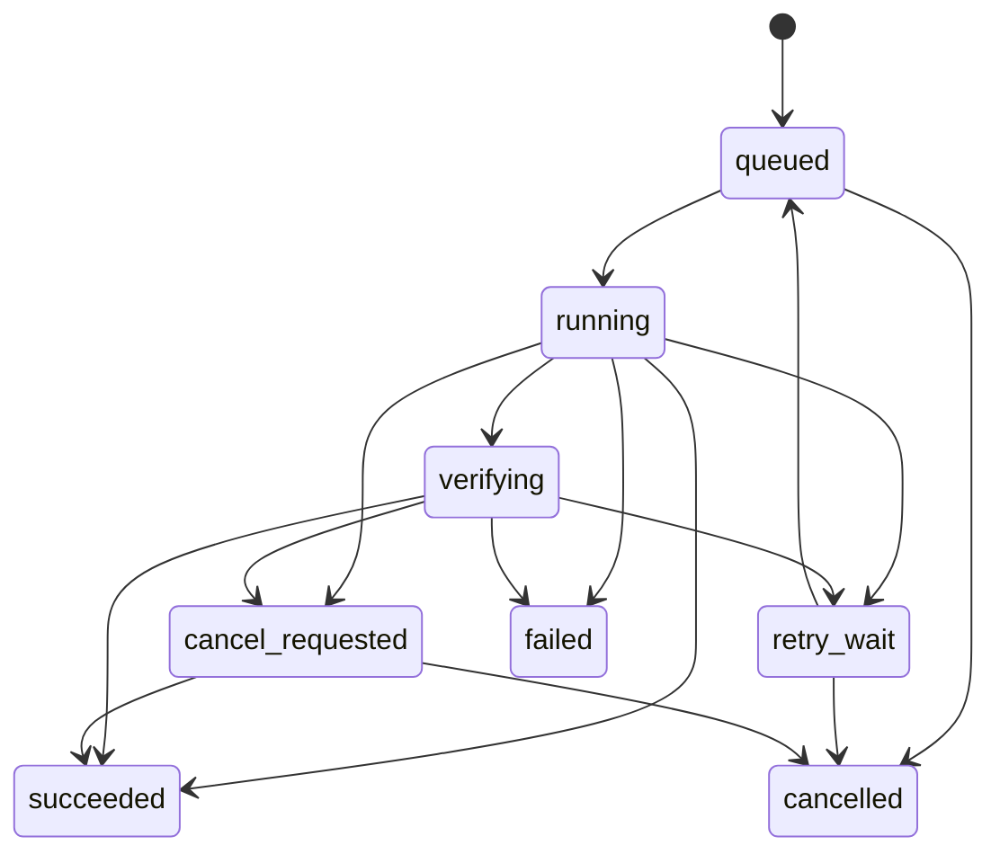

# OpenCut Agent 友好视频编辑系统：完整架构与契约设计

状态：完整目标设计，部分已实现；逐项验收见 `implementation-status.md`。版本：design-v1。日期：2026-09-19。

2026-09-27 增补：[整体架构整治与剪辑能力实施方案](architecture-renewal-plan.md) 规定后续模块归属、协议边界、治理门禁和 W0–W6 迁移顺序。完整产品目标继续保留；当前完成度以 [非 UI 交付台账](headless-completion-ledger.md) 为准。已发布协议不因目标设计更新而自动改变。

本文以当前 OpenCut 主项目与 `tmp/opencut-classic` 的本地源码为依据。源码存在不等于运行验证通过。文中的 MUST／必须是新系统的设计约束，不表示现有代码已经满足。

## 1. 产品定义与设计边界

目标：让人、外部 Agent、脚本和插件通过同一套规则完成素材理解、剪辑、预览、修正、导出，并始终保留可继续编辑的工程。

完整任务链：

```text
输入素材 → 建立索引 → 理解内容 → 生成剪辑计划 → 校验计划
       → 提交编辑 → 局部预览 → 检查与修正 → 导出 → 验证成片
```

### 1.1 产品必须具备的能力

| 范围 | 交付内容 |
|---|---|
| 编辑 | 多轨视频／图片／音频／文字／字幕／图形，分割、裁剪、移动、复制、变速、关键帧、效果、遮罩 |
| 理解 | 元数据、缩略图、波形、转写、词级时间、说话人、静音、镜头和可检索分析结果 |
| 观察 | 工程摘要、区间查询、变更记录、准确抽帧、短预览、音频试听、技术检查 |
| 自动化 | 类型化 API、MCP、CLI、可取消的持久化任务、恢复与重试 |
| 人机协作 | 实时状态、可见修改、人工接管、冲突检测、按事务撤销 |
| 扩展 | 参数化效果、分析器、媒体服务、编辑计划插件、可选 UI 面板 |
| 交付 | 可重开的工程、媒体依赖清单、导出视频、检查报告、可追溯版本 |

### 1.2 默认决策

- 先以本地桌面和无界面运行验证完整编辑链路；同时冻结浏览器与移动端的适配边界，各平台通过能力发现明确可用范围。
- 保留现有 Rust + GPUI 桌面方向，Web 使用 TypeScript + React；UI 不是编辑状态的权威。
- 采用共享 Application API 和隔离 Worker；Embedded、Headless、Service 是不同宿主，独立 daemon 不是内核运行前提。不引入微服务集群作为起点。
- 单个工程分支有一个权威写入者，通过版本检查支持多个客户端；首版不实现任意操作的实时 CRDT 合并。
- 外部 Agent 可独立使用系统；内置聊天／模型接入是可选产品层，不进入编辑内核。
- 每个阶段都有完整验收门槛；阶段完成不等于全系统交付完成。

## 2. 编程语言与技术选择

| 层 | 推荐语言／技术 | 职责与边界 |
|---|---|---|
| 领域内核 | Rust | 时间、工程模型、操作校验、变更计算、效果求值；无网络、数据库和 UI 依赖 |
| 应用服务 | Rust，Tokio | 工程会话、事务编排、任务调度、权限上下文、存储与事件 |
| 本地 API 服务 | Rust，HTTP 框架适配器 | HTTP／SSE、认证和请求转换；具体框架锁版在工程初始化时验证 |
| 桌面 UI | Rust，GPUI | 现有工程延续；通过客户端访问应用服务，不直接修改数据库 |
| Web UI | TypeScript，React | 面板、交互、浏览器资源适配；使用生成的契约与 SDK |
| CLI | Rust | 稳定二进制、JSON／NDJSON 输出、脚本与 CI 集成 |
| MCP | Rust，官方 Rust SDK 候选 | 将相同操作映射为工具与资源，不实现第二套业务逻辑 |
| 合成 | Rust + wgpu／WGSL | 帧合成、效果与遮罩；复用 Classic 的候选 crate |
| 原生媒体后端 | 隔离 Worker 内的 FFmpeg／libav 适配器 | 解复用、编解码、重采样、封装；由后端接口隔离具体实现 |
| 浏览器媒体后端 | WebCodecs、浏览器音频与封装适配器 | 仅宣告实测支持的配置；保留 Classic 媒体库作为候选适配器 |
| 插件运行时 | 原生 Wasmtime，受限 Host API | WASM 计算插件；另有声明式插件和受管理外部服务 |
| ML／模型服务 | Rust／Python／远程提供方均可 | 作为 Worker 或 Provider，不持有工程写锁、不直接写工程 |
| 本地持久化 | SQLite + 内容寻址文件库 | 工程快照、事务、任务、事件与素材分别管理 |

**选 Rust 的原因是跨入口共享领域规则与原生运行能力；不是把所有业务强制写成 Rust。** React 交互、模型生态、平台解码保留各自合适的实现方式。

Rust 内部类型不是公开 ABI。公开 DTO 经显式转换后输出；不能把内部枚举布局、指针、GPU 对象暴露给客户端。

官方已有 Rust MCP SDK，可作为适配器候选，实际采用时需要验证目标协议矩阵并锁定版本。[官方 SDK](https://github.com/modelcontextprotocol/rust-sdk)

## 3. 总体架构



### 3.1 依赖规则

```text
UI / CLI / MCP / HTTP → Application → Domain
                               ↓
                         Port interfaces
                               ↑
                   Storage / Media / Plugin adapters
```

必须遵守：

1. Domain 不导入 GPUI、React、SQLite、Tokio、HTTP 或浏览器对象。
2. UI 不拥有第二份权威工程；UI 可以持有只读快照和未提交的交互草稿。
3. MCP、CLI、HTTP 都调用同一个应用用例，不互相调用对方的字符串命令。
4. 插件返回计划或产物，经应用服务验证后才能影响工程。
5. Worker 读取不可变快照；渲染期间不读取不断变化的活动工程。
6. 同一工程的操作提交串行化，素材分析和不同工程的任务可以并行。

### 3.2 进程职责

| 进程 | 权威与生命周期 |
|---|---|
| Service Host（当前入口 `opencut serve`） | 持有 Application，提供受认证 HTTP，并运行任务 Worker；独立 `opencutd` 名称尚未实现 |
| `opencut-desktop` | UI；可嵌入 Application 或连接 Service Host；桌面接入仍待实现 |
| `opencut` | CLI；当前以 Embedded 方式调用共享 Application，SQLite 原子事务协调并发写入；后续可增加 Service 客户端模式 |
| `opencut mcp serve` | stdio 协议适配器；断开不删除工程和已接受任务 |
| 媒体／分析 Worker | 受任务租约管理，可崩溃与重启；无直接工程写入能力 |
| 插件 Worker | 与主服务隔离，实施配额、取消、超时和能力限制 |

Application 是所有宿主的工程写入权威，不等于必须只有一个 OS 进程。当前原生实现可由多个进程打开同一 SQLite，写入必须经过同一应用用例、数据库写事务与修订检查；Worker 还须通过租约和 attempt 检查才能发布结果。Embedded Host 可以在桌面／移动端进程内持有 Application，Headless Host 可以作为单次批处理运行；浏览器独立运行仍需 WASM 和存储适配。退出宿主后，持久化任务由下一次启动的 Worker 恢复；持续后台运行需要独立 Service Host，不能承诺所有进程退出后仍执行任务。

本地 IPC 可使用 Unix socket／Windows named pipe 承载内部协议；Web 接入使用受认证的 loopback HTTP。远程模式使用 HTTPS。传输差异不能改变领域行为。

## 4. 运行模式与能力边界

| 能力 | 桌面＋daemon | 浏览器连接 daemon | 浏览器独立运行 |
|---|---|---|---|
| 领域规则 | Rust 原生 | daemon Rust | 相同 Rust 核心编译 WASM |
| 权威存储 | SQLite＋文件库 | daemon 存储 | IndexedDB＋OPFS 适配器 |
| 可靠后台任务 | 支持 | 支持 | 不承诺标签页关闭后继续 |
| 原生编解码 | 能力探测后支持 | 使用服务后端 | 以浏览器能力为准 |
| WASM 插件 | Wasmtime | 由 daemon 执行 | 需专用浏览器适配；不能假定原生 WASI 插件直接运行 |
| 本地文件路径 | 通过授权文件句柄／范围 | 需桥接导入 | 通过文件选择／上传 |
| 插件 UI | 声明式 UI；可选隔离 WebView | 隔离 iframe | 隔离 iframe |

两种独立存储模式是不同工程副本。首版不提供浏览器本地库和 daemon 数据库的透明双主同步；迁移通过导入／导出工程包完成。

`system.capabilities` 返回当前 runtime 的实际能力、限制、参数 schema 摘要和可用后端。渲染启动时仍需重新探测关键资源。WebCodecs 不要求实现特定 codec，配置可用性也可能随资源变化。[WebCodecs 配置与能力](https://www.w3.org/TR/webcodecs/)

## 5. 工程领域模型

### 5.1 对象关系

```text
Workspace
 ├─ Project
 │   ├─ Branch → head_revision
 │   ├─ Revision → immutable ProjectDocument
 │   │   ├─ Sequence[]
 │   │   │   ├─ Track[] → Clip[]
 │   │   │   ├─ CaptionTrack[] → CaptionCue[]
 │   │   │   ├─ Marker[]
 │   │   │   └─ Transition[]
 │   │   ├─ AssetBinding[] → immutable AssetVersion
 │   │   ├─ Styles / Parameters / KeyframeChannels
 │   │   └─ dependency_lock
 │   └─ Transaction / ChangeSet
 ├─ AssetVersion → Blob + metadata + analysis references
 ├─ AnalysisArtifact
 ├─ Job / Artifact
 └─ EditSession（视图、选区、播放头；不属于成片内容）
```

这里将 Classic 的 Scene 概念统一命名为 Sequence。一个 Project 可以有多个 Sequence，明确指定默认导出序列；工程本身没有隐含的“活动场景”。UI 的活动序列属于 Session。

### 5.2 基本对象契约

| 对象 | 必须明确的字段 |
|---|---|
| Project | `id, schema_version, default_sequence_id, dependency_lock` |
| Branch | `id, project_id, head_revision` |
| Revision | `id, parent_revision, document_hash, transaction_id` |
| Sequence | `id, settings, track_order, tracks, captions, transitions, markers` |
| Track | `id, kind, enabled, muted, locked, compositing_order, clips` |
| Clip | `id, asset_version_id?, timeline_range, source_map?, params, channels, effects, masks, provenance` |
| CaptionCue | `id, timeline_range, text, words?, speaker_id?, language, source_anchor?, style_ref` |
| AssetVersion | `id, content_hash, streams, duration, source_timebase, color_metadata, availability` |
| AnalysisArtifact | `id, asset_version_id, kind, model_version, config_hash, ranges, confidence?, blob_ref` |
| Artifact | `id, content_hash, media_type, size, job_id?, revision?, dependency_hash, verification_status` |

所有 ID 为不可解读的稳定字符串，客户端不得从字符串结构推断顺序。删除 ID 不复用。新对象 ID 可在计划创建时预分配，以便同一事务后续操作引用；必须做唯一性和归属校验。

素材替换生成新 AssetVersion；旧修订继续引用旧内容。外部文件发生变化时标记需要重新绑定，不能在未产生修订的情况下改变旧工程的实际画面。

原始素材默认不因“删除时间线片段”或“移除素材引用”而删除。垃圾回收另行根据修订、任务和保留策略判断。

### 5.3 时间契约

统一交换格式：

```json
{
  "ticks": "1001",
  "timebase": 30000
}
```

含义：`ticks / timebase` 秒。`ticks` 是有符号十进制整数字符串，取值限制为 i64 范围，避免 JavaScript 大整数丢精度；`timebase` 是 1 到 2³²−1 的整数。范围统一使用 `[start, start + duration)`，duration 必须非负，普通可见片段必须大于零。内部使用检查溢出的宽整数中间值；结果无法在公开格式中精确表示时返回约束错误，不静默舍入。

规则：

- 内核采用可检查溢出的有理时间运算；跨时基比较不先转换成浮点秒。
- 24 fps 第 120 帧可表示为 `{ticks:"120",timebase:24}`；30000/1001 fps 第 1 帧为上例。
- Classic 的 120000 ticks/s 可无损导入为 `timebase:120000`，但不强制全部音频采样率／VFR PTS 都量化到这个时基。
- 时间坐标由字段和操作显式指定为 `source`、`sequence` 或 `clip_local`；不能由当前播放头推断。
- VFR 素材依据真实 PTS 定位，不能仅用 `frame_index / nominal_fps`。
- 编辑对齐策略为 `exact | nearest_frame | floor_frame | ceil_frame`；默认 `exact`，不符合目标约束时报错。自动对齐必须返回请求值和实际值。
- 持久化和幂等哈希使用归一化后的语义表示；等值分数不会因表示不同生成重复编辑。
- `FrameRate` 单独用 `{numerator, denominator}` 表示；浮点秒仅用于显示或明确的便捷输入转换。
- 客户端不得把十进制 ticks 强制转成 JS `number`；SDK 使用 BigInt／精确分数封装。

### 5.4 非破坏性编辑与依赖规则

Clip 保存源素材引用和时间映射，裁剪／变速不重写素材。默认常速映射；时间变化曲线、倒放和冻结帧通过显式能力声明开放。

轨道是有序集合；Classic 的主轨／叠加轨／音轨体验作为轨道角色与编辑策略实现，不将所有工程锁定成三块固定数组。

字幕、转场、关键帧和关联音频必须有依附语义。裁剪／分割操作显式选择策略：`preserve_source_anchor`、`preserve_sequence_time` 或 `reject_if_affected`。未支持的复杂重映射返回错误，不能默默丢弃字幕或效果。

转场是一等对象，引用左右 Clip 与持续时间；验证素材余量、重叠策略和效果能力。仅有特效注册表不等于已完成转场功能。

## 6. 契约来源与版本治理

### 6.1 单一契约来源

领域 DTO 在独立 Rust `contracts` crate 定义；公开任务输入／结果位于纯 `job-contracts`，内部 prepared input 位于 `job-execution`。`api-contracts` 持有公开操作、领域映射和响应 DTO；`editor-application` 持有用例与端口，`sqlite-store`／原生服务实现适配。不能把内部 Worker 记录或原生路径直接变成永久协议。

```text
Rust public DTO + OperationDescriptor
         ↓ 代码生成与一致性检查
JSON Schema 2020-12 / OpenAPI 3.1 / TypeScript SDK
MCP inputSchema + outputSchema / CLI 参数帮助 / 契约文档
```

2026-09-23 当前源码已从 Rust 注册表生成 61 个叶操作、九领域动作的 TypeScript SDK 类型与 75 路径 OpenAPI，并有生成一致性检查；独立 TS/Rust SDK 和 v1–v15 合成历史夹具矩阵已通过当前二进制验收。OpenAPI 覆盖领域发现、工具调用及原始上传／产物下载／公共 SSE；事件记录 Schema 也从同一 Rust 二进制生成。其他旧 REST 兼容路由不属于这份自动化 OpenAPI 的完整清单。真实旧用户库和发行包升级仍待验证。复杂语义约束仍在 Domain 实现，不能声称 JSON Schema 能验证轨道重叠或素材范围。

`system.capabilities.job_kinds` 当前发布九类原生任务的 `name, input_schema, result_schema`；输入 schema 描述提交的 input 载荷，结果 schema 描述成功结果，不包含响应信封。JobRecord 的持久化 input/result 仍是扩展 JSON 边界；Automation 构造 prepared 输入，Worker 以共享类型解析并生成结果，公开 JobView 隐去内部执行细节。旧无锁结果缺少锁字段时保守按 legacy 读取；请求严格拒绝未知字段，结果读取允许忽略新增字段。字段关系的语义约束不能仅靠 Schema 必填项判断。

每个操作描述至少包含：

```text
name, version, kind(query|command|job), input_schema, output_schema,
required_capabilities, declared_effects, deterministic,
idempotency_policy, conflict_policy, errors, examples
```

参数描述共用：类型、单位、范围、默认值、枚举、依赖、可动画性、插值方式、适用对象、后端支持和版本。UI、Agent 和内核验证均使用它。

### 6.2 四类版本不能混用

| 字段 | 意义 |
|---|---|
| `api_version` | 传输 API 主版本，例如 `1` |
| `schema_version` | 工程文件结构版本 |
| `revision` | 工程分支上的内容修订 ID |
| `operation_version / plugin_api / render_engine_version` | 操作语义、插件 ABI、渲染依赖版本 |

已发布 v1 必填字段不删除，不更改单位和已有枚举含义。新增可选字段要求服务器先发布能力；对无法识别的写入字段严格报错，不能悄悄忽略。返回字段允许客户端忽略新增部分。

未知工程节点应保留原始序列化内容并标记不可编辑；无法保证保真时只读打开，禁止保存时丢弃。插件缺失不删除节点；正式导出必须明确报缺失依赖。

OpenAPI 3.1 用作 HTTP 表达层，领域协议不依赖 HTTP 框架。[OpenAPI 3.1.1](https://spec.openapis.org/oas/v3.1.1.html)

## 7. 统一 API：Query、Command、Job、Event

| 类型 | 行为 | 返回 |
|---|---|---|
| Query | 读取指定修订；不修改工程 | 数据、读取修订、分页信息 |
| Command | 有界、快速、原子的工程修改 | 新修订、事务 ID、变更结果 |
| Job | 转写、生成、渲染、导出、批量分析等长操作 | 持久化 job ID |
| Event | 已提交事实或任务进展 | 可续传的事件游标 |

读取 `head` 时服务首先解析为具体修订，整次查询及分页都固定该修订。返回体必须带修订；Agent 下一次写入使用它作为前置条件。

### 7.1 HTTP 资源表

| 方法与路径 | 应用操作 |
|---|---|
| `GET /v1/capabilities` | 能力和限制 |
| `GET /v1/operations` | 操作描述，支持按名称／类别查询 |
| `GET /v1/projects` | 工程列表 |
| `POST /v1/projects` | 幂等创建工程 |
| `GET /v1/projects/{p}/branches/{b}/snapshot?revision=...` | 工程摘要或快照 |
| `POST /v1/projects/{p}/queries/timeline` | 指定修订、序列、区间、字段的查询 |
| `POST /v1/projects/{p}/queries/media` | 素材与分析索引检索 |
| `POST /v1/projects/{p}/branches/{b}/edit-plans` | 校验并保存编辑计划，不修改工程 |
| `POST /v1/projects/{p}/branches/{b}/transactions` | 提交直接操作或已验证计划 |
| `GET /v1/projects/{p}/transactions/{t}` | 操作状态和变更 |
| `POST /v1/projects/{p}/transactions/{t}/revert` | 以新事务执行带冲突检查的逆向修改 |
| `POST /v1/jobs` | 接受长任务，返回 202 与 job ID |
| `GET /v1/jobs/{j}` | 任务状态 |
| `POST /v1/jobs/{j}/cancel` | 请求取消 |
| `GET /v1/artifacts/{a}` | 产物描述与受控下载方式 |
| `GET /v1/events?cursor=...` | SSE 事件流；按授权范围过滤 |
| `GET /v1/plugins` | 插件清单、兼容性和实际授权 |

素材上传属于数据面：先创建上传会话，分块或流式写入临时文件，校验后生成不可变 blob；分析和正式资产注册由任务完成。不要把视频 base64 放进编辑事务。

所有 Query 和列表都支持有界分页。建议首版限制：单事务最多 500 个操作、控制面 JSON 最多 2 MiB、查询默认 100 条／最多 500 条。这些是设计默认值，压测后调整并由 capabilities 返回。

### 7.2 成功与错误信封

成功：`{api_version, request_id, data, warnings}`。错误：`{api_version, request_id, error}`。`request_id` 每次请求唯一，只做追踪；重试去重使用独立的 `idempotency_key`。

```json
{
  "api_version": "1",
  "request_id": "req_example",
  "error": {
    "code": "REVISION_CONFLICT",
    "message": "工程已更新，需要重新读取并校验计划",
    "retryable": false,
    "details": {
      "expected_revision": "rev_42",
      "actual_revision": "rev_43",
      "recovery_action": "refresh_and_replan"
    }
  }
}
```

| 错误 | HTTP | 调用方行为 |
|---|---|---|
| `INVALID_ARGUMENT` | 400 | 修正字段或类型 |
| `NOT_AUTHORIZED` | 401／403 | 恢复身份或调整授权范围 |
| `NOT_FOUND` | 404 | 检查 ID 和对象归属 |
| `REVISION_CONFLICT` | 409 | 重新读取并生成计划，不能直接改版本号重发 |
| `IDEMPOTENCY_KEY_REUSED` | 409 | 相同 key 不允许不同语义请求 |
| `CONSTRAINT_VIOLATION` | 422 | 查看冲突区间、依赖和操作索引 |
| `CAPABILITY_UNAVAILABLE` | 422 | 明确选择其他后端或调整参数 |
| `MISSING_ASSET / MISSING_PLUGIN` | 422 | 补齐依赖 |
| `RESOURCE_EXHAUSTED` | 429／503 | 按服务返回的退避策略重试 |
| `CURSOR_EXPIRED` | 410 | 读取新快照，再续订事件 |
| `INTERNAL_ERROR` | 500 | 使用同一幂等键查询／重试，保留 request ID |

`retryable` 仅表示原请求可否安全自动重试，不表示问题永远无法修复。

## 8. 编辑事务、幂等与并发契约

### 8.1 直接提交示例

请求正文；工程／分支在 URL 中指定：

```json
{
  "api_version": "1",
  "expected_revision": "rev_42",
  "idempotency_key": "workflow_17_step_3",
  "label": "分割访谈并降低后半段音量",
  "operations": [
    {
      "op_id": "op_split",
      "type": "clip.split",
      "version": 1,
      "sequence_id": "seq_main",
      "clip_id": "clip_interview",
      "at": {
        "coordinate": "sequence",
        "time": { "ticks": "12", "timebase": 1 }
      },
      "alignment": "exact",
      "right_clip_id": "clip_interview_right",
      "dependency_policy": "preserve_source_anchor"
    },
    {
      "op_id": "op_volume",
      "type": "parameter.set",
      "version": 1,
      "sequence_id": "seq_main",
      "target": { "kind": "clip", "id": "clip_interview_right" },
      "parameter": "volume",
      "value": 0.5011872336272722
    }
  ]
}
```

前置条件：12 秒处于该片段内部、满足目标帧对齐、目标 ID 未占用，且片段支持音频增益。分割保留左半片段原 ID，右半使用请求中的新 ID。第二条操作可以引用第一条产生的对象。

成功结果：

```json
{
  "api_version": "1",
  "request_id": "req_apply_example",
  "data": {
    "transaction_id": "tx_100",
    "base_revision": "rev_42",
    "revision": "rev_43",
    "committed": true,
    "durable": true,
    "created_ids": ["clip_interview_right"],
    "changed_ids": ["clip_interview"],
    "deleted_ids": [],
    "operation_results": [
      {
        "op_id": "op_split",
        "left_clip_id": "clip_interview",
        "right_clip_id": "clip_interview_right"
      },
      { "op_id": "op_volume", "applied_value": 0.5011872336272722 }
    ],
    "changeset_id": "changes_100"
  },
  "warnings": []
}
```

`created_ids` 与 `changed_ids` 分类不重复，新建后又修改的对象仍列为 created。细粒度属性变化在 ChangeSet 中读取。

### 8.2 执行顺序

1. 验证调用身份和资源归属，生成服务端 actor；不信任客户端自报 actor。
2. 查找作用域内的幂等记录；同 key、同请求返回原业务结果。
3. 获取工程分支写入序列，检查 `expected_revision`。
4. 在不可变基础快照上顺序计算全部操作，最后检查整体约束。
5. 同一数据库事务中写入新修订、ChangeSet、逆向补丁、幂等结果和 outbox 事件。
6. 数据库提交达到配置的持久化保证后返回成功，再发布事件。

批量操作只创建一个修订。任何一步失败都不提交中间工程。不在数据库事务中等待转写、网络调用或媒体渲染。

工程修改的幂等作用域是 `workspace + project + branch + operation family + key`；创建工程等尚无 project 的操作使用 `workspace + operation family + key`；Job 创建使用 `workspace + jobs.create + key`。键与规范化请求摘要绑定，摘要包含基础修订和操作顺序，排除 request ID、追踪信息。写入型任务创建也要求幂等键。

成功幂等记录与事务在工程生命周期内保留；历史压缩也保留去重墓碑。项目彻底删除后该项目作用域失效。接收成功后连接中断，调用方使用同 key 查询／重试，服务器仍返回原事务。先查幂等记录，再检查旧 expected_revision，避免已成功请求被误报冲突。

失败且未提交的业务校验可以重新求值；一旦同 key 已有成功记录，不允许另一个请求覆盖。并发相同 key 由数据库唯一约束与写入序列合并，不能先各执行一遍再去重。

### 8.3 编辑计划与试运行

`edit-plans` 输入与直接事务的 operations 同形，返回：`plan_id, base_revision, normalized_operations, predicted_changes, warnings, validation_errors, expires_at, dependency_hash`。

计划可以持久化，但不能修改工程、下载模型或执行外部收费调用。素材和分析必须事先就绪。预览计划属于单独 Job，渲染临时派生快照，不移动分支 head。

提交计划使用 `plan_id + expected_revision + idempotency_key`，与直接 operations 二选一。提交重新校验版本和依赖；计划不是免检凭证，也不自动获得额外权限。

### 8.4 人工编辑、撤销与分支

拖动期间使用本地草稿，松手后形成一次事务。服务端提交后以权威状态校正 UI。人工与 Agent 同时基于旧修订写入，后提交方收到冲突。

首版采用工程分支级乐观并发，允许不同序列的无关编辑也触发冲突，换取清晰一致的语义。字段级合并以后扩展，不伪装成已经支持。

撤销是新的逆向事务，必须检查目标对象／属性自原事务以来是否变化，以及是否产生新引用。可以证明不冲突的修改可逆转；不能证明时返回 `REVISION_CONFLICT`。禁止整份旧快照覆盖人工后续工作。

支持显式分支用于比较剪辑方案。分支隔离依赖不可变修订共享；首版合并要求显式计划和校验，不承诺自动三方合并全部媒体编辑。

## 9. 首批编辑操作目录

所有修改都通过事务提交。下表列出语义要求；字段的完整机械定义由对应 DTO／schema 实现时生成。

| 操作族 | 关键输入 | 关键约束／结果 |
|---|---|---|
| `project.settings.update` | 项目参数补丁 | 帧率／画幅改变需声明重对齐策略，不能静默重采样时间 |
| `sequence.create/update/delete` | ID、参数、依赖策略 | 默认序列及嵌套引用不能悬空 |
| `track.create/update/delete` | 类型、位置、锁定状态 | 删除非空轨须显式级联策略 |
| `asset.bind/unbind/relink` | AssetVersion、工程绑定 | 重新链接需要新版本；旧修订可追溯 |
| `clip.insert` | ID、轨道、素材、源范围、时间线位置 | 轨道兼容、素材可用、范围合法 |
| `clip.split` | Clip、坐标与时间、新右片段 ID | 严格内部切点；同步拆分关键帧及依赖 |
| `clip.trim` | 新源范围／时间线范围、锚点策略 | 不允许两个范围给出互相矛盾的变速关系 |
| `clip.move` | 目标轨道、位置、碰撞策略 | `reject / overwrite / ripple` 必须显式，默认 reject |
| `clip.delete` | ID 集合、gap 策略、依赖策略 | `leave_gap / ripple` 显式；锁定轨不能间接被移动 |
| `clip.duplicate` | 新 ID、目标位置 | 素材共享，片段与动画节点身份独立 |
| `clip.retime` | rate／映射、音高策略、时间锚点 | 重算范围，处理字幕／音频依附，报告影响 |
| `parameter.set` | 类型化 target、parameter、value | 参数 schema、单位与后端能力验证 |
| `keyframe.upsert/delete` | 对象、参数通道、局部时间、值和曲线 | 不存在的通道不能偷偷创建不支持的动画 |
| `effect.add/update/remove/reorder` | 定义版本、参数、实例 ID | 工程锁定效果实现版本 |
| `mask.add/update/remove` | 定义、参数、动画 | 验证支持的叠加数量与组合规则 |
| `transition.add/update/remove` | 左右片段、时长、定义 | 验证邻接关系、素材余量和时间影响 |
| `caption.insert/update/delete` | Cue、词级时间、样式和锚点 | 文本和词时间冲突时返回校验信息 |
| `marker.upsert/delete` | 区间、文本、标签 | 明确源坐标或序列坐标 |

针对静音删除、自动字幕、重构画幅、B-roll 编排的语义能力，先生成这些基础操作组成的计划，再通过相同事务执行。确定性内核不自行调用 LLM。

## 10. 长任务与恢复契约

### 10.1 Job 类型

`media.import`、`media.proxy`、`analysis.transcribe`、`analysis.shots`、`analysis.silence`、`analysis.index`、`preview.frames`、`preview.segment`、`render.export`、`artifact.verify`、`plugin.invoke`、`project.package`。

创建请求的公共字段：

```json
{
  "api_version": "1",
  "idempotency_key": "workflow_17_export",
  "kind": "render.export",
  "input": {
    "project_id": "project_demo",
    "branch_id": "branch_main",
    "revision": "rev_43",
    "sequence_id": "seq_main",
    "preset": "builtin.mp4-h264-1080p@1",
    "quality": "final",
    "verification_profile": "builtin.export-basic@1"
  }
}
```

导出默认写入受管理 Artifact 库。导出到用户选定路径是独立交付动作，显式携带目的句柄和覆盖策略。远程 API 不接受可任意写入服务器的文件路径。

### 10.2 状态机



`verifying` 适用于需要产物校验的任务；无媒体产物的分析任务也必须通过输出 schema／语义检查后才能成功。简单任务可以从 running 直接 succeeded。

取消是请求，不保证撤销已完成的远程生成或正在原子发布的产物。若发布已先完成，取消结果返回 `already_completed`，状态保持 succeeded。任务终态不因后到事件改变。

Job 记录：`job_id, kind, state, stage, attempt, progress?, input_revision?, resolved_dependencies, worker_lease, timestamps, result?, error?, cancellation_requested`。

进度允许未知；重试时 attempt 增加，不能把进度回退隐藏成同一次执行。总进度只有可计算时提供。

当前原生实现将验证表示为 `running` 状态中的 `progress.stage="verifying"`，取消表示为 `cancel_requested` 标志；公开终态为 succeeded/failed/cancelled。`progress={stage,fraction?,media_time?}` 的 fraction 是当前阶段比例，编码 100% 不等于任务完成。Worker 最多每 250ms 持久化同阶段采样，阶段切换和阶段终值立即记录；旧 attempt、过期租约不能发布进度。任务事件使用独立递增游标，不能拿工程事件游标续接任务流。后续扩展状态机须版本化，不能让客户端假定目标状态均已存在。

### 10.3 接收与完成的区别

- 返回 202 表示任务记录及其输入已经持久化，可以查询；不表示剪辑或导出已完成。
- `succeeded` 表示结果满足任务类型的输出契约；对于导出，至少完成文件封装、可解码性、尺寸／时长／轨道检查。
- 抽样解码属于基础检查，不代表全片所有帧或主观效果均通过。完整解码和人工／模型审片是独立验证级别。
- 分析／生成任务仅产生产物；自动插入时间线必须作为明确的后续事务，重新检查当前工程版本。
- 任务固定提交时解析出的修订和依赖；用户继续编辑不会改变任务输入。

### 10.4 重试、恢复与外部副作用

Worker 使用带期限的任务租约和心跳。租约过期由调度器重排；发布产物时校验 attempt fencing token，旧 Worker 不能覆盖新尝试的结果。

执行语义是至少一次尝试，工程提交和产物发布通过幂等实现不重复可见结果。不承诺进程与网络层的“恰好执行一次”。

Provider 若支持幂等键与任务查询，记录外部 request ID 并恢复查询。若外部生成已发出但响应丢失，且提供方不支持查询／去重，记录 `outcome_unknown` 错误并停止自动重发，避免重复生成与重复扣费。此处属于失败详情，不增加一个模糊的成功状态。

长视频断点续渲只对已实现分段校验和一致封装的后端开放；否则中断后重跑，不宣称任意编码器都能无损续接。

## 11. 事件、订阅与可观察性

事件信封：

```json
{
  "schema_version": 1,
  "event_id": "evt_example",
  "cursor": "cursor_example",
  "type": "project.transaction_committed",
  "project_id": "project_demo",
  "branch_id": "branch_main",
  "revision": "rev_43",
  "transaction_id": "tx_100",
  "payload": { "changeset_id": "changes_100" }
}
```

事件类型至少包含工程提交、素材可用／缺失、任务状态、任务进度、产物就绪和插件状态变化。

规则：

- 数据提交和 outbox 事件在同一数据库事务中落盘；事件发布失败可重试。
- 消费者按 event ID 去重；至少一次投递，同一工程提交按顺序读取，不承诺不同工程之间的全局因果顺序。
- SSE 支持游标和 `Last-Event-ID` 恢复。游标超出保留期返回 `CURSOR_EXPIRED`，客户端重新读取快照。
- 一致性订阅采用“快照＋其水位游标”，再读取该游标之后的事件，避免先订阅／先查询的竞态漏数据。
- 分页结果绑定 revision／索引 generation；游标失效明确返回，不能边翻页边混入新版本。
- 状态转换事件持久化；高频 progress 允许合并。事件不是唯一事实源，最终状态可通过 Query 重新取得。

追踪链：`request_id → actor → transaction_id / job_id → attempt → artifact_id`。记录耗时、队列等待、失败码、解码／合成吞吐、缓存命中、恢复次数和版本冲突率。日志默认不包含完整转写文本、凭据或视频内容。

## 12. 渲染、预览和音频架构

### 12.1 渲染流水线

```text
固定工程修订 + 依赖锁 + 导出配置
  → 校验素材、字体、效果和后端能力
  → 时间映射／参数与关键帧求值
  → 场景与渲染图
  → 解码源帧／生成文字图层
  → 图层、效果、遮罩、转场合成
  → 音频混合、重采样、增益包络
  → 编码与封装
  → 临时产物检查
  → 内容哈希与原子发布
```

Classic 的 Rust `time/effects/gpu/masks/compositor` 是候选基础；TS 的 scene-builder、frame-descriptor 和节点实现提供迁移参照。先为实际使用的效果建立跨后端样例，再宣布功能支持。

#### 当前原生任务的媒体锁与预检边界

新素材在 `asset.bind`／`asset.replace` 提交时固定至 `asset-store/<hash-prefix>/<sha256>`，修订内记录 `Asset.version {id, content_hash, size}`，其中 `id=av_<sha256>` 与工程逻辑 Asset.id 分离。`asset.replace` 保留逻辑 ID 和 clip 引用，并通过最终工程验证。版本素材的 URI 仅作为来源信息；缺失或损坏的 CAS 不允许回退来源 URI。旧修订的无版本素材不会被查询或普通编辑隐式固定。

`render.project` 和 `preview.project_frame` 在接受新任务前确定所选序列实际使用的素材；已固定素材验证已有 CAS，无版本旧素材此时捕获。输入中的原快照 URI 保留；另附 `asset_lock: {version:1, revision, sequence_id, assets:[{asset_id, content_hash, size}]}`。禁用轨道与静音的纯音频轨道不要求无用媒体存在；静音视频仍需要画面源。

请求身份仍由原始任务参数和固定工程快照决定。相同幂等键先查询已接受任务，源文件随后改变或删除不会触发重新捕获。新键对同一版本素材复用固定内容；仅旧无版本素材捕获调用时的内容。复制不持有 SQLite 写事务，提交时在写事务中再次检查幂等。失败不会创建 Job，竞争或失败留下的未引用 CAS 对象需要后续 GC，目前不会主动回收。

Worker 验证清单绑定的修订、序列、素材集合和内容哈希，将输入复制到 attempt 私有目录后渲染；锁定内容缺失或损坏返回 `ASSET_INTEGRITY_ERROR`，不能回退到原路径。运行结果记录清单与 `asset_locking: media_content_locked`。旧持久化任务没有清单时继续兼容执行，明确返回 `legacy_unlocked`。私有输入在正常完成、错误、协作取消和 unwind 时删除；Worker 启动及租约恢复后，根据数据库状态清理已放弃 attempt 的私有输入，保留运行中当前 attempt 和公共产物。

`opencut_render_preflight`、CLI `render preflight --input` 与 HTTP `POST /v1/render/preflight` 共享只读固定修订检查。返回 `revision, sequence_id, ready, issues[]`，问题可关联 asset/clip/cue；`ready` 表示本次检查没有发现问题，不生成任务、不锁定文件，也不保证以后执行成功。实际执行仍检查媒体与后端。

`ResolvedProjectSnapshot` 是不支持 Serde、内部字段私有的执行类型，固定所解析的 sequence；只有显式 `resolve_assets` 流程可构造。resolver 只处理实际 required 的版本素材，失败逐对象保存供预检报告，plan 拒绝任何解析失败。宿主 resolver 负责验证 CAS 或任务私有副本的字节；类型本身保证经过解析流程，不能替代字节验证或抵御故意不验证的宿主代码。普通快照不能直接传入 resolved 渲染请求，调用方也不能在该请求中换用另一 sequence。

修订媒体版本与任务媒体锁现在分别承担内容身份和任务执行依赖职责；最新集成验收记录见 `implementation-status.md`。`edit.plan` 仍是纯计算，返回未固定素材 ID，不锁定外部文件。预检只读解析版本素材，Worker 还会验证清单与修订版本相符；必需版本素材的无锁任务拒绝执行。字体/插件/工具版本锁定、完整素材流元数据、工程包与 GC 仍是目标，不能据此宣称整个工程完全可复现。源素材抽帧、probe 与直接片段导出也尚未采用该锁。

### 12.2 统一语义，不承诺所有后端逐字节一致

预览与导出共享时间映射、参数求值、图层顺序和色彩规则。预览允许使用代理、缩放和低质量，但必须返回质量级别；不能静默省略不支持的效果。

当前 clip 动画支持 opacity、position_x/y、scale_x/y、rotation_degrees、volume 的 Hold/Linear。`editor-core::sample_keyframe_channel` 是求值语义来源，project-render 将其编译为精确时间边界的仿射段，media 不再解释另一套关键帧模型。局部时间是序列呈现时间减去 clip 起点；源媒体变速不改变这个时钟。静态 track opacity／volume 乘到已求值的 clip 参数上。

原生动态视觉先按序列帧率采样，再在固定透明画布执行逆仿射取样，避免动态画幅重配置和逐帧多分支合成。为了稳定等价曲线在分割前后的栅格边界，此 FFmpeg 后端将视觉参数和逆采样坐标量化到各自单位的 `1e-6`；工程文档和领域求值结果不做该量化。时间稳定化先对齐绝对序列帧格点，再减去原 clip 起点，保留非帧格点起点的相位。静态路径保留；贝塞尔／缓动、轨道级关键帧、字幕样式动画和负缩放镜像尚未实现。

源素材抽帧返回源 PTS 与源 timebase；工程合成帧返回 `requested_time, actual_sequence_time, revision, sequence_id, quality, artifact`。一个工程帧可能包含多个素材，不使用单个 `source_pts` 冒充整个合成帧的来源；将来的来源报告应按图层列出素材版本、源时间与解码 PTS。交互 seek 可取消旧请求；准确抽帧／正式导出不能返回旧缓存帧冒充目标帧。

当前新增 `preview.project_frame` 是持久化任务：固定工程快照，通过与正式导出相同的工程渲染链生成私有 H.264/MP4 中间产物，再准确解码选定帧为 PNG。质量标记为 `encoded_project_frame`，中间视频不作为公共产物发布，结束后删除。此模式需要完整渲染，不能等同于低延迟交互预览；低延迟场景求值、代理、缓存和连续播放仍属于后续目标。

`preview.composited_frame` 使用同形公开输入，直接合成 PNG，质量为 `composited_project_frame`。Automation 和 Worker 仅捕获／解析视觉素材，独立 `ResolvedVisualProjectSnapshot` 不可用于完整导出。音频轨只按完整工程语义贡献序列结束时间；视觉请求不能因音频文件缺失失败。当前后端复用绝对序列时间的视觉图，可能仍解码前缀，不构建音频图、不生成完整 MP4。直接 PNG 与有损编码后抽帧不承诺逐像素相同；分别验证视觉预期，并针对固定样例比较差异。

`preview.project_range` 接收固定 `project_id/revision/sequence_id`、`requested_range: {start, duration}` 与 `alignment`。首版固定输出 H.264/MP4，结果包含原请求、`actual_sequence_range`、`quality: encoded_project_range`、完整音视频素材锁和 artifact。先在绝对序列时间求值与合成，再裁取区间并将输出播放时间重置为零；只编码选中区间，但可能仍解码／处理前缀。当前解析整个序列实际需要的音视频输入，不承诺仅锁区间内素材。它是持久化短预览任务，不是连续播放会话。

区间请求使用 `[start, start + duration)`：start 非负、duration 严格大于零、请求终点不得超过序列时长。两个端点分别按同一帧对齐策略处理；nearest 等距取较晚格点。对齐后必须仍有正时长且不超出序列；拒绝塌缩或越界，不静默 clamp。区间 end 等于序列 end 可以合法，单帧请求到 end 则不可合法。输入只做纯时间基本校验后入队，完整序列时长与后端可执行性在 Worker 规划时验证。

工程取帧先按序列有理帧率对齐，`exact` 拒绝非帧格点，`floor` 向前，`ceil` 向后，`nearest` 在等距时取较晚帧。请求时间和对齐时间都必须位于 `[0, render_duration)`；越界明确报错，不静默夹到末帧。对齐以整数有理数计算，不经浮点秒。Worker 还会核验编码视频的实际帧时间等于选定序列时间；不相等时拒绝发布。Web 按工程、修订和请求 generation 区分预览，过期响应不得覆盖新选择。

可复现分三层：

1. 相同基础文档和规范化操作得到相同工程语义／document hash。
2. 固定素材、字体、插件、渲染版本与配置，输出在定义的图像和音频容差内一致。
3. 二进制完全相同只在固定软件编码链通过专门验证后承诺；不把 GPU／硬件编码的跨平台字节一致作为默认保证。

### 12.3 色彩、字体与音频

- Asset 保存色彩原色、传递函数、矩阵、范围、旋转和像素宽高比。
- 首个稳定交付配置限定为经过验证的 SDR 路径；HDR 输入必须显式映射或返回不支持，不能按普通 SDR 静默处理。
- 合成明确线性／非线性空间和 alpha 语义；效果接口声明输入输出空间，避免重复转换。
- 字体文件进入依赖锁；缺字体不能正式导出时偷偷换字形。浏览器与原生文本引擎做样例对比，必要时先用共享文字栅格产物保证一致。
- 音频内部使用明确采样率和通道布局。公共参数 `volume` 的单位统一为 `linear_gain`（0 静音、1 原始增益，当前范围 0..4）；UI 可显示 dB，有限值转换为 `gain=10^(dB/20)`，0 单独显示静音。不得把 dB 值直接存入 volume；音量关键帧转为连续包络。
- 变速后的维持音高、降噪、自动 ducking 是独立能力；Classic 中存在峰值限制器不等于已有响度标准化或对话降噪。
- 导出验证区分峰值、真峰值、响度和音画同步，未实现的检测不标记通过。

当前原生字幕契约：`font_policy={mode:"strict"}` 为默认，只使用指定主字体；`{mode:"explicit_fallback",families:[...]}` 按调用方顺序选择明确允许的回退字体，缺少所需字形时返回能力错误。`max_width`、`line_height` 的单位均为画布像素；`text_align` 在居中的布局框内决定 left/center/right，不能通过重新居中文字墨迹边界抵消对齐。新增默认字段在序列化时省略，保持旧字幕请求的幂等哈希。

导出返回的 `text_layouts` 报告实际字体 family/PostScript name、TTC face index、全局 UTF-8 字节 cluster 范围及像素边界。字体来源仅输出紧凑标识：`file:<path>` 或 `binary:opaque:<length>bytes`；不能对字体容器使用 Debug 输出而把二进制字节放入任务 JSON。这些来源标识用于观察，不等同于已实现字体内容锁定。原生排版已覆盖所验证的中英混排、阿拉伯 RTL、组合字符和多行样例，跨后端一致性仍需独立验收。

### 12.4 后端边界

首版可由隔离 FFmpeg 子进程承接解码／编码／封装，Rust 合成器处理画面；控制参数通过结构化参数列表生成，不执行插件提供的任意 shell 字符串。后续可在适配器内采用 libav 降低拷贝与进程开销。

不要将工程模型长期绑定成 FFmpeg filtergraph；filtergraph 属于一种后端表达。实际发布时记录所用构建、codec 与许可证配置，作为后端依赖清单的一部分。[FFmpeg 官方文档](https://ffmpeg.org/ffmpeg.html)

## 13. Agent 的读取、理解与质量闭环

### 13.1 三层信息输出

| 层 | 返回内容 | 用途 |
|---|---|---|
| 摘要 | 时长、轨道数量、主要素材、能力、诊断 | 快速定位工程状态 |
| 结构 | 指定区间的片段、字幕、参数、变更 | 准确规划操作 |
| 证据 | contact sheet、短视频、音频、转写区间 | 检查画面和听感 |

大二进制通过 Artifact URI／受控下载获取。所有搜索结果携带素材版本、源时间范围、分析来源与可用置信度；未提供置信度时不能伪造分数。

### 13.2 Agent Orchestrator

Orchestrator 位于客户端／应用上层，负责目标、预算、工作流状态、模型选择、证据收集和计划修订。它不能绕过版本、插件权限或事务校验。

建议流程：

1. 读取需求和工程摘要，解析时长、画幅、语言和交付约束。
2. 获取必要分析，复用素材版本对应的缓存。
3. 选择源区间，生成可解释编辑计划，关联素材证据。
4. 创建计划并验证；按已有授权自动提交，或按工作流需要展示待审计划。
5. 渲染关键剪辑点和字幕密集区间，检查声音与画面。
6. 通过新的计划修正；每一步记录输入修订和结果。
7. 固定修订导出，独立读取产物并执行指定验证。

“审美好看”与“技术合格”分开报告。模型评价保存模型版本、检查片段和判断依据，不把采样审片包装成全片检查。

## 14. MCP 设计

### 14.1 定位和协议版本

MCP 是 Editor API 的适配层。工程会话、事务、任务和授权不依赖 MCP 连接是否保持。

本方案以已发布的 `2025-11-25` 作为初始兼容基线，另外建立较新协议版本的测试矩阵；不是声称它是当前最新版本。2026-07-28 发布候选与相关 SDK 文档显示任务和会话语义有调整，因此内部 Job 不绑定某一版 MCP Tasks。[官方版本变更说明](https://blog.modelcontextprotocol.io/posts/2026-07-28-release-candidate/)

首版所有长操作均立即返回业务 job ID，并提供普通查询／取消工具。可选 Tasks 能力只有在客户端、SDK 和服务器共同支持已测试版本时启用；开启后也只映射已有 Job，不另建任务系统。

### 14.2 工具集合

当前公共发现面按领域组织，MCP 默认只列出 `opencut_system`、`opencut_project`、
`opencut_edit`、`opencut_media`、`opencut_task`、`opencut_observe`、`opencut_plugin`、
`opencut_access`、`opencut_workspace` 九个工具。输入统一为
`{"action":"...","input":{...}}`；`opencut://schemas/domains` 给出摘要目录，
`opencut://schemas/domains/{domain}` 给出该领域每个动作的精确输入／输出 schema。
CLI 对应 `opencut system domains` 与 `opencut domain <domain> <action> --input FILE`，
常用 `project`／`edit`／`job` 命令仍为便捷入口。领域调用必须先解析为唯一的公开操作，
再使用该操作的权限、参数校验、审计和应用用例；领域名本身绝不授权。现有 61 个
细粒度操作保留为 v1 兼容入口，MCP `--tool-surface legacy` 可恢复旧发现列表。

下表中的细粒度名称是对应应用操作及后续完整目标，不是当前 MCP 默认列出的工具。
其中 `timeline.query`、`media.search`、`edit.revert`、`artifact.get` 等仍待实现，
不能因所属领域存在就宣告该能力可用。新增能力优先作为既有领域的动作，只有职责和
权限边界确实不同才新增领域；避免每个滑块和内部步骤都变成独立 MCP 工具。

| MCP 工具 | 类型 | 对应应用操作 |
|---|---|---|
| `opencut_capabilities` | Query | 能力、限制、操作版本 |
| `opencut_project_inspect` | Query | 工程／分支／修订摘要 |
| `opencut_timeline_query` | Query | 指定序列与时间区间查询 |
| `opencut_media_search` | Query | 素材与内容证据检索 |
| `opencut_edit_plan` | Plan | 校验 operations，返回 plan ID 与影响 |
| `opencut_edit_apply` | Command | 提交 plan 或 operations，要求版本和幂等键 |
| `opencut_edit_revert` | Command | 带冲突检查的逆向修改 |
| `opencut_job_start` | Job | 分析、预览、导出、插件调用等类型化任务 |
| `opencut_job_get` | Query | 持久化任务状态和结果 |
| `opencut_job_cancel` | Command | 请求取消 |
| `opencut_artifact_get` | Query | 产物描述、证据与访问方式 |
| `opencut_plugin_inspect` | Query | 已安装插件、schema 与能力 |

`opencut_job_start` 使用按 kind 区分的输入 schema，不是任意函数名＋任意 JSON。常见任务可提供窄工具别名，但由同一描述生成，避免语义分叉。

不把每个滑块都扩展成独立工具；不提供任意执行代码、SQL 或 shell 的万能入口。扩展操作通过能力查询和参数 schema 发现。

### 14.3 Tool 结果

提供 `inputSchema` 和 `outputSchema`；结果的 `structuredContent` 复用 API 成功／错误信封，`content` 提供对应序列化 JSON 和必要的资源链接。业务错误置 `isError:true`；协议错误使用 MCP 协议错误机制。成功查询到一个 state 为 failed 的 Job 仍属于查询成功，Job 的失败放在 data 中，不能混淆两层状态。工具的 annotations 是行为提示，实际权限仍由 Host 执行。[MCP Tools](https://modelcontextprotocol.io/specification/2025-11-25/server/tools)

图片、音频只在需要审阅且大小受控时内联。视频优先返回 artifact 描述、下载链接、缩略图和时间范围，不能假定所有 MCP 客户端能直接播放任意视频资源。

### 14.4 Resources 和 Prompts

资源 URI 示例：

```text
opencut://projects/{project}/branches/{branch}/revisions/{revision}/summary
opencut://projects/{project}/revisions/{revision}/sequences/{sequence}/timeline
opencut://assets/{asset_version}/analyses/{analysis_id}
opencut://artifacts/{artifact_id}
opencut://schemas/operations/{name}/{version}
```

URI 用于身份与寻址，不是授权令牌；每次读取重新校验权限。资源读取与订阅行为遵循实际协商版本。[MCP Resources](https://modelcontextprotocol.io/specification/2025-11-25/server/resources)

可选 Prompts 提供“访谈粗剪”“字幕检查”“竖屏改编”等工作流说明；它们引用已发布工具，并明确哪些阶段会产生工程修改，不携带隐藏权限。

### 14.5 传输

- 本地：`opencut mcp serve --transport stdio`，stdout 只输出 MCP 消息，日志写 stderr。
- 网络：Streamable HTTP 适配器，按目标协议实现生命周期和鉴权。
- 本地 HTTP 绑定 loopback，检查 Origin 并认证；远程 OAuth 等授权细节由选定版本和 SDK 实现，不能仅靠“知道端口”获取工程权限。

stdio 和 Streamable HTTP 是 2025-11-25 规范中的标准传输。[MCP Transports](https://modelcontextprotocol.io/specification/2025-11-25/basic/transports)

## 15. CLI 设计

### 15.1 命令结构

以下为拟议命令，当前仓库尚未实现：

```sh
opencut daemon start
opencut system capabilities --json
opencut project list --json
opencut project inspect project_demo --branch branch_main --json
opencut timeline query --project project_demo --branch branch_main --revision rev_42 --sequence seq_main --range 0s..30s --json
opencut edit plan --project project_demo --branch branch_main --input plan.json --json
opencut edit apply --project project_demo --branch branch_main --input transaction.json --json
opencut edit revert --project project_demo --transaction tx_100 --expected-revision rev_43 --idempotency-key revert_100 --json
opencut job start --input export-job.json --json
opencut job wait job_example --timeout 120s --json
opencut job cancel job_example --json
opencut artifact export artifact_example --output ./out.mp4 --overwrite never --json
opencut plugin inspect org.example.silence-planner --json
opencut mcp serve --transport stdio
opencut system domains --domain edit --schemas --json
opencut domain edit plan --input edit-request.json --json
```

CLI 的 `0s..30s` 是便利输入，转换为有理时间后发给 API；必须显示或返回归一化结果。涉及源时间的命令必须另行指定坐标。

### 15.2 稳定输出契约

- `--json`：stdout 只含一个最终 JSON 信封；日志和进度写 stderr。
- `--watch --format ndjson`：stdout 每行一个事件，包含类型和游标，不混入进度条。
- stdin／`--input file.json` 接受与 API 相同 DTO，不使用 shell 字符串承载复杂补丁。
- 非 TTY 不弹交互问题；缺少必要字段返回结构化错误。
- CLI 不自动把过期 revision 改成最新重试。
- 默认创建任务即返回；`job wait` 是显式等待，超时只结束等待，不自动取消已接受任务。
- Ctrl-C 中断等待；只有显式 `--cancel-on-interrupt` 才请求取消 Job。
- CLI 当前可嵌入应用层打开同一 SQLite，多个进程按统一写事务、幂等与修订契约协调；后续可增加连接／启动 Service Host 的客户端模式。每个 Worker 的结果发布仍受租约和 attempt 约束，不通过进程单例代替这些保证。

退出码：`0` 请求成功／等待任务成功；`2` 参数错误；`3` 权限错误；`4` 对象缺失；`5` 版本或幂等冲突；`6` 约束／能力不满足；`7` 任务失败或取消；`8` 连接／服务不可用；`124` 等待超时；`130` 用户中断。创建 Job 返回 0 仅表示已接受，JSON 必须明确 state。

### 15.3 SDK

Rust client 和 TypeScript client 使用相同 DTO。SDK 可自动重试明确可重试的网络错误，但写请求必须沿用原幂等键；不能隐式更新 expected_revision。SDK 的 `waitForJob` 支持取消等待和取消任务两个独立动作。

### 15.4 编辑器脚本面板与移动端

脚本面板是正式入口，通过同一 SDK 提供类型提示、日志、取消、计划查看和事务提交。脚本运行上下文不能访问 UI store 或绕过 Application API。脚本是工作流客户端，插件另有安装、依赖锁和贡献生命周期。

移动端 UI 技术需要验证；核心通过稳定 DTO／FFI 接口嵌入，文件、GPU、编解码和后台任务由平台适配。常驻 daemon 和桌面 GPUI 不作为移动端前置条件。移动端生命周期必须测试保存确认、前后台切换、任务暂停和资源恢复。

## 16. Plugin 设计

### 16.1 插件类别

| 类型 | 典型能力 | 输入／输出 | 运行方式 |
|---|---|---|---|
| 声明式 | 字幕样式、参数预设、模板 | schema／资源／参数 | Host 校验后加载 |
| 编辑计划 | 静音删除、自动排布、片段编排 | 固定工程快照＋分析 → EditPlan | WASM 或受管理 Worker |
| 分析 | 转写、镜头识别、节奏分析 | 素材版本 → AnalysisArtifact | WASM／ML Worker／Provider |
| 媒体生成 | 配音、音乐、图像、视频 | 类型化请求 → Artifact | Provider Job |
| 效果／转场 | 图像处理、遮罩、过渡 | 参数＋帧资源 → 受限渲染描述 | Host 支持的渲染插件接口 |
| 导入／导出 | 字幕、工程交换格式 | 数据包 ↔ 校验后模型／产物 | 受限解析 Worker |
| UI 面板 | 参数面板、素材检索面板 | ViewModel＋类型化动作 | 声明式 UI 优先；隔离 Web 面板可选 |

内建功能通过同一贡献注册表描述；时间、事务、存储和权限等系统基础仍由内核提供。插件不替换这些正确性边界。

### 16.2 Manifest 示例

```json
{
  "manifest_version": 1,
  "id": "org.example.silence-planner",
  "version": "1.2.0",
  "display_name": "Silence Planner",
  "plugin_api": ">=1.0.0 <2.0.0",
  "runtime": {
    "kind": "wasm-component",
    "entry": "plugin.wasm",
    "world": "opencut:planner/planner@1.0.0"
  },
  "targets": ["native"],
  "permissions": [
    "project.snapshot.read",
    "analysis.read",
    "edit.plan.propose"
  ],
  "contributes": {
    "operations": [
      {
        "name": "org.example.silence-planner.plan",
        "version": 1,
        "kind": "job",
        "input_schema": "schemas/input.json",
        "output_schema": "schemas/output.json"
      }
    ]
  },
  "limits": {
    "memory_mib": 128,
    "wall_time_ms": 5000,
    "output_bytes": 1048576
  }
}
```

Host 另存包的 SHA-256、来源、签名验证结果与实际授权，不让包通过自报字段证明可信。包内相对路径不得逃逸包根目录。Manifest 的限制是请求值，Host 可以收紧，不能突破用户／工作区配额。

命名空间使用发布者反向域名风格，操作不能覆盖内建同名能力。新插件安装不自动将任意几十个工具暴露给所有 Agent；先通过插件能力查询发现，再按工作流启用。

### 16.3 执行契约

原生计算插件采用版本化 WASM Component／WIT 接口。输入输出用 ID、标量、字节和受控资源句柄；不传 Rust 内存地址、数据库连接、原始 GPU 指针或宿主对象。

建议 Host 能力接口：

```text
snapshot.read(revision, query) → bounded data
analysis.read(analysis_id, range) → bounded data
media.read(handle, range, budget) → bounded bytes/frames
artifact.write(staging_handle, bytes) → staged artifact
plan.propose(base_revision, operations) → proposed plan
progress.report(stage, progress?)
cancel.is_requested() → bool
```

Host API 必须独立实施权限、大小限制、超时和取消；WASM 沙箱不会自动约束 Host 代它发出的网络请求。WASI 文件和网络能力不默认开放。

Wasmtime 的内存隔离可用于隔离插件计算，fuel／epoch 中断用于限制执行；异步 Host 调用和 GPU 工作另设超时与进程边界。[Wasmtime 安全模型](https://docs.wasmtime.dev/security.html)、[执行中断](https://docs.wasmtime.dev/examples-interrupting-wasm.html)

完整高分辨率帧不能反复经过 JSON／LLM／WASM 拷贝。帧处理使用 Host 管理的资源句柄或受限共享缓冲；GPU 效果走受验证的渲染接口。

### 16.4 插件副作用

- 计划插件输出 operations，不能直接修改工程。调用方选择是否提交，提交仍检查修订。
- 分析插件输出带 provenance 的分析产物；生成插件输出媒体产物，两者都不默认插入时间线。
- 声明外部服务的插件通过 Host Provider 代理访问网络，凭据保存在 Host，不写入工程包。
- Native 可执行插件／Python Worker 不因“独立进程”就获得沙箱保证。第三方默认走 WASM 或受限服务；原生扩展单独安装、按目标 OS 实施资源和权限隔离。
- WGSL 是代码，可能导致 GPU 超时或设备丢失；必须校验、限额并隔离，不把着色器字符串当作无风险配置。

### 16.5 安装、升级、卸载与工程锁定

生命周期：发现 → 下载暂存 → 校验包与兼容性 → 记录授权 → 安装确定版本 → 启用贡献 → 禁用／升级／卸载。

工程 `dependency_lock` 记录插件 ID、版本、包哈希、效果 schema 版本及必要资源哈希。正在执行的 Job 固定这些依赖，升级不替换运行中的版本。

升级可并存旧版本；插件数据迁移必须是显式计划，对副本运行并通过验证后再提交。插件卸载前检查引用；允许缺失状态打开工程，但必须保存未知节点原数据。正式导出缺失效果默认失败，若用户选择跳过，生成新的明确导出配置和报告，不修改原工程来掩盖问题。

### 16.6 UI 扩展

优先用参数 schema 自动生成 GPUI／React 面板，保证核心插件不依赖 WebView。

复杂 Web 面板运行在隔离 origin／sandbox iframe 或受限 WebView 中，通过有 schema 的消息桥访问允许的 Query／Command；不能直接访问 React store、Rust内部对象或 daemon 通用 token。桌面没有 WebView 适配时，该面板 capability 显式不可用，插件核心功能仍应可从 API 使用。

浏览器独立运行暂不承诺支持所有原生 WASI Component；插件声明目标，能力检测拒绝不兼容包。统一语义通过 Host 接口保持，运行时支持通过矩阵管理。

## 17. 存储、工程包与崩溃一致性

### 17.1 原生存储

```text
workspace/
  workspace.sqlite
  blobs/sha256/<prefix>/<hash>
  staging/<job_id>/<attempt>/
  plugins/<publisher>/<name>/<version>/<package_hash>/
  cache/                     # 可重建的代理、缩略图、索引缓存
  logs/
```

数据库逻辑表：`projects, branches, revisions, transactions, idempotency_records, assets, analyses, jobs, job_attempts, artifacts, plugin_installations, grants, outbox, events`。

首版使用快照＋ChangeSet＋操作记录；不强制采用纯 Event Sourcing。操作记录用于审计、重试和逆向修改，打开工程不要求重放全部历史。只读缓存可重建，不作为唯一事实来源。

SQLite 启用事务和适当的 WAL／同步策略；`durable:true` 指在声明的同步策略下提交完成，不能以后台防抖保存代替。所有客户端通过共享 Application 用例写入。原生 Embedded／Service 宿主可打开同一本地 SQLite，由事务、修订及任务租约协调；UI 不绕过应用服务直接写库，远程客户端不共享数据库文件。

### 17.2 文件与数据库不能假装是同一个事务

产物先写 staging → 完成封装与检查 → 计算哈希 → 同卷原子移动到 blob 库并执行必要同步 → 数据库提交 Artifact 引用。

发生崩溃时：

- 文件尚未发布：清理或恢复 staging。
- 文件已发布、DB 未引用：作为孤立 blob 延迟回收。
- DB 已提交：对应 blob 必须已持久化；启动检查缺失／损坏时明确标记不可用。
- 成功回复丢失：幂等记录返回原结果。

不能先提交一个指向尚不存在文件的“成功产物”。对文件系统不支持的原子操作，使用适配器定义的恢复协议并在能力中说明。

工程事务只引用已就绪的素材版本。媒体导入、分析和生成先完成资源准备，避免工程事务承担跨数据库与外部服务的分布式提交。

### 17.3 缓存与垃圾回收

缓存键至少包含素材内容哈希、时间区间、参数、模型／引擎版本和必要依赖。代理不能覆盖原素材；分析缓存不能仅按文件名复用。

活动 Job、保留修订、分支、锁定依赖和已导出工程包清单都影响资源保留。GC 使用可审计保留策略；清理缓存与删除原始素材是不同操作。

大批量修改超过单事务限制时，分批作用于临时分支，验证后在目标分支未改变的前提下原子更新分支指针。不能以多个普通提交伪装成一次不可见的原子操作。

### 17.4 工程交换包

拟议 `.opencut` 工程包包含：manifest、版本化工程文档、依赖锁、资源清单、可选媒体与字体、provenance 和校验和；采用可流式处理的归档形式，具体容器在打包适配器中固定。

支持 `linked` 与 `self_contained` 两种模式。linked 包的路径仅是重链接提示，读取后仍需确认文件内容版本；self_contained 包携带可分发依赖。包导入检查路径逃逸、资源大小和缺失项，不写出包目标根目录之外。

OTIO／其他剪辑交换格式作为导入导出插件支持；仅映射双方能够表达的内容。自定义 shader、字幕样式等不能保证跨格式保真，转换报告必须列出损失或阻断。[OpenTimelineIO 的范围](https://opentimelineio.readthedocs.io/en/latest/)

### 17.5 浏览器存储

IndexedDB 保存修订和操作状态，OPFS 保存媒体；同样先准备文件再提交引用，并提供孤立文件恢复。配额不足和存储权限丢失必须返回明确错误。

浏览器多标签页通过主写入 Worker／标签页所有权管理和数据库版本前置条件避免并发覆盖。不能将 UI 内存状态当成跨标签页锁。页面关闭前的尽力 flush 不能替代明确提交成功。

## 18. 授权、资源范围与内置信任边界

这是软件协议的一部分，目标是让已授权工作持续执行，而不是让每次剪辑都弹确认。

- 普通可撤销的工程操作按会话已有授权自动执行。
- 授权绑定 principal、workspace／project、允许操作及资源范围；server 推导 actor。
- 上传到外部 Provider、安装新的可执行插件、覆盖外部文件等越出既有范围的行为，需要由产品明确呈现并取得对应授权。
- 插件声明权限不等于获得权限；运行时只拿到此次调用所需的 capability handle。
- 路径、Artifact URI、资源 ID 和 job ID 都不是权限凭证；每次使用检查归属。
- LLM 读取的转写、字幕、网页或插件描述是内容数据，不能据其文本授予系统权限。
- UI 面板、HTTP 客户端和外部 Agent 都受同样的资源检查；CORS 不代替认证。
- MCP 的提示字段不代替 Host 的权限实现。

## 19. 仓库与模块布局

建议目标结构；按依赖边界组织，初期可合并少量 crate，避免过早拆成几十个服务：

```text
apps/
  desktop/                    # GPUI，延续当前目录
  web/                        # React，延续当前目录
  daemon/                     # opencutd
  cli/                        # opencut
  mcp/                        # 可编入 CLI，也可独立打包的适配层
  worker/                     # 媒体／分析 Worker 启动器
  api/                        # 现有云入口；按需保留认证等职责
crates/
  contracts/                  # 公开 DTO、操作描述、schema 导出
  time/                       # 精确时间、帧率、时间映射
  domain/                     # 工程模型、领域不变量
  edit/                       # 操作归约、计划、ChangeSet、逆向补丁
  application/                # 用例、权限上下文、事务与任务编排
  storage/                    # repository traits＋原生存储适配
  media/                      # 素材元数据、媒体后端接口
  render/                     # 场景求值和渲染图
  compositor/                 # GPU 合成／效果／遮罩
  jobs/                       # 状态机、租约、重试、取消
  plugin-host/                # Manifest、WIT Host、资源限制
  client/                     # Rust SDK
  wasm/                       # 浏览器领域核心桥接
packages/
  sdk-ts/                     # 生成类型＋薄客户端
  plugin-sdk/                 # WIT、Manifest schema、例子
  contract-fixtures/          # 输入输出、错误、版本兼容用例
plugins/
  builtin/                    # 预设、样式、内建贡献描述
tests/
  conformance/                # API／CLI／MCP 等价性
  media-fixtures/             # 固定素材和结果参考
  recovery/                   # 崩溃／重试／断连
docs/
  architecture/
  contracts/
  adr/
```

现有 `apps/api` 是 Cloudflare Worker 示例，不能将其健康检查／echo 接口当成媒体后端。大型原生渲染由 daemon／Worker 承担；云入口可以后续负责身份、任务路由和对象存储访问。

UI 只通过客户端和事件投影更新。即使桌面与应用服务有可选同进程嵌入模式，也必须保持相同服务接口，不能直接绕过用例层写 Domain。

## 20. Classic 迁移矩阵

| Classic 来源 | 保留价值 | 迁移方式 | 必须补齐 |
|---|---|---|---|
| `rust/crates/time` | 整数时间、帧率、对齐 | 保留算法和案例，扩展交换／内部时间能力 | VFR、音频时基、溢出和不支持帧率行为 |
| `project/types.ts`, `timeline/types.ts` | 工程、片段、轨道、效果关联 | 映射为 Rust Domain 与公开 DTO | 分离 Session 和资源对象、版本化 schema |
| `params/registry.ts` | 参数定义和依赖 | 提取可序列化描述 | 单位、能力、版本、校验、插件 schema |
| `timeline/placement` | 计算／应用分离、碰撞和轨道兼容 | 迁移纯算法及 fixture | 稳定 ID、修订绑定、显式策略 |
| `commands` | 操作粒度、撤销意图 | 提取领域语义并重建执行入口 | 事务、幂等、结构化结果、持久化 |
| `animation`, `retime` | 插值、曲线、分割、时间映射 | 迁移算法和测试 | 字幕／转场／音频依赖的统一映射 |
| `subtitles`, `transcription` | SRT／ASS、转写流程、可编辑字幕 | 解析器和行为先复用／对照 | Cue／word 模型、来源、说话人、任务持久化 |
| `services/renderer` | 场景节点、帧描述、合成顺序 | 与 Rust 渲染图做逐项映射 | 字体、色彩、准确取帧、原生导出 |
| `rust/crates/effects/gpu/masks/compositor` | 原生／WASM 候选基础 | 先独立编译与固定场景验证，再接新工程 | 后端一致性、插件 ABI、资源隔离 |
| `media`, `video-cache`, `waveform-cache` | 缓存、解码、波形、音频 | 复用策略，重写平台适配 | 精确查询与交互缓存分离 |
| `services/storage` | 数据与大文件分离、迁移案例 | 保留设计和历史兼容测试 | 提交保证、文件恢复、修订与去重记录 |
| `actions`, UI hooks | 快捷键、选区、面板交互 | 留在 UI 层，翻译为明确操作 | 不能成为依赖“当前选区”的公开接口 |
| Classic React 组件 | 已有属性面板和时间线交互 | Web 可评估抽取，GPUI 复刻行为 | 两端共用规则与参数定义 |

不把 Classic 整个复制进新主项目后同时维护两套权威编辑规则。过渡期可以保留 Classic 作为行为对照或迁移桥；每个用例迁到新内核后，UI 对该用例只调用新内核。

当前 Classic 的工程格式版本为 31，但它是文件格式版本，不是协作修订号。导入器先识别版本、解析为中间模型、验证，再生成新工程；保留原文件以便回读对照。

## 21. 一条完整流程的跨入口契约

需求示例：“从访谈中选三个重点，剪成约一分钟竖屏视频，加入中文字幕和背景音乐。”

| 步骤 | 调用 | 状态／产物 |
|---|---|---|
| 1 | `media.import` Job | 素材版本与元数据，尚未自动改时间线 |
| 2 | `analysis.transcribe / shots` Job | 固定素材版本上的分析产物 |
| 3 | `media.search` Query | 候选源区间、文本、画面证据 |
| 4 | `edit.plan` | 片段、字幕、音量包络和画幅参数的操作清单 |
| 5 | `edit.apply` | 一次事务得到新修订 |
| 6 | `preview.segment` Job | 关键剪辑点的固定修订预览 |
| 7 | Query＋新 Plan／Apply | 有证据的修正及新修订 |
| 8 | `render.export` Job | 固定修订的成片 Artifact |
| 9 | `artifact.verify` 或导出验证配置 | 技术报告；必要时完整解码／审片 |
| 10 | `project.package` Job | 工程包、媒体依赖和来源清单 |

这些调用可分别由桌面 UI、CLI、MCP 或 SDK 发起。给定相同输入修订、操作与权限上下文，业务结果应等价；request ID、时钟和追踪信息可以不同。

背景音乐来源和自动画幅构图属于明确能力；缺少所需 Provider／分析时报告未满足项，不用占位音乐或默认裁切冒充任务完成。

## 22. 测试与验收契约

### 22.1 必须覆盖的测试层

| 层 | 关键验证 |
|---|---|
| 时间／算法 | 分割前后源范围守恒、VFR PTS、混合帧率、负时间／溢出、变速和关键帧连续性 |
| 操作 | 参数合法性、锁定轨、碰撞、依赖、撤销，不存在悬空引用 |
| 事务 | 第 N 条失败全部不提交、同 key 重试只出现一个可见修改、并发冲突 |
| 持久化 | 提交前后杀进程、响应丢失、文件已发布 DB 未提交、恢复不丢引用 |
| 接口 | HTTP／CLI／MCP 使用相同 fixtures 得到等价结果和错误码 |
| 任务 | Worker 崩溃、租约过期、旧 attempt 发布被拒绝、取消竞争、外部结果未知 |
| 插件 | 超时、内存／输出超额、非法 Host 调用、缺插件、版本锁、升级迁移失败 |
| 渲染 | 固定字体／颜色／字幕／变速／遮罩／转场样例，预览与导出差异容差 |
| 音频 | 混合采样率、增益包络、音高策略、音画同步、削波检测 |
| UI | 人工与 Agent 并发、修改可见、拖动只形成一个事务、冲突可恢复 |
| 工程包 | 打包后离线重开、媒体重链接、缺失依赖、未知节点保留 |
| 长任务 | 长视频与大素材的内存边界、背压、磁盘不足、断连恢复 |

媒体视觉测试记录具体容差和参考引擎；不能只检查“文件存在”或只比较文件哈希。结果包含分辨率、帧数／时长范围、音轨、采样率、抽样／完整解码范围，以及图像／音频差异指标。

### 22.2 首批验收场景

1. 同一剪辑事务提交两次，修订和新增片段只出现一次。
2. 三条操作中第二条失败，工程和历史都无部分修改。
3. Agent 读 rev A 后用户手动编辑得到 rev B，Agent 旧计划返回冲突。
4. Agent 撤销自己的剪辑时，不覆盖用户后续已修改的字幕；冲突显式报告。
5. 导出固定 rev A 时继续编辑到 rev B，产物仍与 A 对应。
6. 导出中杀死 Worker，可按所宣告的策略恢复或重跑，旧尝试不能覆盖结果。
7. UI 关闭、MCP 断开，已接受任务仍可通过 CLI 查询。
8. 插件陷入循环或超额分配，插件调用失败，工程仍可读写。
9. 未安装效果插件的工程可以保留数据打开，正式导出明确失败。
10. VFR 视频与不同采样率音频经分割、变速和导出后，通过指定同步验证。
11. 同一固定编辑计划通过 CLI、MCP、UI 生成相同语义工程。
12. 一段真实访谈完成分析、粗剪、字幕、音乐、预览修正、导出，并重开工程继续编辑。

### 22.3 性能验收方法

先选固定硬件与素材集：不同编码的 1080p／4K 素材、长访谈、多个音轨、密集字幕和多效果场景。记录导入耗时、seek 延迟、操作延迟、峰值内存、预览帧率、导出速度、索引大小和 Agent 往返次数。

初期不在没有原型数据时承诺“所有设备实时 4K”或固定开发周数。先测基线，再将目标写入独立 benchmark profile；每次发布使用同一 profile 回归。

## 23. 实施顺序与阶段完成定义

| 阶段 | 实施内容 | 出口条件 |
|---|---|---|
| A：契约与基础 | contracts、时间模型、工程模型、操作描述、Classic fixture | 关键结构与错误契约冻结，时间和模型测试通过 |
| B：编辑内核 | 纯操作、计划、事务、版本、幂等、逆向补丁、SQLite | 无 UI 可创建／编辑／保存／重开工程，故障与并发测试通过 |
| C：媒体闭环 | 导入、解码、音频、渲染、导出、Job、Artifact 验证 | 真实素材准确剪辑、预览和导出，恢复测试通过 |
| D：多入口 | HTTP／SDK／CLI／MCP、桌面事件同步、Web connected 模式 | 同一 fixtures 跨入口一致，人工与 Agent 协作通过 |
| E：理解与插件 | 转写／字幕、检索、WASM 计划插件、Provider、依赖锁 | 一条完整 Agent 剪辑流程交付，插件隔离和升级验证通过 |
| F：能力扩展 | 完整效果／遮罩／转场／曲线 UI、工程交换、浏览器独立模式 | 对应功能矩阵逐项实测，未支持项通过能力接口准确反映 |

阶段 A 同时冻结插件 Host 和 Job 的接口，阶段 E 再扩大实现；避免先把系统写死，最后硬塞插件。阶段 B 开始就使用同一命令入口，不能先做 UI 专用逻辑再补 API。

代码完成、模拟测试、真实媒体验证和用户流程验证在交付报告中分列。全系统完成需要所有约定平台和功能矩阵通过，不能用单个成功导出示例替代。

## 24. 关键架构决策与风险处置

| 决策 | 采用方案 | 原因／代价 |
|---|---|---|
| 核心语言 | Rust | 共享规则和原生媒体；跨语言 DTO 需要生成和校验 |
| 桌面 UI | 延续 GPUI | 保留现有方向；不能直接复用 React 组件，需实测复杂时间线与无障碍能力 |
| Web | React＋同一 API；独立模式另设适配 | UI 复用 Classic 经验；浏览器后台和 codec 能力有边界 |
| 控制架构 | 单 daemon＋Worker | 简化写入权威和部署；CPU／GPU／内存仍需调度 |
| 并发 | 分支级乐观锁 | 规则清楚；初期无关操作也可能冲突 |
| 操作历史 | 快照＋ChangeSet＋审计日志 | 可恢复且打开速度可控；逆向修改需额外校验 |
| 接口 | 类型化操作，四种入口共用应用服务 | 避免多份语义，契约生成需 CI 约束 |
| MCP | 薄适配器，业务 Job 独立 | 适应协议演进，需维护兼容矩阵 |
| 插件 | 声明式优先，WASM 计算与 Provider 分层 | 有清晰边界；高性能媒体处理仍需专门接口 |
| 渲染 | 统一求值与图，平台后端分离 | 尽量一致；跨平台字体、色彩和编码必须实测 |
| 迁移 | 按领域用例替换 Classic | 可保留算法资产；过渡期需防止两套规则长期分叉 |

需要通过技术验证才能最终锁定的事项：GPUI 时间线性能与平台适配、具体 FFmpeg 分发配置、原生文字栅格方案、WASM 插件浏览器适配范围、目标 codec／色彩能力、首批模型 Provider。它们不阻塞上述领域和控制面契约，但不能在验证前标记已支持。

## 25. 设计依据

### 本地源码依据

- [主项目 README](../../README.md) 与 [桌面说明](../../apps/desktop/README.md)：重写方向及当前实现阶段。
- [Classic 工程结构](../../tmp/opencut-classic/apps/web/src/project/types.ts)、[时间线类型](../../tmp/opencut-classic/apps/web/src/timeline/types.ts)。
- [Classic 时间模块](../../tmp/opencut-classic/rust/crates/time/src/media_time.rs)、[帧率](../../tmp/opencut-classic/rust/crates/time/src/frame_rate.rs)。
- [参数注册表](../../tmp/opencut-classic/apps/web/src/params/registry.ts)、[放置规则](../../tmp/opencut-classic/apps/web/src/timeline/placement/resolve.ts)。
- [命令核心](../../tmp/opencut-classic/apps/web/src/core/managers/commands.ts)、[批量命令](../../tmp/opencut-classic/apps/web/src/commands/batch-command.ts)。
- [渲染帧描述](../../tmp/opencut-classic/apps/web/src/services/renderer/compositor/frame-descriptor.ts)、[场景导出](../../tmp/opencut-classic/apps/web/src/services/renderer/scene-exporter.ts)。
- [保存管理](../../tmp/opencut-classic/apps/web/src/core/managers/save-manager.ts)、[存储服务](../../tmp/opencut-classic/apps/web/src/services/storage/service.ts)。
- [字幕导入](../../tmp/opencut-classic/apps/web/src/subtitles/insert.ts)、[转写服务](../../tmp/opencut-classic/apps/web/src/services/transcription/service.ts)。
- [视频缓存](../../tmp/opencut-classic/apps/web/src/services/video-cache/service.ts)、[Classic Rust workspace](../../tmp/opencut-classic/Cargo.toml)。

### 官方资料依据

协议和运行时引用用于核实外部能力。本文的模块划分、默认限制、状态机和 API 路径是本项目的设计选择，不是外部规范的要求。

- [MCP 2025-11-25 Tools](https://modelcontextprotocol.io/specification/2025-11-25/server/tools)
- [MCP 2025-11-25 Resources](https://modelcontextprotocol.io/specification/2025-11-25/server/resources)
- [MCP 2025-11-25 Transports](https://modelcontextprotocol.io/specification/2025-11-25/basic/transports)
- [MCP 2026-07-28 RC 变更](https://blog.modelcontextprotocol.io/posts/2026-07-28-release-candidate/)
- [MCP 官方 Rust SDK](https://github.com/modelcontextprotocol/rust-sdk)
- [Wasmtime 安全](https://docs.wasmtime.dev/security.html) 与 [执行中断](https://docs.wasmtime.dev/examples-interrupting-wasm.html)
- [WebCodecs](https://www.w3.org/TR/webcodecs/)
- [OpenAPI 3.1.1](https://spec.openapis.org/oas/v3.1.1.html)
- [FFmpeg](https://ffmpeg.org/ffmpeg.html)
- [OpenTimelineIO](https://opentimelineio.readthedocs.io/en/latest/)
