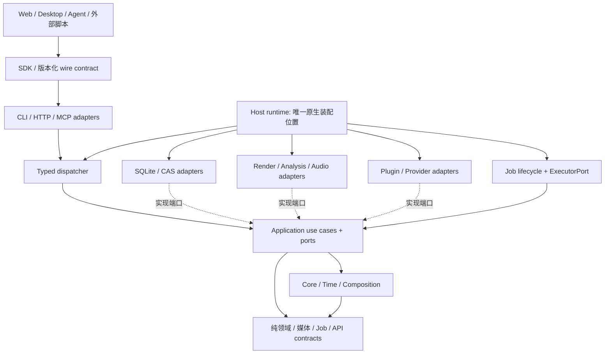

# OpenCut 整体架构整治与剪辑能力实施方案

更新：2026-09-29。当前宿主装配、工具分派接口和任务执行接口已落地；依赖政策覆盖 22 个模块，临时迁移例外为 0。已实现和未完成项以 [当前交付台账](headless-completion-ledger.md) 为准。

OpenCut 提供外部 Agent 调用的剪辑能力，内部不承担对话、创作规划或 Agent 自主执行循环。下方 W0 及 D01–D03 数量保留为迁移前基线，不作为当前依赖状态。

本方案依据当前源码和本次海南剪辑反馈：画面不重复、不出现人物、不配音、不加字幕、只用配乐，镜头稳定、转场自然，缩短冗余，修复选段、遮罩和节拍。它们是需要工具可靠表达和检查的编辑意图，不应变成散落在脚本中的一次性规则。

## 1. 文档权威与范围

- [design-v1](agent-friendly-editor-v1.md) 保留完整产品目标；本文件是后续开发的架构治理与实施顺序增补，取代其中与本文件冲突的目标分层和优先级。
- 已发布的 API、工程、任务、Composition、插件 ABI 和工程包契约保持原版本语义。本文件中的新协议名称均为**设计候选**，不是已可调用工具；发布必须有独立契约、版本和兼容验收。
- [交付台账](headless-completion-ledger.md) 是当前完成度入口；历史实施文档按当时状态阅读。本文不把历史“同后端预览与导出一致”当作独立语义正确证明。
- Web 已按用户要求进入实现与验收，具体边界见本文末尾；Desktop 继续独立排期。客户端、SDK、预览和协议共用应用语义，新界面不得重建另一套项目权威。
- 默认采用模块化单体、可隔离 Worker 和可选服务宿主。服务拆分需有资源隔离、部署或扩展依据；不能仅为“解耦”把每个 crate 改成网络服务。

## 2. 整治前的问题与处理依据

| 源码/真实动线事实 | 架构问题 | 本方案处理 |
|---|---|---|
| 已有纯 contracts/core/composition、应用事务端口、固定修订、持久 Job、幂等与租约 | 不能推倒重来，也不能把重复脚本视为正式能力 | 保留既有不变量，补能力端口和可验收协议 |
| `automation::Automation` 持有原生路径与 SQLite facade，并在分派中构造 Native 能力；CLI 同时依赖多种执行适配器 | 入口分派与宿主装配混合，容易继续长成万能入口 | 抽出 host-runtime 装配，dispatcher 只依赖应用 facade |
| `job-runtime` 同时承担调度和具体媒体/存储连接 | 增加后端容易侵入生命周期规则 | 以执行器端口隔离；先保证取消、租约和发布语义不变 |
| `compile_v3` 曾漏传 transitions，而后端转场测试仍通过；本轮已修复 | 每层各自“正确”，整条语义链仍能丢节点 | 编译覆盖回执、后端能力协商、公共入口独立像素/音频基准 |
| 转场扩展 source handle 曾改变 clip-local 关键帧时钟；本轮已修复 | 编辑时间、取样时间、执行窗口边界混用 | 明确时间空间，区间编译不可重新归零曲线 |
| 同一项目 revision、不同 OpenCut 执行二进制产生不同转场；包工具锁只覆盖 FFmpeg/ffprobe，仍可能报告 `fully_reproducible=true` | 素材完整与执行可复现混在一个布尔值中 | ExecutionIdentity 与分级复现证据；旧声明不作为验收证据 |
| 选稳段、人物抽检、运镜统计、音乐节拍依靠本机临时分析 | 正式 evidence 协议缺少这些结果类型和规划消费接口 | 扩展既有 evidence 查询，保留算法身份、时间区间和不确定性 |
| 已有边界检查，但只覆盖部分禁止依赖；部分文档仍描述早期实现 | 架构只能靠自觉，新增入口/模块容易绕过 | 全模块依赖政策、例外到期、负向测试和单一状态入口 |

以上不是“所有功能缺失”：现有关键帧、基本遮罩、交叉淡化、音量曲线、波形、镜头分析、原子编辑和任务事件均保留。本轮重点是语义完整、职责归位和能力闭环。

## 3. 目标依赖和运行边界

以下箭头是静态依赖/端口实现关系，不是要求所有调用经过网络：

**同进程协议**采用 Rust trait、不可变 DTO 和明确错误；由宿主注入实现。**跨进程协议**采用版本化消息、受授权的 artifact handle 和固定任务身份。CLI 是协议适配器，不是其他模块通过 shell 拼命令调用的内部 RPC。SDK 不导入原生执行依赖，MCP session 不拥有 Job 生命周期。

### 3.1 模块归属

表中的新名字是责任边界；只有形成独立依赖或生命周期时才拆 crate，避免用空壳包制造形式分层。

| 责任域 | 当前承载 → 目标 | 权威职责 | 不允许承担 |
|---|---|---|---|
| 契约 | contracts / media-contracts / job-contracts / api-contracts / job-execution | DTO、版本、错误、任务输入；公开与内部输入分离 | 运行 I/O、读取环境、构造后端、存储路径决策 |
| 编辑内核 | time / editor-core | 时间、不变量、原子编辑计划、ripple/roll/slip/slide 等语义 | SQL、文件、HTTP、当前 UI 选择状态 |
| 合成编译 | composition | 固定快照 → 版本化 Render IR；节点来源和时间语义 | 解码、字体查找、FFmpeg 命令、资源路径 |
| 应用服务 | editor-application 内按项目/分析/规划/执行/交付组织模块 | 权限、幂等、事务、端口编排、结果归属 | 原生实现、传输状态机、万能 ServiceLocator |
| 入口分派 | automation → 注入式 dispatcher | 工具解析、结构化响应、调用上下文、公共用例路由 | 开数据库、猜目录、构造 FFmpeg/插件/执行器 |
| 宿主装配 | host-runtime | 创建端口实现、资源预算、配置、启动与关闭 | 编辑规则、工程变更策略、另一套鉴权规则 |
| 存储适配 | sqlite-store / asset-store / storage-budget | 原子读写、CAS、发布 journal、配额、迁移 | 重新解释剪辑意图；直接调用媒体算法 |
| 渲染适配 | project-render / media | 验证并绑定资源、执行 Render IR、报告覆盖和资源消耗 | 从工程自行推导另一套时间线；静默丢弃节点 |
| 分析适配 | 当前 media/本地外部程序 → AnalysisProvider 端口 | 返回可溯源的区间证据与产物 | 修改工程、替用户提交选段、自动放宽本地处理要求 |
| 执行调度 | job-runtime + ExecutorPort | claim/heartbeat/cancel/recover/publish fence | 硬编码各模型、滤镜与第三方调用策略 |
| 插件/生成服务 | plugin-host + 分类 ABI/Provider 端口 | 受限执行，返回计划/证据/产物 | 直接写 SQL、CAS 或工程；绕过授权调用外部服务 |
| 客户端 | sdk-rust / sdk-ts / Web / Desktop | 呈现、输入、观察、取消请求 | 复制领域规则；通过项目根路径读取私有存储 |

现有应用层对 api-contracts 的纯 DTO 依赖暂保留；新领域规则不得读取 HTTP/MCP 名称或传输字段。需要共享的用例 DTO 应归其契约域，再由 transport 映射，不能为消除一个 import 复制模型。

B1字体依赖审查（2026-10-13）：`native-services`定向新增锁文件已有的`ttf-parser = 0.25.1`与`ureq = 3.2.0`（仅rustls）。前者实现应用注入的静态字体解析/cmap端口，避免在Rust与浏览器重复手写字体解析器；后者实现固定Google Fonts提交/路径/大小/hash的公共字体下载端口，拒绝重定向与客户端任意URL，默认离线、由宿主政策放行，不发送工程内容/文本/凭据。检查点传播授权/取消，blocking网络受有界超时约束；字体许可原文与源字节身份保留，渲染只消费授权CAS并核当前文字覆盖。仅手工增加这两条具体依赖，无新增crate或迁移例外；领域/时间/合成层不引入解析或网络库。B1固定字体文字静帧已完成限定真实验收，范围见台账；依赖准入本身不构成完整字体功能交付。

### 3.2 三种宿主共享一个内核

- Embedded：调用应用端口和宿主构建器，无网络开销。
- Headless/Service：CLI、HTTP、MCP 适配相同用例；控制面 JSON，媒体数据面用流/句柄，不把大文件塞进工具 JSON。
- Worker：可内嵌或隔离进程；输入固定 revision、资源锁、策略、执行版本，输出经 attempt fence 发布。独立进程化必须通过 kill/restart/cancel/重复投递验收后才声明支持。

项目修改继续经唯一原子提交用例；分析和渲染只消费不可变快照。跨进程不共享可变内存对象，不直接写对方数据库，不依赖启动目录或私有文件布局。

## 4. 必须先冻结的协议语义

下列为设计字段清单，W1/W2 将其落实为契约和生成类型。既有请求不会被强行包进新 envelope。

| 协议候选 / 归属 | 核心数据 | 不变量与失败处理 |
|---|---|---|
| ApplicationRequestContext / application | request/trace、可信 caller、policy revision；写入另带 idempotency key 与 expected revision | caller 由宿主鉴权生成；相同键不同请求冲突；固定修订不能偷偷换 head |
| CapabilityDescriptor / api + media contracts | protocol/IR/ABI 支持版本、节点与参数支持范围、时间/格式限制、资源预算 | `supported`、`implemented`、`verified` 分开；能力响应来自实际执行后端；不支持时具体拒绝 |
| CompileReceipt / composition | source revision、IR version/hash、每个源节点到 IR 节点映射、排除理由、编译器身份 | enabled/in-scope 节点必须 executed 或 explicitly rejected；disabled/out-of-range 可排除并说明；不以节点数量相等替代语义匹配 |
| ExecutionIdentity / job + package contracts | compiler/renderer build hash、IR semantic version、FFmpeg/模型/插件/字体 hash、运行配置、平台/后端、determinism profile | revision 只标识项目内容，不标识执行实现；构建自报版本号不足以作为精确身份 |
| AnalysisEvidence / 既有 evidence 扩展 | asset content hash、source time range、kind、model/algorithm/version、parameters、sampling coverage、confidence/unknown、artifact handle | 结果是观察不是保证；抽样无人≠全片无人；模型置信度不可跨模型直接等价比较；不以波浪运动当相机运动 |
| EditorialIntent + EditPlan / core + application | 目标时长、约束、排除对象、重复策略、运镜/节奏偏好；候选段及证据引用；操作列表和受影响范围 | 硬约束与偏好分开；旧配音要求由新意图版本明确替代；无可行计划时报告冲突，不能靠重复或违约补时长 |
| BeatGrid + MarkerSet / analysis contracts + core | rational 时间、beat/downbeat/phrase、tempo segment、来源、置信度、人工修订 | RMS 峰值不是 beat；不假设整曲恒定 BPM；打点编辑与音乐曲目版本绑定 |
| PreviewRequest / preview contracts | revision、range、quality、seek generation、execution identity、policy | 旧 generation 不得覆盖新呈现；缓存复用需要语义和权限同时匹配 |
| Render/Analysis ExecutorPort / 内部 job-execution | 固定输入、能力需求、预算、取消 token、progress sink、只读/暂存 artifact handles | Worker 不接受客户端指定任意可执行命令；取消有确认和资源清理；任务恢复保留原版本语义 |
| DeliveryManifest + ReviewFinding / package/API | revision、job attempt、artifact hash、执行身份、技术验收、时间码审片意见、交付选择 | “最新文件名”不等于选定交付；engine/参数改变后旧验收失效；技术通过与人工观感分开 |

端口应按能力小接口组合，保留已有 ProjectStore/JobLifecycleStore/RenderPreflight 等实现；不引入一个可调任何工具的 `call(name, JSON)` 作为内部所有层的万能端口。动态 JSON 仅留在真正的 wire/plugin 扩展边界，进入内核前类型化校验。

### 4.1 时间、参数和画面语义

- 原素材时间、clip-local 时间、序列时间、输出窗口、音频样本位置必须显式区分。沿用精确 MediaTime 和 `[start,end)`，跨帧/样本取整规则写入契约。
- transition handle 扩展取样范围，不改 clip-local 原点；有变速时先定义 source handle 与 timeline handle 的映射及不足处理。范围预览与完整导出使用同一映射。
- Mask 明确坐标空间、变换顺序、羽化单位、alpha/premultiplication、追踪绑定和遮挡失败状态；Transform 不冒充稳像。稳定器输出派生素材/轨迹、裁切预算、残余运动和失败信息，不覆盖原素材。
- 参数注册表包含类型、单位、范围、默认值、可动画性、插值方式、IR 表达、后端能力和兼容版本。`exposure_ev` 与当前加性亮度实现的差异须用新语义版本纠正，不能同名悄悄改变旧工程效果。
- 色彩域、输入解释、线性/显示域效果顺序、输出色彩与范围必须明确；音频明确 dB/线性增益、通道布局、采样率、响度测量条件。画面或声音变化不得藏在 adapter 默认值里。

### 4.2 错误、版本和演进

- 每个命令规定前置条件、幂等范围、事务边界、超时/取消、权限、资源消耗、成功收据和可重试条件；用户输入/不支持/冲突/预算/执行失败不可统一成 unknown error。
- 工具 wire schema、工程 schema、IR semantic version、插件 ABI、分析模型、缓存布局分别演进，不能共用一个版本号推断兼容。
- 保持旧工具 schema/read_only 精确冻结；即使“只加可选字段”也须先验证冻结策略。不能兼容时新增版本化工具，SDK/OpenAPI/MCP 从同一声明生成。
- 先双读/旧入新出或显式迁移，再迁移调用方，最后按已公布退役规则移除旧入口；迁移必须有失败恢复和旧 fixture 验收。不能把双写两套业务规则作为长期方案。
- Provider 协议按插件类别定义 I/O、版本、配额、取消和产物验证。TTS/音乐/生成视频是可替换 provider，不把某个模型或供应商埋入编辑核心。

## 5. 两项 P0 可靠性闭环

### 5.1 请求语义必须到达画面和声音

完整路径为：公共命令 → 已保存工程 → 固定 revision → 编译覆盖回执 → 资源绑定 → 后端节点执行回执 → 成片独立验证。

1. 对每一种可编辑节点建立可追踪 ID；合法编译优化可以多对一/一对多，但必须保留来源映射。
2. preflight 校验能力覆盖，执行器校验收到的 IR 与回执摘要相符。任何无解释的节点丢失失败退出，不返回“完整成功”。
3. 分别测试纯编译语义、绑定时间、后端像素/PCM、公共 API 全链。用红/蓝色块、已知音频脉冲和手算混合值做独立 oracle。
4. 预览/导出相等只证明一致性；必须再验证期望效果确实出现。转场至少覆盖起点/中点/终点、剪辑两侧、非零源起点、动画、变速、禁用轨及区间 seek。
5. 新效果必须同时登记 capability、IR、执行与拒绝路径、独立基准。仅序列化成功或 renderer 单测通过不可标记交付。

### 5.2 复现声明必须有级别

新契约分开返回 `media_self_contained`、`execution_environment_locked`、`semantic_output_verified`、`bit_exact_verified`，每项带 unknown/pass/fail、检查范围及 evidence ID。它们不能相互推导。

旧 `fully_reproducible` 只按历史契约读取并标记 legacy claim，不再作为新验收的放行条件；写路径是否收紧、如何提示旧客户端，必须在 W1 单独评审并验证兼容，不能在本轮文档变更中暗改旧 wire schema。新包格式应携带编译器/执行器与完整资源身份；不匹配时 preflight 返回差异，允许用户选择兼容重渲染，但结果必须生成新执行收据。

缓存键至少覆盖素材身份、IR/执行身份、输出参数、色彩/音频配置和时间窗口；完整项目 revision 是保守正确的第一版。后续局部复用用可证明等价的子图 hash，并扩展转场 handle、效果依赖、音频尾音范围。失去授权的缓存命中不能向调用方返回内容。

## 6. 整体实施顺序与退出条件

以下为依赖顺序，不是完成承诺日期；每一阶段均需更新台账和证据，不能以文档完成代替实现完成。

| 阶段 | 具体任务和主要位置 | 前置 | 必须提交的验收产物 |
|---|---|---|---|
| **W0 架构基线（本轮）** | 全 21 个 crate 依赖登记；12 条既有边单列迁移债务；门禁、负向测试、CI 配置；本方案及台账链接 | 当前源码 | 本地 gate 通过、违规 fixtures 被拒绝；远程 CI/分支保护另行验证 |
| **W1 宿主与 P0 语义** | ①从 automation/CLI 提取 host-runtime，dispatcher 注入现有应用端口；②定义 CompileReceipt/ExecutionIdentity；③公共入口转场/曲线/音频独立基准；④版本化复现报告与保守预检；⑤TS 导入边界与协议合同测试 | W0 | 同一用例经 embedded/CLI/HTTP/MCP 产生等价事务/错误；旧 schema 不变；伪 backend/内存 store 可替换；漏节点及换 renderer 能被识别；移除 D01/D02 |
| **W2 可观察与快速反馈** | 分阶段进度投影；代理素材、帧/区间缓存、seek 取消、依赖失效；人物/运动/稳定区间/重复内容 evidence，算法插件身份和本地策略接入 | W1 身份和能力协商 | 正确区间/时间原点；快速连续 seek 无过期画面；算法异常明确 unknown；固定基准冷/热延迟、RSS 和缓存命中收据 |
| **W3 编辑规划与执行隔离** | EditorialIntent/证据选段；ripple/roll/slip/slide、同步组/J-L 编辑、关联对象原子迁移；BeatGrid/乐句剪辑；ExecutorPort 从 job-runtime 分离 | W1；选段消费 W2 | 缩短时字幕/音轨/关键帧/转场不漂移；锁轨冲突明确；一次提交/一次撤销；取消/kill/restart 不重复发布；移除 D03 |
| **W4 运动/转场/遮罩** | 稳像适配、速度曲线、可协商重采样；有 handle 约束的自然转场；Bezier mask/动画/追踪与失败回退 | W2 证据、W3 时间/规划 | 稳像前后抖动/裁切/形变证据；场景切换不跨镜跟踪；节点全链 oracle；坏追踪可修正/撤销；不能以“无报错”代替观感验收 |
| **W5 声画与交付** | 版本化色彩管理、白平衡/曲线/LUT/scopes；音频 bus/EQ/动态/响度/真峰值；可编辑标题与字体锁；审片意见、包恢复、长素材存储策略 | W1 身份；W3 编辑；W4 参数语义 | LUT/色彩与 PCM 独立基准；无配音/字幕等意图可验证；缺字体/插件/工具明确诊断；包外恢复和继续编辑；>1 GiB 单素材政策明确实现和验收 |
| **W6 整体验收与发行** | 新一组素材从导入到交付走正式 API/CLI/SDK；跨平台、签名、升级/回滚、长媒体与故障矩阵；按 UI 恢复决策接入前端 | W1–W5 | 固定发布物与二进制 hash 的包外收据；能力矩阵无虚假完成；用户审片与技术验收分别记录；无项目专用脚本才能完成的必需步骤 |

W1 内建议以四个可审查变更提交：宿主抽取、语义回执、执行身份/复现、公共入口独立基准。每次保持原有功能可用，不在一次全仓改名中同时改变剪辑语义、协议和存储。

性能验收应先冻结素材、机器、工具链和测量方法。建议 W2 的产品目标为代理预览热启动/seek p95 ≤ 500 ms、冷启动 p95 ≤ 2 s；这是待基线确认的目标，不是当前实测能力。分别报告预览首帧、seek、连续吞吐、4K 导出及峰值内存，不能用一个小样本推断 p95。缓存预算、并发上限和降级质量必须可配置。

## 7. 从框架阻止继续腐化

### 7.1 自动检查与治理基线

- [dependency-policy.json](dependency-policy.json)：22 个模块逐一声明责任、层、归属和 normal/build/dev 依赖，外部依赖也需登记；这是一份**当前允许基线**，不是目标架构已经达成的证明。
- [check-architecture.py](../../scripts/check-architecture.py)：检查所有 workspace 成员和条件/optional 依赖，使用 Cargo 实际包名避免 rename 绕过；拒绝未登记模块/依赖、替换内部包来源、未登记本地 path、生产依赖环、过期/重复/已消除例外和过期允许项。
- [负向 fixtures](../../scripts/tests/test_architecture.py)：证明增加违规边时门禁会失败，覆盖 dev/生产混用、build、rename、条件依赖、例外到期等。
- [架构 CI](../../.github/workflows/architecture.yml)：PR/push 和定期复核执行依赖门禁；不因仅改文档跳过。既有 [纯契约检查](../../scripts/check-contract-boundaries.py) 继续检查解析后的传递依赖和源码 I/O 边界；新门禁不替代它。

当前已增加 TypeScript 导入边界检查，宿主抽取和调度接口隔离也已落地。门禁仍不分析任意 Rust 函数内部、动态加载或全部外部依赖的传递语义；已登记的 adapter 依赖不代表任意位置可直接调用其实现。Cargo 版本/features/source 的升级还需锁文件和行为审查，依赖包名登记不能替代供应链检查。

### 7.2 迁移债务不能无限续期

D01 工具分派、D02 宿主入口、D03 任务执行的临时依赖迁移均已完成，当前例外清单为空。原迁移基线保留在 [当前交付台账](headless-completion-ledger.md)。

后续确需例外时，必须记录原因、退出条件和复核期限；不能将未完成迁移改为永久允许依赖。

### 7.3 每个变更的交付合同

1. 先说明归属、输入/输出、依赖方向、失败/取消/恢复和副作用；跨边界变更附 ADR，禁止以“工具层方便”引入反向依赖。
2. 同源生成公共类型和能力信息，运行旧 wire 兼容、affected crate 检查；有语义变化时必须提交独立结果 oracle。
3. 新增能力同时更新 source → plan → IR → backend → artifact 验收矩阵；尚不支持的组合明确拒绝。
4. 架构政策变更必须展示依赖图差异及理由。仓库维护者需将架构 workflow 设为 required check，并为政策/核心契约设置真实 CODEOWNERS；这些服务端设置本轮未执行，不能声称已经强制所有合并。
5. 验收报告绑定源码版本/dirty source 摘要、binary/artifact hash、平台、工具链、输入 fixture 和命令。全量检查只在变更影响或发行门槛要求时执行，不能靠反复运行相同测试替代缺失断言。
6. 核心不内置供应商；临时研究脚本不得成为未登记的产品调用链。可复用算法先接能力端口，项目脚本只消费正式接口。

## 8. 安全、资源与进度属于横切契约

用户要求“只在本地处理”时，任务的 ExecutionPolicy 应传给分析器、模型、插件、预览和导出后代任务；不能通过换 Provider 绕过限制。只读输入以 handle 授予，写入限定 attempt 暂存和受控发布。权限检查、网络策略、超时、内存/磁盘预算与日志脱敏由宿主执行，不能依赖每个业务脚本自觉。

现有 Job/event/lease/journal 继续复用。补充“索引→分析→计划→提交→预览→导出→验证”的阶段投影，包含当前 revision、最近证据、已完成项、失败原因、是否仍在执行和可见产物。没有可计算工作量时不伪造百分比或 ETA；“编译成功”“文件已生成”“技术验收通过”“人工审片通过”分别展示。此前重复回答“正在看”也属于协作执行问题，增加工具字段不能代替真实汇报。

## 9. 完成的判断

最终验收用另一组具有抖动、重复场景、人物、变速、混合帧率和音乐变化的素材，通过正式工具完成：分析 → 选稳定且不重复的候选段 → 自然缩短 → 乐句对齐 → 必要稳像/遮罩 → 局部预览纠正 → 全片导出 → 工程包异地恢复继续编辑。

每一步必须可追溯、可取消、可恢复、可解释失败；不出现人物等内容约束需要明确检测覆盖与必要人工确认，不能由抽样自动提升为绝对保证。海南素材不进入公共仓库或远程 CI，自动回归使用合成/可公开 fixture。

**架构门禁通过表示边界没有未经审查地扩张；协议测试通过表示实现符合合同；成片和恢复验收通过才表示该剪辑动线交付。三者缺一不可。**

## Web 运行与模块边界（2026-09-29）

`apps/web` 原位迁移成 React/Vite 静态编辑器；模块按职责命名，不另建带版本后缀的平行实现。Classic 的可调整面板布局和时间标尺用于交互迁移，浏览器单例、IndexedDB/OPFS 工程权威和浏览器渲染执行链不进入新架构。原始协议类型名保留兼容约束。

| 模块 | 责任和依赖 |
|---|---|
| `editor/model` | 公共生成类型的视图、精确时间、请求草稿；无 I/O、React 状态或工程存储 |
| `editor/workspace` | 注入式连接与工程状态、回包隔离、串行写入、共享 SDK、任务变更观察；不导入具体 UI 功能 |
| `editor/assets`、`timeline`、`preview`、`inspector`、`tasks`、`history`、`projects`、`connection` | 各自呈现和输入，依赖 workspace/model/shared，不互相导入实现 |
| `editor/shared` | 通用界面与有界下载，不持有工程权威 |
| `apps/cli/src/web_host.rs` | 静态资源、同源入口和 Host 检查；编辑鉴权仍由既有 HTTP 中间件负责 |

边界理由：不新增 Rust crate 或依赖政策例外。历史查询读取经过授权的 head identity，不为获取元数据将视觉工程解码成旧文档。字幕交换仍复用应用层解析/导出与原子编辑，宿主仅适配快照和现有事务入口。Web 只依赖五个运行包；Playwright 和格式化工具限开发验证。`apps/api` 空壳和未使用 UI 脚手架已删除。检查由 `apps/web/scripts/check-boundaries.mjs` 和 SDK 跨组件导入检查共同执行。

完整本机检查与产品边界见[当前交付台账](headless-completion-ledger.md)，不得以构建或浏览器主流程成功代替全部专业能力、跨平台发行与性能验收。

### Web 原版界面还原与偏好设置（2026-09-29，实施中）

- 以 `tmp/opencut-classic/apps/web/src` 为页面与交互参照，复用原版 ruler 和 Bézier graph；保持唯一服务端项目权威。原版 transitions/adjustment 本来是占位页，不能宣称原版已实现。
- 原版浅/深色中性灰与蓝色强调色用于编辑器；新增页面适用 frontend-design。新增 GSAP 与 @gsap/react 仅用于 shared/motion 中的短暂界面过渡，respect reduced-motion、scope、卸载清理；不介入播放时钟、编辑请求或渲染器。这两项前端依赖有明确呈现职责，不改 Rust dependency-policy 基线。
- `shared/locale` 是唯一允许持久化语言/主题偏好的浏览器模块，只写两项固定键；不保存 token、媒体、工程、修订或队列。翻译在呈现端完成，不改变公开枚举/DTO。
- `server start --config` 读取本机 JSON；同源 Web 使用进程期 HttpOnly/SameSite=Strict 会话，由检查 Origin/Host/Fetch Metadata/custom header 的 POST bootstrap 建立。长期 Agent Bearer token 不发送给页面。API/MCP 的现有授权策略保留；cookie 身份仅用于同源 Web 请求。
- 素材预览缓存按 SDK 会话/工程/固定素材哈希隔离，仅保存小图与波形，上限 128 项、最多两个并发生成；源文件以授权 Range 响应读取。媒体 hash 检验和流期间权限重验保持有效。

### 素材单次读取导入（2026-09-30）

旧上传控制契约要求在创建会话时提供整文件摘要，导致浏览器完整读取一次校验、再次读取传输。新增 `stream_uploads` 公共声明及 begin/inspect/complete/abort/query 操作，原声明保持原样；跨进程仍使用既有版本化 HTTP/工具注册表。原有配额、分块大小与并发上限不变，SDK/OpenAPI 从公共声明生成，不增加依赖边或修改允许列表。

应用层 `UploadSession` 表示摘要尚未声明的内部状态，不序列化为公共 DTO。旧投影只能暴露已知摘要的会话；流式投影独立声明可空摘要。SQLite 在同一事务中固定摘要、核验完整分块覆盖、封存会话、创建任务及事件/审计；重放必须摘要相同，权限仍在每次操作重验。数据库内部写协议升级至 24，阻止旧宿主把未定摘要误作已知摘要；此编号不用于新增产品页面或模块名称。

原生适配器负责有界字节接收、每块摘要、持久化确认与清理，HTTP 宿主仅做路由与投影装配。浏览器一边累计整文件摘要一边传输，worker 仍独立验证完整内容后识别格式并固定素材版本。没有通过取消完整性检查换取速度；传输结束后的格式识别与受控存储仍是实际工作。新旧接口共用应用语义，未引入 CLI 子进程作为内部调用方式。

### 项目命名与场景结构（2026-09-30）

`contracts/project_edit` 独立声明项目重命名、场景创建/重命名/删除批次，不扩展冻结的 visual/base operation 枚举。`editor-application/project_edit` 纯函数从固定快照生成提案，继承主场景设置、建立视频轨并禁止删除主场景，删除时同步移除该场景的可视节点和曲线，保留共享素材。

`sqlite_project_edit` 适配器复用从既有 visual apply 提取的 `commit_edit`：同一事务写修订、项目名称与 head、编辑日志、幂等回执、outbox 和审计。权限、owner edit hold 在重放前复核；没有增加 crate、依赖边或数据库版本。宿主只注册两项独立的 plan/apply 操作；SDK/OpenAPI 仍从同一声明生成。

Web 场景列表与重命名属于既有 projects 模块，仅依赖 workspace/model/shared；未新建工程权威。场景切换写入导航 URL，刷新可恢复所选场景，当前场景被移除时状态回落到主场景。页面借用既有 Modal/GSAP 生命周期与主题字典。此节不覆盖项目删除/复制、书签或完整撤销栈迁移。

### 持久撤销与重做导航（2026-09-30）

新增只读 `history_navigation` 契约，从指定修订的第一父链解析编辑导航；合并作为一次编辑，不把尚未合并的分支操作纳入主线栈。应用层纯 `Navigation` 接收类型化编辑/撤销/重做事件，按因果目标维护顺序，新编辑清空重做；SQLite 在同一授权读取快照中提取日志，最多遍历 100,000 个修订并检查循环，不读取媒体或生成新的项目权威。创建/格式提升记录不作为可撤销的编辑。

Web 从服务重新读取导航，不再保存单个本地 redo ID 或猜测最新 transaction。导航绑定项目与修订，执行仍走既有选择性 plan/apply，保留固定修订、权限/hold、幂等、冲突及原子写入。新增只读工具从公共声明生成 SDK/OpenAPI，旧 139 个工具声明不变；没有新增模块依赖、数据表或政策例外。此导航只描述编辑历史目标，活动场景/选择恢复属于视图状态，另行迁移。

### 项目库与原子复制（2026-09-30）

新增共享项目库元数据与 owner 批量复制操作，公共声明统一生成 SDK/OpenAPI，原 140 个工具声明保持不变。应用层负责目标校验、完整文档复制与主场景精确时长；存储层在同一 IMMEDIATE 事务检查全部源 head、写入新项目首修订、素材关联、项目插件授权、outbox、审计及唯一批次回执。复用从已有工程包导入提取的首修订发布函数，不引入 CLI 内部调用或新的依赖边。副本不继承源修订历史、分支、后台任务、用户凭证或编辑锁。

内部数据库协议升至 25，增加 `project_media_bindings` 及统一读取视图。素材内容和原导入来源保持一份；副本具有独立的项目授权关联，可继续复制。inspect、HTTP 源预览与资源分页使用同一关联投影；旧媒体 DTO 不变，旧宿主不能重开新数据库。原素材记录仍受外键和既有 GC/发布围栏保护，绑定不伪造上传任务或重新读取文件。删除项目必须另行处理这些共享引用和任务生命周期，不得直接复用复制逻辑清表。

Web projects 模块沿用 Classic 网格/列表、选择与信息呈现；排序使用服务元数据，时长比较保持精确有理数。复制按界面展示的固定修订提交，项目数据仍由服务独占；语言、主题与 Modal/GSAP 使用既有共享组件。本节不关闭项目删除、工程封面缩略图、批量改名或所有站点页面的迁移缺口。

### 项目删除与素材库移除边界（2026-10-07）

项目删除由 owner 应用用例通过 `ProjectDeletionStore` 原子写入删除标记并返回固定回执，再经已有 `UploadCleanup` 端口释放暂存文件；清理失败返回可重试列表，不把已提交的删除报告成事务失败。SQLite schema26 保留不可变历史、审计和原始媒体根，撤销访问授权与项目库可见性；复制项目、已接受任务及公共下载仍遵守既有保留策略。删除和任务提交共用 SQLite 写栅栏，未结束的项目任务阻止删除，接收中的上传原子中止。它不是存储安全擦除或整个归档的物理清除。

素材移除规划位于纯 application `media_library`，为基础/视觉文档生成同一编辑意图；原子写入、权限/owner hold、锁轨、固定修订、幂等、审计与撤销继续由既有编辑端口承担。相关视觉节点先于片段移除，以保留目标锁检查；跨场景字幕保留文字并解除被移除素材的来源关联。Web 与 Agent 调用新增声明式操作，SDK/OpenAPI 统一生成，已有公共 DTO 不扩展。每批最多 64 项，展开后沿用 128 操作上限，超限拒绝整个事务。

Web 的 `shared/view-preferences` 只保存项目库布局和排序到固定键 `opencut.library`；不保存文档、凭证或媒体。边界检查仅允许该文件对这个字面量键执行 getItem/setItem，并继续拒绝别名、动态键与 IndexedDB 权威。新增文件仍在既有 UI、application、API 与 SQLite 模块中，未增加 crate、依赖边或政策例外；不重新生成依赖基线。

### 时间线视图恢复（2026-10-07）

时间线缩放、横向滚动和精确播放头属于 UI 视图偏好，按项目/场景身份保存在独立固定键 `opencut.timeline`；不包含修订、文档、媒体或凭证。扩展同一偏好模块的字面量键检查，不开放任意浏览器存储。最多保留64个近期视图，合并200ms内的频繁更新，pagehide立即提交；刷新时读取服务端当前文档后，纯 UI 模型将位置限制在独占结束点之前的最后有效帧，保持整数有理时间。历史浏览不写入当前项目视图，存储不可用不影响编辑权威。仍未增加 Rust 依赖或迁移例外。

项目库增量的最终验收和本机升级见 [当前交付台账](headless-completion-ledger.md)；全面 Classic 页面/功能迁移仍未完成，逐项缺口以 [当前交付台账](headless-completion-ledger.md) 为准。

### Classic 公共页面与预览快照（2026-10-07）

`Web/site` 负责原版首页、品牌、路线图、赞助、法律说明、更新记录及公开社区内容；装配入口按路径分别加载站点与编辑工作区。公共内容读取仅访问固定 Marble/GitHub 公开端点，使用独立、无凭证、可取消、有界响应适配器，不包含项目或媒体参数。UI 边界检查禁止 site 导入编辑状态/SDK，也禁止编辑模块导入公共内容适配器；允许复用语言、主题和入场动画。没有新增依赖、crate 或依赖政策例外。

独立 HTTP 宿主显式允许公共页面与有界详情路径，保留方法、Host、路径遍历、静态根/符号链接以及编辑 API 身份验证规则。原版博客服务实时可达性单独验收，夹具测试不代替外部接口成功。原版已发布更新记录仅是历史内容，不作为本地功能完成证据；原版浏览器存储及分析服务描述按实际本机存储和无分析集成修正，并补齐中英文字。

预览保存/复制快照复用既有固定修订、指定场景与精确时间的原生合成帧任务，不读取浏览器画面截图，不引入第二渲染权威。保存对话框和图像剪贴板在点击手势中启动，等待真实 PNG；切换工程/场景/修订沿用现有请求世代与取消。快照操作不编辑项目，原生帧仍接受既有权限和策略检查。右键菜单和工具栏共用操作状态，菜单按键不穿透到时间线编辑。

### 面板视图与引导（2026-10-07）

同一UI偏好模块限定新增字面量opencut.layout/opencut.welcome；只存横/纵面板百分比、完成标记和有界原版已读版本。投影丢弃外来字段，拒绝非有限尺寸/错误总和，仅用户完成拖动或键盘调整时保存，窗口自适应不覆盖意图。原版动态摘要从已发布记录生成，构建检查一致；它是公共内容元数据，不引入编辑状态或服务凭证。引导、通知和恢复布局不进入工程修订或历史。UI边界不允许开放动态存储键，没有新增依赖或迁移例外。打包Web构建使用临时目录，不修改正在服务的资源树；本机页面发布仍经已验证资源的备份和替换。

### 场景语音与预览视图（2026-10-07）

场景转写是固定修订的持久分析任务：应用层授权、验证与捕获素材锁，宿主装配配置中的本地引擎，原生执行器复用合成导出的音频滤镜处理裁切、时序、恒速、音量和静音。字幕规划保持纯函数；SQLite 适配器通过既有视觉 journal 一次提交有界的完整提案，保留权限、owner hold、幂等与撤销。公共意图与内部 prepared job、模型路径分开，新增独立工具并由共享声明生成 SDK/OpenAPI，原有合同不修改。当前锁包含整个场景依赖，尚未做仅音频依赖的捕获优化；不声称所有转写模型或语言准确度已验。

预览 Fit/百分比、中键或空格平移只改变视图几何，画布手柄使用同一显示尺寸换算逻辑坐标。网格复用原版分割规则，TikTok 参考 SVG 从原版静态内容转换，原版空实现的自定义线补为有界可编辑视图；其他空平台定义不冒充成熟功能。偏好模块显式放行唯一字面量 opencut.preview，投影仅保存辅助线类型、1–24 行列和至多32条百分比位置，不保存工程或凭证。弹层通过既有 React portal 避免面板裁切，并复用减少动画偏好的 GSAP 入场；没有新增生产依赖、Rust crate 或迁移例外。工程 URL 编码应用标识，不再假定 Agent 的工程 ID 是 UUID；宿主只映射入口文件，静态资源的路径防护保持独立。

### S1连续声画的执行边界

新增`opencut_visual_preview_v4_frame`只读规划/绑定操作，附着既有声音owner lease、generation及overlay fence；宿主重查当前与原调用者Read/RunJobs，读取固定V4修订，发布前再校验。应用复用normal静帧source→IR→prepared→decoder事实绑定。纯visual事实移至contracts后由composition原名再导出，原内部序列化不变；公开计划类型移至api-contracts供内部协议再导出，不引入API→composition依赖或政策例外。

Web仅通过`visual-preview-renderer.ts`桥执行既有Classic解码、WGSL及GPU合成器，不复制几何、源时钟、动画或工程权威。以AudioWorklet消费回执的服务确认时间取帧，一帧在途、一个最新待处理意图；超150ms清除旧画面。首帧准备完再开PCM流；seek/暂停/修订或授权失效沿用声音控制，取消旧generation。复用GPU管线，编码字节缓存按固定资源身份校验并计入每帧预算；同资源保留有界三画布解码池，实际尺寸准入先于分配，完整保留量及新增临时量共同计入原预算。同一合成帧只借用每个资源的一种源时间/准入观察，其他请求沿用单帧独立画布，避免池复用覆盖待上传图层；相同请求共享解码事实与GPU上传，逐层合成不省略。Web由GPU surface转ImageBitmap呈现并关闭替换/迟到位图；native默认RGBA及独立单帧释放路径保留。停止/失效关闭解码池、surface及GPU realm，不新增依赖或政策例外。浏览器GPU/驱动及操作系统RSS与原生隔离进程不同，不能沿用静帧执行身份或硬RSS验收。本批仍限normal视频/静态PNG/JPEG，其他视觉类型和导出另行验收。

本地Worklet累计消费帧只用于显示新旧/滞后围栏；Rust确认时间仍唯一编译源→IR。默认音频prepared-linear的原精确位置数组在私有Node/page桥中改为受限JSON文本，避免逐对象封送；恢复后按原sampler执行，公开wire与源位置算法不变。

Worklet只在原两块FIFO内预填，短EOF由匹配token的end解除预填；静默等待不推进消费帧。时间线仅对稳定呈现事实订阅/缓存片段主体，播放头继续取原控制器当前消费状态，动作使用最新控制器/回调；选择、草稿、权限、修订、语言和主题仍使视图失效。

同帧规划与解码事实绑定由应用层`PreparedPictureV4`复用既有纯IR及ClassicVisualSession；宿主只保留一个受原60层/32资源及像素预算准入的私有prepared帧，按完整声音session与精确Time匹配，未命中保持直接绑定的原完整准备路径。复用不缓存授权：每次绑定前后仍核对当前/原调用者Read/RunJobs、固定修订存在、owner/lease/generation/overlay及150ms窗口。宿主内SQLite视觉processing policy是固定配置，随prepared输入捕获；若将来允许动态政策，该缓存必须增加政策版本或禁用复用。停止、过期、代际控制及生产失败释放准备缓存。不新增模块/依赖/allowlist例外，跨进程DTO保持原样。

实时声音的已验证`BoundPreviewAudioV4`由原`ClassicAudioSession`持有，借用同一固定准备并只保留一份声源格式及原生PTS索引；每个PCM块复用绑定，避免再次校验、克隆完整voice/segment集合。输入顺序单独保存为有界索引，原绑定/回执的精确比较和编译voice顺序保持；重复绑定仍核验，变更或未授权绑定拒绝且不替换原事实。每次块编译仍先执行实时资源checkpoint，宿主保留生产/发布的权限及代际围栏。无关键帧的element/track物理增益每voice每块求值一次，动画保持原60Hz采样插值与generation anchor；临时gain沿用原应用准入。该复用不扩展两块FIFO或PCM/进程预算，不新增源时钟算法、公开wire、模块或依赖。

隔离浏览器一次`next`执行在原4096帧上限内返回双声道Float32小端字节文本及原完成回执，省去逐声道串行的page→Node回调。Node先对两声道完整长度/规范hex和捕获command一致性准入，再逐包检查取消，沿用原两条私有PCM包；Rust仍逐包校验原权限、command/generation/overlay及最终固定声源回执，并在宿主状态机围栏后发布。只有同一块的有界字节返回方式改变，未增加生产并发、消费credit或缓存；精确源/增益事实和PCM采样保持原实现。执行模块身份包含host/page源文件，不能仅以未变的Rust二进制或Web产物认定运行身份未变。

Worklet原消费回执附带实际`currentFrame`与量子帧数，生产控制器仍只使用原累计消费帧。验收脚本在原8192条观察上限内核对连续设备帧区间、逐量子copied及累计cursor增量，再计算真实缺帧；缺失/乱序/不一致回执标为证据不足。原页面时间加权停顿与confirmed deficit门槛保留，并补设备量子缺帧≤1%的独立检查。新增`apps/web/scripts/scene-preview-consumption.mjs`只做验收观察算术，不进入运行时、源时钟/IR、credit算法或SDK；这是验证边界内的纯辅助文件，不新增产品模块、依赖或allowlist例外。完成块k与原两槽FIFO后继传输块k+2关联；图时钟消息滞后及report→补块耗时都不是DAC延迟或独立原生生产耗时。

Web连续声音的数据泵在既有workspace/v4/audio-preview模块内隔离到Dedicated Worker；依据是当前候选在HD GPU/UI负载下实测completion→report及credit→补块长尾和逐量子欠供给，是否改善仍须绑定新Web候选验收。新增pump/device-port文件分别承载原parser/SDK控制串行和原两槽转移/停止回执，UI测试注入与Worker共用同一实现，不引入第二播放器、源时钟或项目权威。用户点击时仍在主线程创建/恢复AudioContext及Classic母带链，只有开始PCM前将AudioWorklet MessagePort单次转移；主线程只保留呈现、编辑控制和设备关闭。私有channel/version1绑定唯一token及递增RPC，复用共享SDK声明和cookie/bearer装配，不存储或记录凭据；公开wire/生成契约、Rust模块和依赖政策不变。

停止先同步断开主线程输出并冻结Worker报告、取得真实processor最终游标，再等待原在途报告、串行提交playing=false的最后消费报告，随后执行原pause/seek/临时gain控制；旧stream直到该代际围栏之后才取消。Worker拒绝未被自身停止回执确认的final cursor，不以墙钟、队列尾或超时替代；取消、错误和代际替换终止原Worker，旧回执不发布。原固定revision、owner/lease/generation/overlay、原/当前调用者权限与媒体policy仍由Rust用例复核，隔离只迁移数据传输与credit调度。验收旁路在实际Worker观察有界PCM传输和HTTP控制RTT，跨realm时间按performance.timeOrigin换算；Worklet逐量子回执在页面到达处保持原门槛，未注入start观察则拒绝验收。此观测不向产品消息增加PCM副本，也不作为物理DAC时间。

持续消费验收沿用同一候选，新增scene-preview-continuity纯观察辅助与专项入口，仅在验证脚本边界内执行，不进入产品PCM/IR/SDK或增加依赖政策。页面与Worker原始队列保持8192/512/2048等上限，周期提取后清空，仅携带一个窗口边界量子；每个相邻render frame和exact cursor/copied关系均检查，换窗不能重置完整性。首个实际PCM量子及终态cursor独立核对，最多64个窗口摘要；观察溢出或缺失拒绝验收。像素选择取外部固定合成时间表的区间内部，独立颜色/PCM预期不取服务编译结果。

Worker侧旁路在原生MessagePort onmessage进入、生产处理器释放credit之前记时，再关联覆盖报告及原两槽后继块k+2；periodic drain的边界保留有界待匹配记录。页面时间按timeOrigin换算，图消息延迟另列，不能混为原生/DAC耗时。持续专项通过CDP单独读取实际Worker V8 heap，并以pid/start身份采样自有Rust服务及后代RSS；页面heap、Worker heap、native RSS和GPU分配分别留证，不把其中任何一项当总内存或kernel硬限额。终态检查原服务消费回执、声音设备关闭、Worker target消失及被捕获原生子进程退出。专项结果与剩余操作/长源范围只在当前台账和摘要维护。

原生阶段诊断只在显式`--profile-native-preview`本地验收入口通过Node预加载装配；需原仓库音频/视觉包、显式可执行文件、既有密集工作区及已构建Web，不能隐式构建或复制fixture。保持原Rust/私有packet/PCM/权限与取消语义，旁路测Node命令入口、原page evaluate、编译broker、page producer与两路hex封送；额外观察RPC单列，其时长不能冒充生产路径。page producer减callback仍合并解包、校验和混合；broker含Rust/IPC/调度，重叠elapsed不得相加或称纯CPU/GC因果证据。观察只存4096行以内的数值/计数，活动记录最多4项、文件≤2MiB、本地独立目录；不记录PCM、owner/lease、资源路径或token。moduleRegistry原包hash不足以标识注入后的执行：报告另记启动前probe源码hash，明确扩展的观察身份；缺失/溢出/非连续command或sample拒绝诊断，报告失败不得掩盖产品失败。常规持续验收不注入；诊断回执与原验收分目录保存。无新产品模块/依赖/allowlist例外，资源预算不扩大。

进一步调度观察仍属本地旁路：在原exposeFunction配置时包住同一个handler以记Node进入/返回，保留原envelope/政策检查；page只记producer/callback进入与最后hex退出，不传入新的业务字段。准备/终态各4次往返校准Node–page相对时钟，使用最紧往返区间及两端包络，误差宽度超过10ms拒绝细分结论；这不是持续硬件时钟认证。保持全部3516命令计量，只选最慢32条详细时间戳、最大的32条25ms定时器迟到≥1ms和隔离页longtask数值；选择样本不冒充完整调度/CPU/GC追踪。32条界限不扩大PCM队列或资源配额，所有新增数值仍归原2MiB本地诊断文件上限。unsupported长任务观察须显式记录，不能当零长任务；原模块hash与启动前注入文件hash继续分列。

Node GC旁路使用当前原生Node24.19.0已检查支持的PerformanceObserver(gc)及detail.kind/flags；停止时takeRecords后disconnect，保留全部已交付事件计数/时长及最长32条数值，不记录栈/heap内容/路径，不主动GC或增大heap。GC样本与同一Node单调时钟的command/evaluate区间相交；选择样本无命中不等于无GC，某轮未再现旧长尾不证明其原因。孤立--expose-gc冒烟仅验证观察器API，与真实产品测量范围分开。新增记录仍在原2MiB数值文件上限内，产品协议/预算与默认运行不变。

preview宿主在原BrowserRealm装配中选择公开`chromium.launch`的同进程通道，移除原`launchServer`→`connect`本地WebSocket往返；导出/visual/source-art默认装配保留。新增包内host/owned-browser只负责进程拥有者适配：Node `child_process`诊断通道取得实际ChildProcess，在spawn后按本次已准入的可执行文件核对；单actor、唯一活跃root，拒绝并发/歧义/观察API不支持。捕获窗口仅限launch，退出解绑；启动取消/失败也等待迟到root的实际exit。Pinned Playwright在Unix把浏览器设为独立进程组，关闭超时沿用一秒后SIGKILL及真实exit确认；不读Playwright私有字段、不新增CDP端口或shell用例替代。沿用原PID发布、启动/取消宽限、monitor/CSP/网络与env政策，以及原Rust固定修订/原凭据/lease/generation/overlay围栏。该适配属于既有native host模块，无新包/依赖/allowlist例外；主Node运行时及preview-direct-v1写入既有engine身份，host源字节仍计入moduleRegistry。无公开schema或PCM变化，其他平台/Node能力需独立验收。

补块关联仍在同一验收旁路内：Worker按实际转移PCM字节累计sample起点，保留最大32条receipt-entry→refill详情，原完整统计/两槽与4096项上限保持。原生command ID/start/count逐项与该独立转移观察核对；最多8条前序report/heartbeat区间只记kind及数值，先转换Worker→page timeOrigin，禁止带owner/lease/token。原Response及text内容保持，控制观察等待SDK实际消费原响应体，headers到达与body完成分开；后续SDK JSON校验/调度并未单独计时。关联消费窗口使用实际consumed/supplied sample范围，不冒充缺帧量子的精确时间或单一因果证明；终态Worker提取可能截去供给尾段。缺失/重复/变更command、时间域或字节身份拒绝关联，旧诊断不伪造新字段。启动前身份覆盖原Native探针和实际credit/witness/summary辅助文件，无产品协议、队列预算、Rust/Web二进制或新依赖变化。

消费控制顺序仍由既有Web/Worker共享pump负责：服务端报告释放消费credit但不续租；有完成回执待报告时，先合并到最新真实设备游标，非紧急heartbeat后置。以单调时钟扣除整次报告耗时后，服务端剩余lease若不足原3秒串行控制超时加2秒调度余量，则优先续租，包括未到常规500ms间隔和持续backpressure。该余量是客户端续租调度保护，不扩展服务端30秒租约或既有超时；报告/heartbeat沿用同一3秒abort窗口、唯一在途控制及原idempotency/权限/generation/overlay围栏。freeze先丢弃待报告完成，实际final cursor等待在途控制后串行提交，再由原操作围栏取消旧流。无源时钟/IR/DSP重算、公开DTO/模块/依赖或allowlist变更；Rust仍拥有租约、固定修订和消费权威。

Web文档离开沿用原V4 Stop用例：现有controls effect拥有pagehide监听（包括BFCache），卸载解绑；立即静音/冻结/取消本地流，携带最后已校验的session/owner/lease/generation和新control ID经原SDK发送keepalive Stop。浏览器终止时不能等待最终设备cursor，因此不伪造报告；显式pause/seek/gain仍保留原final cursor流程。Stop回执不发布旧页面状态，同一身份只发一次；迟到已准入create/Play若返回新身份或generation，分别清理，不以旧Stop取消新代际。已知设备/PCM失败也清理已知session，未知创建/Play控制结果继续保留原请求/key恢复；没有已知身份或浏览器不派发pagehide/网络不可达时，原30秒租约仍是后备围栏。SDK keepalive仅转发标准fetch选项，不改变工具DTO、鉴权、响应解析、错误或幂等语义；不使用独立fetch/beacon旁路重建控制协议。无新依赖/Rust模块或dependency-policy例外。

SDK边界扫描与现有Web边界扫描对齐唯一visual-preview-renderer→classic-visual-renderer公开src/index导出入口。该导入早已存在并由Web gate精确准入，包exports指向该公开入口；执行Rust固定IR和受预算/哈希/原SDK鉴权约束的字节，不导入Node/host或评估项目。修正陈旧SDK扫描的漏项，不新增产品导入或再生成依赖基线；负例继续拒绝相邻decoder、host、其他Web文件和SDK本身跨入此实现。当前架构/契约及专用边界检查验证此范围，未声明全仓等价交付。
