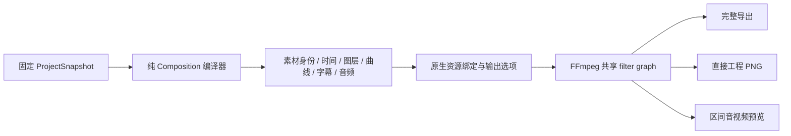

# 共享合成描述与求值契约

2026-09-21。当前实现版本为 `opencut.composition.v1`，用于固定修订的合成编译和后端接入。它不是新的持久化工程格式、Job 请求格式或 HTTP 工具；现有公共 Schema 和数据库版本不变。

## 分层与数据流

`opencut-composition` 只依赖纯工程、媒体契约、Core 和 Time。编译不访问文件、字体、编解码器、网络、数据库或 Worker。`media-contracts::composition` 持有可泛化输入句柄的 Timeline、视频/图片/音频节点、曲线和字幕原语；原生 media 包以 PathBuf 类型别名继续消费同一组原语，不依赖工程模型或编译器。

`ProjectRenderAdapter` 负责经过宿主验证的素材解析、把逻辑引用绑定为文件路径，以及选择容器、编码器、输出位置和覆盖策略。完整导出与区间预览使用 AudioVisual 编译；直接工程帧使用 Visual 编译。三者调用同一编译实现，不再分别计算视觉节点或序列时长。FFmpeg 的现有共享图构建器继续把这些原语转换为滤镜表达式。

## 描述契约

| 字段/类型 | 语义 |
|---|---|
| `format` | 固定字符串 `opencut.composition.v1`；缺失或未知版本不能反序列化为当前 Composition |
| `revision` / `sequence_id` | 描述对应的固定历史修订与序列；不能隐式改为当前 head |
| `scope` | `visual` 或 `audio_visual`；Visual 中没有音频节点，但保留完整可呈现时长 |
| `timeline` | 画布 width/height、精确 frame_rate、duration，和 video/image/audio/caption 节点；不含输出路径和编码参数 |
| `SourceRef` | `asset_id` 与 `version`；版本带不可变 ID、SHA-256、大小，旧未固定素材允许 null；不携带来源 URI |
| 节点时间 | MediaTime：十进制字符串 ticks 与正整数 timebase；时间比较与帧对齐使用精确有理数 |
| `EvaluatedCurve` | clip-local 分段仿射描述，区间为 `[start,end)`；Hold 的两端值相同，Linear 在区间内线性插值；空曲线使用静态参数 |
| 字幕 | 已编译的开始/时长、文字、字体策略、颜色、宽度、行距、对齐；源 anchor 与编辑对象仍保留在工程快照中 |

`Timeline<I>::try_map_inputs` 只替换输入句柄。测试已绑定到整数句柄，说明数据结构没有强制采用本地文件；这不等于 GPU/Web 渲染器已实现。原生绑定检查素材身份/版本相等，再走既有已解析版本和本地文件检查。解析得到非 UTF-8 路径时记录明确问题，不做替换字符转换，也不回退来源 URI。

编译先验证完整工程。序列不存在、非法结构和当前不支持的参数/轨道形式有明确错误。纯编译成功表示工程可表达为当前合成原语，不表示宿主已具备文件、字体或编码器；实际执行前仍需要 Native preflight 和 Worker 素材验证。反序列化成功同样不是执行授权，当前宿主执行使用自身从已验证快照编译的描述。

## 时间与视觉语义

- 序列呈现范围为 `[0,duration)`。duration 取启用视觉轨、启用且未静音的音频轨、typed caption cues 的最大结束时间；空序列拒绝。Visual 保留音频尾段时长，因此尾段可呈现黑场。
- 帧位置在序列格点上对齐，nearest 等距选择较晚帧。请求和对齐结果均必须落在半开范围；区间对齐两个端点，不自动裁剪越界结果。直接帧与编码后抽帧使用同一组选择函数。
- clip-local 时间是精确序列时间减 clip 起点，不先把 clip 起点舍入为帧。源时间按 source_duration/timeline_duration 的常速映射；非零源起点保留。范围输出保留原序列相位，不能把曲线或源时间在区间起点重新归零。
- 画布黑底；视频与图片先等比 contain，再缩放。位置是相对画布中心的像素偏移，正值向右/下；正旋转为顺时针。track opacity 与 clip opacity 相乘，轨道索引决定从下到上的层叠，字幕位于视觉轨之上。
- 同 z_index 的原语采用视频、图片、各自数组索引顺序；由工程编译产生的不同轨道不会共享轨道索引。Hold/Linear 是当前曲线范围；Bezier、完整效果/转场/遮罩仍归 R6。

## 音频与后端边界

未静音视频轨生成 optional audio 节点；没有源音轨时可移除该节点。启用、未静音音频轨的音频输入为必需。音频增益是轨道与 clip 增益的乘积，曲线使用同一 clip-local 语义；Visual 不解析音频文件、不生成音频图，也不求值纯音频轨的参数。

FFmpeg 目前混音到 48 kHz stereo，混合不自动归一化；时间延迟按样本位置处理，1 倍速绕过会移动瞬态的 atempo。采样器、像素量化、字形栅格化、编码有损误差属于后端实现，不能因使用同一描述就承诺跨后端逐字节一致。当前后端速率、极大时间和字体能力限制仍由 preflight/执行明确拒绝。

描述保持精确时间，不把不可区分的相邻大整数段先折成 f64。FFmpeg 表达式存在其自身精度限制；相关纯算术检查与实际像素检查分别保留，不互相替代。

## 演进与验收

改变上述时间、默认几何、层叠或音频语义需要新的 Composition format；未知 format 拒绝。当前格式没有对不认识的字段静默放行。新增后端应消费此描述，通过共享时间夹具、像素/PCM 及字幕语义检查后再声明支持，不能另写一套工程解释逻辑。

依赖/源码门禁检查纯编译器闭包；Rust 可移植测试证明无宿主资源编译和非文件句柄绑定。原生测试和公共 CLI/HTTP 任务验证真实 full/direct/range 产物、固定修订、取消与清理。结果见 [本轮验收](../qa/r2-composition-2026-09-21.md)。连续预览 Session 尚未由本轮实现，后续应消费同一描述，不通过循环创建帧 Job 代替。
