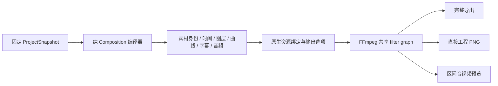

# 共享合成描述与求值契约

2026-09-21。当前实现版本为 `opencut.composition.v1`，用于固定修订的合成编译和后端接入。它不是新的持久化工程格式、Job 请求格式或 HTTP 工具；现有公共 Schema 和数据库版本不变。

## 分层与数据流

`opencut-composition` 只依赖纯工程、媒体契约、Core 和 Time。编译不访问文件、字体、编解码器、网络、数据库或 Worker。`media-contracts::composition` 持有可泛化输入句柄的 Timeline、视频/图片/音频节点、曲线和字幕原语；原生 media 包以 PathBuf 类型别名继续消费同一组原语，不依赖工程模型或编译器。

`ProjectRenderAdapter` 负责经过宿主验证的素材解析、把逻辑引用绑定为文件路径，以及选择容器、编码器、输出位置和覆盖策略。完整导出与区间预览使用 AudioVisual 编译；直接工程帧使用 Visual 编译。三者调用同一编译实现，不再分别计算视觉节点或序列时长。FFmpeg 的现有共享图构建器继续把这些原语转换为滤镜表达式。

## 描述契约

| 字段/类型 | 语义 |
|---|---|
| `format` | 固定字符串 `opencut.composition.v1`；缺失或未知版本不能反序列化为当前 Composition |
| `revision` / `sequence_id` | 描述对应的固定历史修订与序列；不能隐式改为当前 head |
| `scope` | `visual` 或 `audio_visual`；Visual 中没有音频节点，但保留完整可呈现时长 |
| `timeline` | 画布 width/height、精确 frame_rate、duration，和 video/image/audio/caption 节点；不含输出路径和编码参数 |
| `SourceRef` | `asset_id` 与 `version`；版本带不可变 ID、SHA-256、大小，旧未固定素材允许 null；不携带来源 URI |
| 节点时间 | MediaTime：十进制字符串 ticks 与正整数 timebase；时间比较与帧对齐使用精确有理数 |
| `EvaluatedCurve` | clip-local 分段仿射描述，区间为 `[start,end)`；Hold 的两端值相同，Linear 在区间内线性插值；空曲线使用静态参数 |
| 字幕 | 已编译的开始/时长、文字、字体策略、颜色、宽度、行距、对齐；源 anchor 与编辑对象仍保留在工程快照中 |

`Timeline<I>::try_map_inputs` 只替换输入句柄。测试已绑定到整数句柄，说明数据结构没有强制采用本地文件；这不等于 GPU/Web 渲染器已实现。原生绑定检查素材身份/版本相等，再走既有已解析版本和本地文件检查。解析得到非 UTF-8 路径时记录明确问题，不做替换字符转换，也不回退来源 URI。

编译先验证完整工程。序列不存在、非法结构和当前不支持的参数/轨道形式有明确错误。纯编译成功表示工程可表达为当前合成原语，不表示宿主已具备文件、字体或编码器；实际执行前仍需要 Native preflight 和 Worker 素材验证。反序列化成功同样不是执行授权，当前宿主执行使用自身从已验证快照编译的描述。

## 时间与视觉语义

- 序列呈现范围为 `[0,duration)`。duration 取启用视觉轨、启用且未静音的音频轨、typed caption cues 的最大结束时间；空序列拒绝。Visual 保留音频尾段时长，因此尾段可呈现黑场。
- 帧位置在序列格点上对齐，nearest 等距选择较晚帧。请求和对齐结果均必须落在半开范围；区间对齐两个端点，不自动裁剪越界结果。直接帧与编码后抽帧使用同一组选择函数。
- clip-local 时间是精确序列时间减 clip 起点，不先把 clip 起点舍入为帧。源时间按 source_duration/timeline_duration 的常速映射；非零源起点保留。范围输出保留原序列相位，不能把曲线或源时间在区间起点重新归零。
- 画布黑底；视频与图片先等比 contain，再缩放。位置是相对画布中心的像素偏移，正值向右/下；正旋转为顺时针。track opacity 与 clip opacity 相乘，轨道索引决定从下到上的层叠，字幕位于视觉轨之上。
- 同 z_index 的原语采用视频、图片、各自数组索引顺序；由工程编译产生的不同轨道不会共享轨道索引。Hold/Linear 是当前曲线范围；Bezier、完整效果/转场/遮罩仍归 R6。

## 音频与后端边界

未静音视频轨生成 optional audio 节点；没有源音轨时可移除该节点。启用、未静音音频轨的音频输入为必需。音频增益是轨道与 clip 增益的乘积，曲线使用同一 clip-local 语义；Visual 不解析音频文件、不生成音频图，也不求值纯音频轨的参数。

FFmpeg 目前混音到 48 kHz stereo，混合不自动归一化；时间延迟按样本位置处理并采用半样本向后舍入。非 1 倍速音频按源时长／时间线时长的精确有理数选择最近的整数重采样率，变速会改变音高，与 Classic 默认 `maintainPitch=false` 一致；Composition v1 不表示保留音高，Classic 的 `maintainPitch=true` 导入会明确拒绝。若整数采样率会使剪辑端点偏离超过一个 48 kHz 样本，后端明确返回不支持，避免静默累积漂移。变速瞬态和 AAC 有损重建仍由专项 PCM 验收限定；采样器、像素量化、字形栅格化、编码有损误差属于后端实现，不能因使用同一描述就承诺跨后端逐字节一致。当前后端速率、极大时间和字体能力限制仍由 preflight/执行明确拒绝。

描述保持精确时间，不把不可区分的相邻大整数段先折成 f64。FFmpeg 表达式存在其自身精度限制；相关纯算术检查与实际像素检查分别保留，不互相替代。

## 演进与验收

改变上述时间、默认几何、层叠或音频语义需要新的 Composition format；未知 format 拒绝。当前格式没有对不认识的字段静默放行。新增后端应消费此描述，通过共享时间夹具、像素/PCM 及字幕语义检查后再声明支持，不能另写一套工程解释逻辑。

依赖/源码门禁检查纯编译器闭包；Rust 可移植测试证明无宿主资源编译和非文件句柄绑定。原生测试和公共 CLI/HTTP 任务验证真实 full/direct/range 产物、固定修订、取消与清理。结果见 [当前交付台账](headless-completion-ledger.md)。连续预览 Session 尚未由本轮实现，后续应消费同一描述，不通过循环创建帧 Job 代替。

## V4 直接帧边界

`composition::project_v4::compile_frame_v4` 消费完整 V4 固定修订，输出不含文件路径的独立 IR4；采样值直接进入执行字段，资源请求时钟、资源内读取窗口和实际 EOF 状态分别表达。Visual scope 明确排除音频；帧的音量点样本不构成音频范围编译。

`ProjectFrameAdapterV4` 经宿主 resolver 验证并绑定 CAS，保留源确点、显式 Floor/Exact 策略与实际 PTS 回执。当前只支持受检 Legacy 媒体/矩形/椭圆、旧效果/蒙版和交叉淡化；Classic、文字字体、复杂合成和未解析 EOF 明确拒绝。六项手写小型输入的独立像素样本已验；V4 Worker、范围、完整导出与跨后端等价仍未实现；下述未母带 PCM 阶段不作为完整渲染结果。临时解码使用独占子目录并自动清理，取消及处理策略沿用宿主原生后端。

纯 `prepare_audio_v4` 一次验证固定修订，`compile_audio_block_v4` 每块最多4096帧、总声部采样预算65536。Classic placement start floor、duration ceil，元素增益使用量化起点后的局部 sample clock，轨道增益使用场景 clock；120000 tick 动画时钟与精确源 sample 位置分开。 authored rate/source request 保留原义，Classic 有效取样速率另行按原版限制为0.01–5；保持音高在单位/epsilon速率仍要求中间Float32写入，不允许 Native 线性路径冒充。Unknown/Present无格式保留 probe 要求，Disabled/Muted/Absent 在增益和资源采样前排除；长字幕及无音频场景保留静音尾。

`ProjectAudioAdapterV4` 只产生顺序 `UnmasteredPcmStageV4`：实际 FFmpeg PCM、首帧 PTS=0、原生采样率、mono双复制/多声道前两路、线性插值、实际 EOF 零尾、稳定逐声部 float32 混合及逐 sample gain。真实 PTS/声道/已观察采样数与已证实 EOF 独立记入回执。输入只允许本机自包含容器，MOV 私有选项按实际 demuxer 绑定；子进程由 admission 管理，有限队列/总解码预算/取消 kill/reap，无中间导出文件。八项手写 WAV/恶意引用样本已验，不能据此推断 Browser decodeAudioData 的 priming/重采样等价。

原生适配器继续拒绝保持音高、旧 Native resampling、非零解码原点及 Classic whole-scene peak/compressor。不能把 SoundTouch C++、FFmpeg atempo/asetrate/amix 当作原 soundtouchjs0.3.0 或浏览器母带等价；完成前不发布 V4 完整音频或 Worker 渲染结果。范围/seek 必须保留 DSP 历史与全段 peak 判定，不能逐块重置或局部峰值决定母带。

### Classic 浏览器音频适配边界

`packages/classic-audio-renderer` 为 Web 与后续隔离浏览器 Worker 共用的执行适配器。独立包的理由是共享真实解码、SoundTouch 与母带实现；它不拥有工程或修订，不解释时间线/曲线，不调用内部 CLI。宿主通过 typed in-process ports 供应固定修订的准备事实、精确源位置、逐样本幅度、CAS字节、资源保护、处理策略及执行身份；公共跨进程桥仍需版本化声明，当前类型不作为新公开协议。

纯准备事实从实际 authored duration 而非量化放置帧数计算，保留 decoded 的全部声道预算与 sliced/resampled/output 三个Float32缓冲；保持音高分为单位/epsilon的prepared-linear和非单位的prepared-soundtouch。浏览器使用44100Hz目标解码、视频经固定mediabunny1.41.0串接/OfflineAudioContext重采样，以及未修改soundtouchjs0.3.0；vendor保留完整LGPL与包/源码身份。母带只对整场peak>0.98启用真实WebAudio压缩、0.98输出增益和clamp，范围最后截取。预览始终压缩及系统音量为另一个尚未接入profile。

适配器的数组预算不能替代隔离进程的RSS/时间限制。`abortRendering`必须真正终止realm/进程并确认；普通promise拒绝或OfflineAudioContext不可用的close不算完成取消。生产Rust桥、隔离Worker装配、CAS租约与发布围栏仍待贯通；独立浏览器WAV/DSP接受不证明固定工程端到端导出或视频解码等价。
