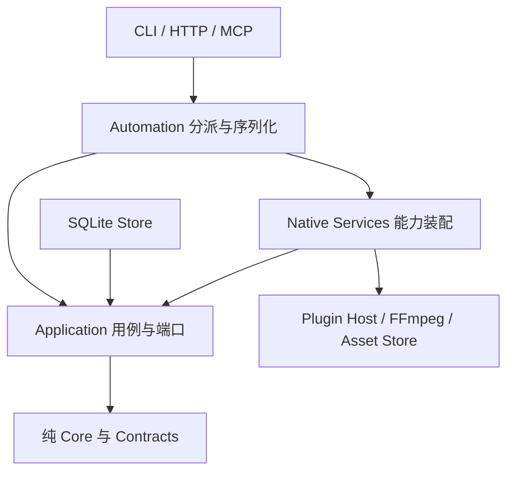

# 原生能力与应用用例边界

2026-09-21。本文约束当前预检、媒体目录与 planner 插件，不表示连续预览、分析 Provider 或效果插件已实现。

箭头表示依赖。Automation 是原生宿主装配的一部分；不宣称其依赖闭包可直接编译至浏览器。Application 的传递依赖不包含 SQLite、CAS 文件实现、FFmpeg、Wasmtime 或 Native Services。Native Services 的生产依赖不包含 SQLite；现有 SQLite 仅作为其集成测试宿主。

## 用例和契约

| 用例 | Application 负责 | 能力适配器负责 | 失败与副作用 |
|---|---|---|---|
| 渲染预检 | 经 ProjectRead 读取指定历史修订；提交拥有所有权的 FixedPreflight；核对返回 revision、sequence 和 ready/issue 一致性 | 只读解析固定素材，调用原生渲染后端生成问题报告 | 无任务和产物；不创建素材库。适配器返回矛盾报告为 INTERNAL_ERROR；有效的不可渲染结果是 ready=false 与具体 issues |
| 插件计划 | 读取指定历史快照；只接受候选 Operation；调用 Core 重新验证并生成 EditPlan | 校验包摘要、授权、ABI、输入/输出 Schema；以内存、fuel、墙钟和输出上限执行 WASM | 插件计划没有工程写端口；不会提交事务。计划语义无效统一 INVALID_PLUGIN，details 保留插件身份和原始 cause |
| 插件目录 | 提供类型化 list/inspect/install 入口 | 只读查询，或显式安装时加锁、校验并发布包 | list/inspect/plan 不创建插件根目录；install 仍是写操作。公开路径不可表示为 UTF-8 时明确失败；安装前检查，避免已安装却无法返回结果 |
| 媒体检查与修复 | 验证小写 SHA-256 身份；按探测内容分类；核对修复观察的内容身份 | 检查元数据；修复在同一内容锁内比较期望摘要、验证私有副本、实际探测、执行分类回调并原子发布 | inspect 不创建目录。冲突、错误内容或探测/分类失败保留原元数据；修复不改写工程历史 |

`PluginRuntime::propose` 只接收参数及不可变快照，返回 `Vec<Operation>`。调用前数据库快照读取已经结束，不跨 WASM 调用持有数据库事务。用户后续 apply 必须继续使用计划的 base revision；head 已变时返回冲突，不自动刷新并重放。原生 `PluginHost::invoke_plan` 作为兼容入口也调用同一个 Application 验证函数。

`MediaCatalog::repair` 的分类回调必须在适配器的内容锁与原子发布动线内执行。端口没有把修复拆成应用层分别执行的 read/probe/write，以免破坏并发检查。`DetectedMedia` 使用可移植字符串和纯元数据；原生 PathBuf 到字符串使用严格转换，不通过替换字符改变文件身份。

## 公共兼容与接入

27 个工具的 wire Schema 不变，旧 22 个工具的冻结 Schema/read_only 检查继续通过。此次可观察行为修复是只读能力不创建各自目录、语义错误归因于插件，以及拒绝无法精确表达的原生路径。数据库保持 schema v3。

`automation::{media,plugins,render}` 保留兼容导出；新嵌入宿主可直接实现 Application 端口并调用用例，也可组合 Native Services 与任意 ProjectRead 实现。当前公共插件 install_path 及源媒体路径仍使用宿主本地路径语义，尚不是远程资源引用。

这里的“只读”指能力调用不写工程状态、不创建媒体/插件/CAS 目录。CLI 首次打开新 workspace 仍会初始化 SQLite；不承诺整个进程零文件写入。验收从已创建的 workspace 起比较完整数据库内容和目录变化。

依赖与源码门禁位于 `scripts/check-contract-boundaries.py`；真实 CLI 只读动线为 `scripts/verify-read-only-capabilities.py`，WASM 计划动线为 `scripts/verify-plugin.py`。实际结果见 [本轮验收](../qa/r2-native-capabilities-2026-09-21.md)。后端无关合成描述、完整历史版本兼容矩阵和发行尚未由本次迁移完成。
