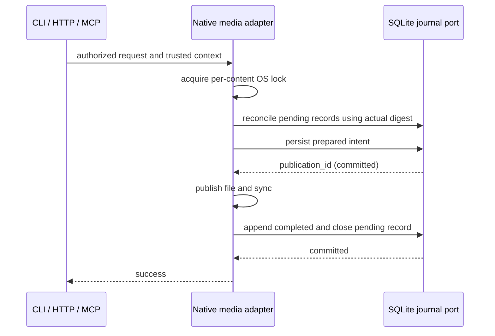

# 原生文件发布与来源记录契约

当前接通 workspace 媒体内容、元数据发布与元数据修复。插件安装将在相同协议下接入；本文件不把尚未接入的操作算作已审计。Web/GPUI 只保留接入约定。

## 分层与执行顺序

纯 `api-contracts::maintenance` 定义对象、意图、阶段、事件和查询。纯 Application 持有校验、发布顺序与 Journal/Read 端口；SQLite 适配持久化意图和追加事件；AssetStore 持有真实文件、SHA-256、原子 rename、同步和对象锁。Native Services 负责装配，Automation/HTTP 不直接决定文件是否可以去重。

同一 content_hash 的内容和元数据使用同一个 OS 锁，覆盖核对、发布前记录、文件发布及完成记录。另一协作进程不能在写入仍持锁时核对其现场。SQLite 事务只包裹短记录操作，不跨 FFprobe、完整文件哈希或文件系统发布；锁顺序为对象锁 → SQLite。直接篡改本机目录／数据库的 OS owner 位于信任边界内。

## 意图和阶段

对象为 `media_content` 或 `media_metadata`，均使用小写 SHA-256 content_hash，不能输入路径。意图包含 action、object、before_hash（允许 null）和 after_hash。媒体内容 after_hash 必须等于 content_hash；元数据指纹是完整 Asset JSON 文件的字节 SHA-256，包含其已有字段。

| phase | 可作出的判断 |
|---|---|
| prepared | 发布前记录已提交；不能认定文件已变更或调用仍存活 |
| completed | 正常路径完成文件发布／同步，完成记录也已提交 |
| observed_applied | 持锁核对时现场等于原 after_hash；不伪称知道中断前的执行过程 |
| observed_unchanged | 现场仍等于 before_hash，包括此前不存在且现在仍不存在 |
| observed_diverged | 现场既不等于 before_hash 也不等于 after_hash；保留实际指纹并要求独立处理 |

准备记录失败时不执行文件发布。发布过程出错，或文件发布后完成记录失败，返回 `PUBLICATION_OUTCOME_UNKNOWN`（HTTP 500、CLI 8），details 包含 publication_id、cause 和下一操作 `opencut_maintenance_reconcile`。pending 保留，不能把错误响应当成文件未改变的证明。

核对只观察并追加结果，不覆盖文件，不自动把现场恢复到 before/after，也不补造 completed。成功核对后关闭对应 pending，同一核对重复执行没有新事件。下一次协作写入在同一锁内先核对旧 pending，再判断本次前提。没有后台时间推断或根据 PID 猜测提交成功。

## 媒体动线

上传先流式接收私有 staging，限制大小并探测内容；进入发布阶段后重新校验 staging 指纹。同名已存在内容必须校验真实字节哈希，损坏时明确拒绝，不能静默去重或覆盖。内容和元数据分别记录，具有相同 HTTP response request_id；内容可能成功而元数据未发布，该状态可独立核对与重试。

元数据正常发布保持已有内容级事实不被重复上传改写；修复仍要求 expected_metadata_hash，在同一锁内比较并探测固定内容。实际未改变的重复发布／修复没有新 publication。原来的 upload/repair 成功输出保持兼容。

## 查询、核对及恢复

`opencut_maintenance_query` 为 owner-only 只读工具。target 支持 workspace、`object: { object: ... }`、`publication: { id: ... }` 和 `request: { id: ... }`（均使用 kind 标签）。request 同时匹配本事件 request_id 和 origin_request_id。after_sequence 为独立的规范非负 i64 十进制字符串，limit 为 1–500；响应 events/last_sequence/has_more 用于升序续查。序号不得与其他审计／事件／MCP cursor 混用。

事件包含原意图、publication_id、本次可信 actor/request_id、原始 origin_request_id、实际 observed_hash 和 UTC created_at。正常完成和事后核对都追加独立事件，因此翻页观察不会漏掉先前 prepared 的后续结果。

`opencut_maintenance_reconcile` 是 owner-only 写工具，输入 `{ "object": { "kind": "media_metadata", "content_hash": "..." } }`。返回现场指纹及已核对的 publication ID。它会等待协作写入释放对象锁，客户端停止等待不代表核对未执行。HTTP、两种 MCP、通用 CLI call 和 typed SDK 共用工具。项目 read_audit 不授予全局维护历史或核对权限。

查询覆盖从数据库 schema 6 开始的已接入发布，不包含旧操作、临时文件清理、访问失败、独立无工作区库调用或尚未接入的插件安装。原生库保留显式 UntrackedPublication 兼容入口；公共宿主必须传入真实 Journal。

## 数据库与验收

schema 6 原子新增 maintenance_publications 和 maintenance_events（及索引），记录状态与追加事件在同一 SQLite 事务中提交。v1–v5 升级不伪造历史发布记录；旧 schema 程序不能打开升级后的工作区，不提供逆向迁移。

放行证据须包含真实上传/FFprobe/独立字节校验、准备与完成记录故障注入、变更现场核对、持锁并发，以及发布前/后真实 SIGKILL。文件同步成功不等于经历了硬件断电验收；当前不声称跨 SQLite/文件系统的原子事务或其他平台的持久化等价性。
