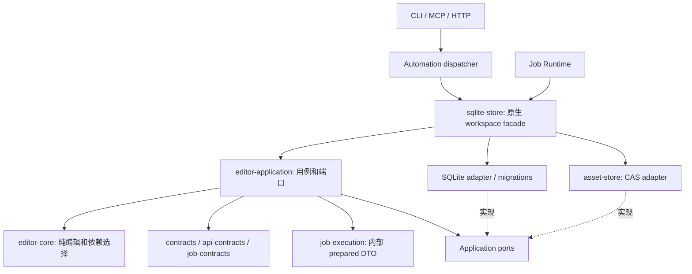

# Application 与原生存储边界

2026-09-21。`opencut-editor-application` 已移除 SQLite、CAS 实现和 tempfile 依赖，保留工程用例、任务接受、生命周期、查询／游标与公开视图。`opencut-sqlite-store` 承担原生 workspace 初始化、SQLite 适配和 CAS 依赖装配。

## 包职责

| 包／模块 | 负责 | 不负责 |
|---|---|---|
| editor-application/projects | 创建、只读计划、编辑与恢复编排；原始请求身份、计划与事务结果 | 打开数据库或媒体文件 |
| editor-application/jobs | 固定修订、依赖选择、素材锁调用及任务接受 | CAS 本机路径与 SQLite 连接 |
| editor-application/lifecycle | 租约校验、状态转换、待发布事件及 JobService | 系统时钟读取、锁或 SQL |
| editor-application/queries | 查询输入校验、分页游标、历史父链遍历、公开事件转换 | rowid、SQL 或数据库生命周期 |
| editor-application/job_views | JobRecord 到公共 JobView 的类型化允许字段投影、产物身份 | 查询数据库或检查文件可用性 |
| sqlite-store/sqlite_projects | 工程聚合原子提交、回执查找、CAS pin adapter | 自动刷新 head 或重算编辑计划 |
| sqlite-store/sqlite_jobs | 获锁后取时、调用共享状态机、状态和事件原子持久化 | 第二套生命周期规则 |
| sqlite-store/sqlite_queries | 项目与任务读适配、持久化锚点验证、一致性读分页 | 公共游标格式、公开结果脱敏 |
| sqlite-store native facade | schema v1/v2→v3 迁移、WAL/FULL、连接超时、临时内存 workspace、CAS root 和宿主入口装配 | 公共协议模型的权威定义 |

SQLite 连接使用适配器自己的本地 wrapper，实现 Application 的端口。没有让 Application 引用原生适配器，也没有通过反向依赖或条件开关隐藏 SQLite。实际数据库和故障／并发检查移动到 sqlite-store；纯公开视图检查保留在 Application，总检查没有被删掉。

## 查询端口

JobRead 提供单任务、遗留列表／事件，以及带上界的任务页和带锚点的事件页。WorkspaceRead 提供工程列表、历史单项和工程事件，同时满足 ProjectRead 的 head／固定 revision 读取。

Application 负责解析 `job-page:<upper>:<after>` 与 `job-events:<scope>:<sequence>:<event-id>`，校验 limit 和过滤范围，并生成下一游标。适配器依据真实存储验证锚点，不接收任意 SQL。JobPageSlice 返回原始记录、稳定集合上界及是否还有下一页；公开字段投影由 Application 完成。

SQLite 任务页将上界查找、锚点验证、ID 列表和每条任务读取放进同一 DEFERRED 读事务。事件页也将过滤对象、anchor 和事件列表放在同一个读事务中。这样一页内部不混合多次数据库观察；跨页保持成员上界，但任务状态仍可随之后的页更新。当前不存在任务／事件 GC；未来删除锚点时必须返回 CURSOR_EXPIRED，不能静默从头开始。

历史遍历使用不可变 revision 父链，不依赖数据库行偏移；head 是读取时观察值。新的提交不会在本次父链中插入或移动已有 revision。

## 宿主迁移与兼容

原生 Rust 接入从 `opencut_editor_application::EditorApplication::open(path)` 改为 `opencut_sqlite_store::EditorApplication::open(path)`；CLI、HTTP、MCP dispatcher、Worker、原生预检和插件装配已迁移。纯用例和端口仍从 `opencut_editor_application::{projects,jobs,lifecycle,queries}` 导入。

这是内部 Rust 源码接口迁移，不承诺旧内部 crate import 保持不变。远程 API／MCP／CLI JSON、27 个工具、SDK wire 类型、原请求身份和 schema v3 不变。旧 22 工具的 Schema/read_only 继续通过冻结 fixture 校验。

`check-contract-boundaries.py` 现在对 Application 全部源码及传递依赖执行门禁，禁止 SQLite、原生存储／媒体、Worker、Automation、Wasmtime、UI 和临时目录库。SDK／公开契约的更严格门禁继续保留。Moon 分开配置纯 Application 检查和原生存储故障／恢复验收；远程 CI 是否执行另行报告。

## 剩余范围

本轮完成原生存储的包级迁出，不代表完整 R2 放行。预检、媒体维护、插件等剩余编排仍位于 Automation／原生适配侧，后端无关合成描述、完整历史版本矩阵、SDK 发行等继续推进。浏览器／其他数据库存储适配器尚未实现；Web/GPUI 产品实现和真实 UI 验收按用户要求暂缓，不能以本轮依赖检查替代客户端验收。
