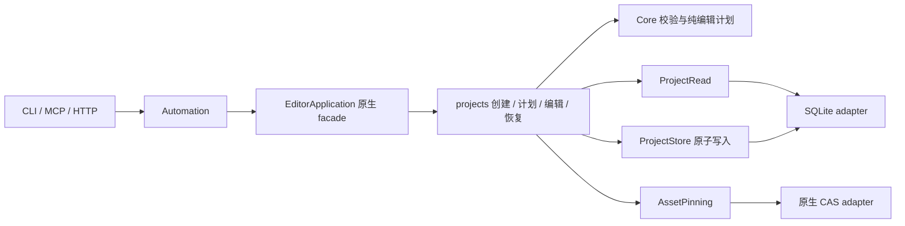

# 工程事务端口契约

2026-09-21。工程创建、只读计划、原子编辑和整工程恢复由 `editor-application::projects` 编排，SQLite 实现已迁至 `sqlite-store::sqlite_projects`。后续完成了 [包级存储迁出](native-storage-boundary.md)，Application 已不依赖 SQLite。

## 调用与所有权

Application 生成具体编辑计划、事务 ID、新修订 ID 和结果；适配器负责存储读取、并发串行化、完整写入和回执读取。只读计划仅依赖 ProjectRead，不获得 AssetPinning 或写端口，因此不会为计划捕获媒体文件。

| 端口 | 方法 | 必须满足的约束 |
|---|---|---|
| ProjectRead | head | 返回已提交工程 head；NOT_FOUND 与存储故障必须区分 |
| ProjectRead | revision | 限定 project_id，历史内容不可改写；不能跨工程读取同一个 target |
| ProjectRead | replay_create / replay_edit | 比较原始类型化请求身份；同键同请求返回首次结果，同键不同请求明确失败 |
| ProjectStore | create_atomic | 同一提交边界内复查回执及工程唯一性，写工程、初始修订、幂等回执、project.created 事件 |
| ProjectStore | commit_atomic | 同一提交边界内先复查回执，再比较 expected_revision，原子写 revision、head、transaction、receipt、outbox |
| AssetPinning | pin | 捕获不可变素材版本，不发布工程编辑；只在真正的资产绑定／替换执行期间调用 |

ProjectStore 不暴露逐表 save 方法，调用方不能在事务外分别写 head、回执和事件。PreparedCommit 只能由应用用例构造；外部适配器通过只读 getter 取得 snapshot、transaction result、audit request JSON 和 event ID。应用不向适配器交付可以针对新 head 自动重算的编辑闭包。

## 顺序与并发

1. 检查幂等键并读取原始请求回执；成功重试直接返回，无需重新捕获已删除的源媒体。
2. 检查预期 head。若在首个回执读取后 head 已变化，先再读一次回执：同一请求可能已由另一连接原子提交，不能误报冲突。
3. 对原始快照执行素材准备及 Core 计划计算。文件准备不持有 SQLite 写锁，也不改变 expected_revision。
4. SQLite 在 IMMEDIATE 写事务内再次复查幂等；再比较 head；提交完整聚合记录。失败整体回滚，不能仅保留新修订或事件。

不同请求争用同一 base 时至多一个成功，另一个返回 REVISION_CONFLICT。相同请求竞争时返回同一 transaction，不增加第二条事件。竞争期间捕获但没有被提交引用的 CAS 文件允许残留，后续 GC 负责回收；当前未实现 GC，不能声称无残留。

整工程恢复读取指定历史内容，并创建新的 revision 与 transaction，不回退或重写历史。读取 target 不持有写锁，因为 revision 内容不可变；提交仍比较调用方原 expected_revision。

## 请求身份与兼容

`identity::request_identity` 和 `EditIntent::identity` 提供适配器共用的 v2 摘要及历史摘要。create 的回执作用域为 workspace，但摘要包含请求的 project id；apply／restore 的回执按操作族、project id 和 key 隔离。

已知 Time 有理数采用规范形；自由 metadata、params、value、parameters、details 保持原样。新回执保存 v2 digest。读取旧 unversioned 事务时，只有历史审计请求的 legacy digest 确实匹配旧回执，才允许用恢复出的语义摘要比较；素材准备后的审计请求不一定等于原始请求，不能跳过此证明。

数据库版本仍为 3。HTTP/MCP/CLI 输入输出、原始幂等作用域和生成 Schema 不变；只读错误信息不包含存储实现类型。新接口属于宿主内部应用接口，不是新的远程工具或额外权限边界。

## 验收与尚未完成的边界

定序验收在第一次回执读取与下一次 head 读取之间，通过另一条真实 SQLite 连接完成 create、apply 或 restore，再推进 head，验证原结果仍可重放。另在素材准备钩子中插入竞争编辑，验证旧计划、回执和事件均未发布。

`scripts/verify-project-transactions.py` 使用独立 CLI 进程、真实 SQLite 出站事件故障、独立数据库计数和公开工程回读，验证创建／编辑／恢复回滚、重试、不同请求竞争和四个相同请求同时提交。跨 SDK 响应丢失、同请求重放与 MCP/HTTP 继续复验。

任务租约后续已完成 [生命周期端口](job-lifecycle-port-contract.md)；任务查询与分页、工程历史／事件查询以及 SQLite 数据库生命周期的后续分离见 [原生存储边界](native-storage-boundary.md)。预检／插件等用例归位、后端无关合成计划和完整版本矩阵仍属 R2 剩余范围。Web/GPUI 实现按用户要求暂缓，未来可调用相同端口规则；当前未提供浏览器存储适配器。
