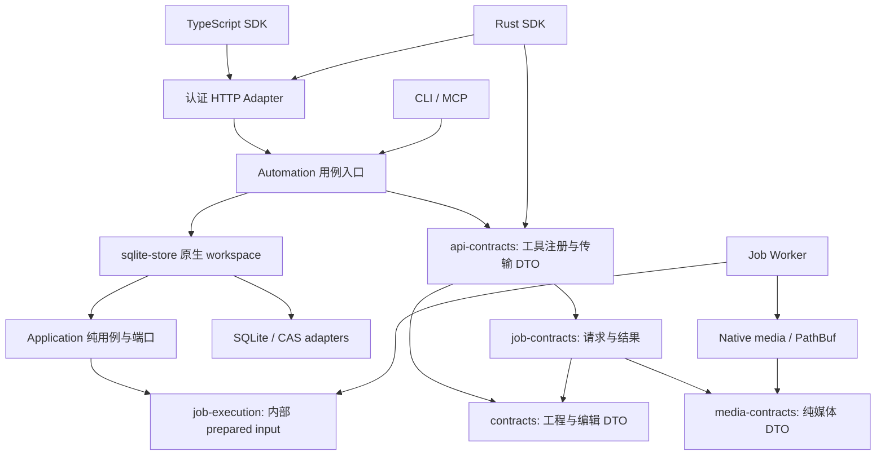

# 公共契约与原生执行边界

2026-09-21。本轮落地 R2 的纯契约依赖、同源工具注册和 Rust SDK；不宣称 R2 整体完成。

## 所有权

| 包 | 权威内容 | 禁止依赖 |
|---|---|---|
| contracts | 工程／Operation／Time、素材身份与锁清单 | 存储、网络、原生媒体、Worker、UI |
| media-contracts | 媒体时间／流信息／编码选项／排版报告、输入和结果字段 | 原生执行、文件系统、图像和字体实现 |
| job-contracts | 八类公开任务输入／结果、JobKind 关联类型和 Schema | Application、AssetStore、prepared input、原生执行 |
| api-contracts | 29 个工具名字／输入／结果／read_only 及同源 Schema；历史、事件、预检、插件 manifest 和 v1 JobRecord | SQLite、媒体 Worker、Wasmtime、HTTP 实现 |
| job-execution | 接受后固定 snapshot、asset_lock、解析前参数的内部持久输入 | SDK 不得导入此包 |
| editor-application | 工程／任务／租约／查询用例与端口 | SQLite、CAS、原生媒体、Worker、Automation、UI |
| sqlite-store | 原生 workspace、SQLite 事务／查询适配、迁移与 CAS 装配 | 不定义公共 DTO 或另一套编辑／生命周期规则 |
| sdk-rust | HTTP 传输、结构化错误、固定请求调用、任务观察 | 编辑状态权威、存储实现、原生执行 |

公开媒体 DTO 的位置参数默认为 String，原生媒体实现用 PathBuf 实例化相同字段定义。两种类型通过显式 map_paths/try_map_paths 转换，避免复制两套字段。非 UTF-8 原生路径向公开产物描述转换时返回错误，不能用有损字符串改变身份。String 在 v1 仍表示宿主路径，不等于远程 URL。

公开 tool marker 与工具 Schema 从一个声明生成；Rust Tool::Input/Output 和 TS 工具映射取相同定义。JobKind 的 Input/Result 也与能力发现共用声明。响应 request ID 在 Adapter 创建，纯 Response DTO 不生成 UUID 或读取运行时状态。

## 兼容证据与剩余迁移

纯契约拆分时未改变 v1 JSON 字段及 Schema：拆分前保留的 tools/OpenAPI/TS 生成文件与新 binary 的生成结果完全相同，历史请求和结果测试、MCP/CLI/HTTP、真实渲染与插件入口通过。公共 Job 增量之后总数为 27；冻结 fixture 验证旧 22 个工具 Schema/read_only 不变。无需修改数据库版本。内部 Rust 模块路径变化已更新本仓库调用处，不承诺旧内部 crate 源码接口保持不变。

依赖门禁 `scripts/check-contract-boundaries.py` 检查传递依赖及纯契约源码中的原生路径／I/O 引用；Moon 已配置入口，远程 CI 尚未执行。仓库外 Rust 消费者额外证明不依赖原生库；TypeScript 与 Rust 实际共享 fixture、原 revision 和幂等键重放同一事务。

仍须继续：

1. 公共 JobView 已通过新增五个工具落地，旧 JobRecord 保留兼容；见 [公共任务契约](public-job-view-contract.md)。旧入口退役和远程输入身份仍未完成。
2. 原生路径尚未全部替换为受授权的 artifact/asset identity；SDK 不将本机路径包装成远程地址。
3. 任务入队已迁到 Application，通过 JobSubmissionStore 原子接受任务，素材依赖选择与渲染共享 Core 规则。工程创建／编辑／恢复现已通过 ProjectStore 原子端口分离，见 [工程事务契约](project-transaction-port-contract.md)。租约生命周期已通过纯状态机和原子端口分离，见 [生命周期契约](job-lifecycle-port-contract.md)。Application 已完成 SQLite 包级迁出及查询／分页端口，见 [原生存储边界](native-storage-boundary.md)；预检／插件等剩余用例归位仍未完成。
4. 合成描述仍有原生后端类型；共享后端无关合成语义还需从当前媒体求值抽离。
5. 完整历史版本矩阵、SDK 发行、SSE/媒体传输封装继续跟踪。契约搬迁不等于这些产品能力已交付。

2026-09-21 事件观察增量增加 `opencut_event_changes`，当前共 28 工具；独立 NDJSON Schema 由同一个纯契约模块生成，详情见 [事件观察契约](event-observation-contract.md)。上述拆包和旧 22 工具冻结验证仍适用。

2026-09-21 上下文增量增加 `opencut_resource_read` 和纯 ResourceView DTO，当前 29 工具；MCP 与 HTTP/CLI/SDK 使用同一应用查询，参见 [MCP 上下文契约](mcp-context-contract.md)。
