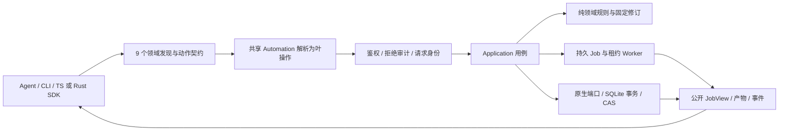

# R0–R7 当前源码产品与架构核对（2026-09-23）

判断对象是从历史记录恢复、后续继续推进的当前源码。设计目标以[完整架构](../architecture/agent-friendly-editor-v1.md)和[验收迭代](../architecture/acceptance-driven-iteration-plan.md)为准；历史 QA 只证明对应版本。当前生成的 OpenAPI 有 76 条路径，最新 macOS x86_64 debug 开发包通过 34 项仓库外验收；此前不同脚本版本的 36 项收据保留为历史证据。状态用“部分完成”表达已实现的边界，不把缺失阶段折算为完成百分比。

2026-09-24 补充：Web 的根路径入口、合成音频导入、字幕、整工程恢复式撤销／重做、预检、帧／区间预览、导出及重开后的浏览器播放已按[真实 Chrome 动线](r7-web-browser-2026-09-24.md)实测。R1／R7 仍为部分完成。

2026-09-24 继续：Web 导入／替换已转为项目上传和授权素材读取，4.32 MB 多分块与受限权限／篡改拒绝见[本轮验收](r7-web-scoped-import-2026-09-24.md)。这补足一个 R2/R7 数据动线，不改变全工作区准入、完整 Web SDK 接入和 R0–R7 仍未完成的结论。

2026-09-24 包复验：新增素材端点与跨 SDK 接续上传已随同一个 macOS x86_64 debug 开发包在仓库外验收；Chrome 实际播放、空文件错误提示、31 项 Web 测试、类型检查和构建通过。

2026-09-24 R0 续验：恢复审计的四条精确跨 SDK 动线已纳入[同一开发包的 36 项仓库外验收](r0-cross-sdk-recovery-2026-09-24.md)并通过。真实旧用户库、中文访谈／VFR／长视频和性能基线仍缺，R0 不整体放行。

2026-09-24 R2 控制写入核查：在 payload 准入余量为零且读者固定 WAL 的真实多进程动线中，四次编辑仍提交，WAL 增至 4,021,152 字节；64 MiB 独立卷盘满时编辑／取消会准确回滚，但没有修复预留保证。见[缺口实测](r2-database-control-gap-2026-09-24.md)与[控制写入契约](../architecture/database-control-admission.md)。R2 仍为部分完成。

2026-09-24 R2 后续：独立控制额度账本、owner 配置和持久控制预留已经[单独验收](r2-database-control-ledger-2026-09-24.md)，同一新 debug 开发包在仓库外 36 项复验通过。真实 CLI 仍能在 4096 字节控制限额下提交 339,968 字节数据库，证明 SQLite 写前拦截尚未接入；R2 状态不变。

2026-09-24 R2 再续：管理型 SQLite 连接已接入具名 VFS；固定 WAL 读者下，控制额度拒绝编辑后工程 head 不动，调高额度以原幂等键重试仅提交一次。128 MiB 独立卷填满后的拒绝、恢复、checkpoint 与完整性检查通过。64 MiB 卷在默认 64 MiB 空余门槛下无法初始化，repair 预留、全工作区物理保证和完整发行验收仍缺；R2 依然部分完成。

2026-09-24 R2 本轮收据：相同 x86_64 debug 开发包在仓库外[32 项完整验收](evidence/r2-control-vfs-package-acceptance-2026-09-24.json)通过，覆盖双 SDK、MCP/HTTP、历史迁移、VFS、独立盘满、Worker、网络撤权、上传导入及解码后重开；可选 WASM component 未随本轮提交验收。共享空余门槛过高时 owner 可能连预算重新配置也无法进入，须由实际 repair 通道解决；状态仍为部分完成。

2026-09-24 继续修复：本机 OS owner 的原生账本恢复 CLI 在 SQLite 不可达时可检查并修正过高空余门槛，带受限凭证的调用拒绝；真实遗留 WAL 与 64 MiB 卷初始化动线已[单独验收](r2-native-recovery-cli-2026-09-24.md)。这只是 repair 前置入口，没有预分配空间或盘满取消保证；完整 R2 状态不变。

2026-09-24 交付复验：该恢复入口和既有编辑／导入／Worker／历史协议已随同一 x86_64 debug 归档在仓库外[33 项整包验收](evidence/r2-native-recovery-package-acceptance-2026-09-24.json)通过；本轮未随包验可选 WASM component，不据此放行完整 R2 或 R0–R7。

2026-09-24 物理修复预留：8 MiB 预留已经实际写入、同步并在 64 MiB HFS+ 卷上核对分配块；卷填满到外部可用 0 字节后，本机 owner 的 repair VFS 完成排队 Job 取消、终态上传释放、补足及数据库完整性检查。Worker 和内嵌 HTTP 宿主对瞬时 SQLite BUSY 的处理经 7 秒真实写锁验证；最终 debug 开发包在仓库外通过 34 项验收，见[本轮收据](r2-physical-repair-reserve-2026-09-24.md)。运行中任务、SQLite 临时文件、全部控制元数据、外部写入及全故障矩阵未放行，R2 仍为部分完成。

2026-09-24 SQLite 临时文件增量：工作区绑定 VFS 对匿名磁盘临时文件执行写前控制预留；真实 4 MiB 临时表的额度拒绝、无部分行、恢复、预留释放和目录符号链接拒绝已验。更新包在仓库外[34 项整包验收](r2-sqlite-temp-vfs-2026-09-24.md)通过。上段的临时文件缺口是前一版本状态；当前剩余具名未知文件类型、控制元数据物理边界、运行中 repair 等缺口，R2 仍部分完成。

2026-09-24 账本暂存增量：`ledger.tmp` 写入前核对真实空闲与活动预留，普通准入保留最小空余，自动 Worker 上限留下账本和锁空间；repair 退出前预检下一版账本。真实 64 MiB 盘满卷验证策略拒绝无部分修订、释放预留后同键恢复，最终包在仓库外[34 项整包验收](r2-ledger-staging-2026-09-24.md)通过。严格物理硬配额与完整 R2 仍未放行。

2026-09-24 运行态盘满恢复增量：真实 64 MiB 卷验证活跃 Worker 阻止 repair，强杀 Worker 后存活的 ffprobe 通过继承尝试锁阻止取消，子进程退出后 owner 原子取消运行态 Job 并核对审计；排队任务、上传释放、预留补足及数据库完整性同卷通过。新 x86_64 debug 开发包在仓库外重跑并通过 34 项整包验收，见[专项收据](r2-running-worker-repair-2026-09-24.md)。这是有界停机恢复，不代表全部并发故障或完整 R2 放行。

2026-09-24 自动退出补验：同一交付包的真实 Worker 在阻塞 ffprobe 期间遭遇控制额度耗尽，退出并释放管理型数据库连接；owner repair 随即取消遗留运行态，无须等租约过期。此[独立收据](r2-running-worker-repair-2026-09-24.md)不计入前述 34 项整包结果，也不代替物理盘满／多宿主完整矩阵。

## Agent 的实际执行路径

九领域工具是发现层；61 个叶操作仍是权限、幂等、审计及兼容单元。MCP 默认列表只给 `action` 枚举与通用 `input` 容器，Agent 必须先读取该领域的精确 schema，再调用。CLI `system domains`、MCP `opencut://schemas/domains/{domain}` 和 HTTP `/v1/domains/{domain}` 提供同源契约。持久 Job 的“已接受”与“成功产物”是两种状态，SDK 需要显式等待、读取公开 JobView 并核验产物。

## Rust 内核与外层适配

Rust 内核不是单个 crate，也不是 CLI／MCP。它的纯计算部分与应用／原生适配有明确边界：

| 层 | 当前源码位置 | 已承担的规则 | 当前限制 |
|---|---|---|---|
| 公开模型与精确时间 | `crates/contracts`、`crates/time` | 工程／操作 DTO；有理时间的精确比较、运算和帧格对齐，溢出明确报错 | 时间公开表示仍限 i64 ticks／u32 timebase；DTO 本身不能替代业务校验 |
| 编辑领域内核 | `crates/editor-core` | 工程不变量、对象 ID 与轨道/素材范围、参数/关键帧校验；20 类已注册操作在固定 revision 上生成 `EditPlan`，失败批次不改变快照 | 只有现有操作与参数语义；无选择性撤销、分支合并、完整效果／遮罩／转场 |
| 合成语义内核 | `crates/composition` | 将不可变工程修订编译为不含文件路径/编码器的 `Composition`，统一 full/direct/range 的时间、画面、音频与字幕选择 | 当前支持的轨道／参数子集；无第二渲染后端、连续播放 Session |
| 应用用例与端口 | `crates/editor-application` | create/plan/apply/restore、素材固定、任务生命周期、权限与公开投影；`ProjectStore::commit_atomic` 要求 revision/head/事务/幂等回执/事件一次提交 | 是业务编排层，不应被称为纯领域内核；完整协作与资源治理未完成 |
| 原生执行适配 | `crates/sqlite-store`、`asset-store`、`storage-budget`、`media`、`project-render`、`job-runtime`、`plugin-host` | SQLite 原子实现、CAS、额度账本、FFmpeg、固定修订渲染、持久任务与受限插件 | 依赖本机文件／FFmpeg；尚无全工作区写入保证及完整插件类别 |

实际编辑链为 `Automation::call → 领域动作解析与叶操作鉴权 → Application::projects::plan/apply → editor-core::plan_transaction → ProjectStore::commit_atomic → SQLite 修订、回执、审计与事件`。渲染链从持久 Job 取固定修订，经过 `composition::compile` 的纯描述，再由 `project-render`／`media` 原生适配执行。2026-09-23 对 `contracts/time/editor-core/composition/editor-application` 五个 crate 的独立 Rust 测试共 37 项通过，依赖边界脚本通过；包内真实编辑、预览、导出与 Worker 恢复另见本轮验收。这证明当前子集的执行路径，不证明 Rust 内核已覆盖完整视频编辑语义。

| 阶段 | 当前判断 | 已有源码／本轮证据 | 不能放行的关键缺口 |
|---|---|---|---|
| R0 验收基线 | 部分完成 | 恢复历史夹具并跑通 v1–v15 × 两摘要 30 格；真实 HTTP/CLI 合成音视频 10 项；双 SDK 与官方 MCP 独立消费；最新 macOS x86_64 debug 开发包仓库外验收 34 项通过，四条精确跨 SDK 恢复动线已核销；[回放失败项按序号分类](recovery-replay-failure-audit-2026-09-23.md) | 缺真实旧用户库、中文访谈／VFR／长视频与硬件性能基线；当前包不等于 release／完整系统发行 |
| R1 正确性与状态 | 部分完成 | 当前二进制通过导入识别、原子编辑与同键重放、冲突、旧修订导出、损坏产物拒绝、重启重开；Web 已验实际浏览器导入、整工程恢复撤销／重做和播放 | 异步交错、选择性撤销、真实音频边界及崩溃窗口尚未组成同一版完整放行证据 |
| R2 架构与公开契约 | 部分完成 | 纯 Core、Application 用例、原生端口、SQLite/CAS 适配及共享 Automation；九领域/61 叶操作四入口；76 路径 OpenAPI 包含项目素材读取、原始上传、产物下载和公共 SSE；最新包已验双 SDK 接续真实音频上传、受限预检、64 MiB 盘满／WAL、CAS 清理、Worker 输出准入和媒体／下载写入预算；插件/WASM 有早期独立证据，本包未附可选 component；管理型 SQLite 主库/WAL/journal/SHM 和匿名磁盘临时文件已有 VFS 写前控制预留，本机 owner 可独立恢复锁死策略；8 MiB 物理 repair 预留在真盘满下完成有界取消、暂存释放与补足 | 全工作区写入准入仍显式为 false；具名未知 SQLite 文件、控制元数据的严格物理保证、运行中任务／并发故障的盘满修复、产物保留／持续会话引用、release／跨平台交付验收未完成 |
| R3 人机协作 | 部分完成 | 提交事件、游标观察、固定修订与整工程恢复存在；Web 有事件及操作协调代码 | 无选择性事务撤销、因果重做、显式分支比较／合并；真实浏览器与外部 Agent 并发协作未验 |
| R4 连续预览 | 部分完成 | 工程帧／直接帧／区间预览和导出可由真实 Worker 生成，合成描述共用 | 无连续播放 Session、seek generation／owner lease／presentation telemetry；无真实播放 A/V 与性能门槛证据 |
| R5 素材理解 | 未形成闭环 | 媒体探测与人工给定字幕／时间码可参与剪辑；MCP prompt 明确不声称自动转写 | 无可验的转写、词级时间、说话人、镜头／静音分析产物与证据搜索；不能完成真实访谈自动理解到修正的动线 |
| R6 完整编辑／插件／工程包 | 部分完成 | 现有多轨、字幕、部分 clip 参数、真实 FFmpeg 求值与受限 WASM planner；开发包已验真实 WASM 安装、发布恢复、项目级授权与 MCP 规划；Classic 复用方向已设计 | 效果／转场／遮罩／复杂文字的全链语义，Classic 工程导入，分析器／Provider 等插件类别，自包含工程包与跨机器重开均未放行 |
| R7 宿主与交付 | 部分完成 | CLI、HTTP、MCP 和 SDK 可真实使用；仓库外开发包已验；Web 编辑台 31 项逻辑测试、TypeScript 和 client/SSR 生产构建及统一契约检查通过，真实 Chrome 已验合成音频导入和播放；桌面为 GPUI 壳 | 长视频流式播放与浏览器／Agent 并发未验，Web 的 Bun 锁定依赖／发行未验；桌面尚未接共享 Application；浏览器独立存储、移动端、release／跨平台升级与最终十二条门槛缺失 |

核心分层方向清楚，且当前四入口能走同一业务规则；“Agent 可通过结构化契约剪辑合成素材”已具备实证。完整目标所要求的“理解真实素材、人机选择性协作、连续观看、完整效果、可携带工程和多宿主交付”尚不能成立。下一迭代应先封存当前源码与可复验包、核销恢复缺口和 R0 素材矩阵，再关 R2 资源治理，随后按 R3/R4/R5 的真实产品动线推进，最终补 R6/R7；每项通过源码、协议、真实产物和用户动线四层证据判定。
