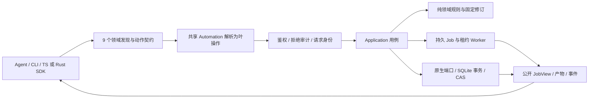

# R0–R7 当前源码产品与架构核对（2026-09-23）

判断对象是从历史记录恢复的当前源码快照。设计目标以 [完整架构](../architecture/agent-friendly-editor-v1.md) 和 [验收迭代](../architecture/acceptance-driven-iteration-plan.md) 为准；历史 QA 证明的是当时版本，不自动证明当前源码、当前二进制或发行包。当前开发包及 75 路径证据见 [数据面复验](r2-data-plane-openapi-2026-09-23.md)。状态用“部分完成”表达已实现的边界，不把缺失阶段折算为完成百分比。

## Agent 的实际执行路径

九领域工具是发现层；61 个叶操作仍是权限、幂等、审计及兼容单元。MCP 默认列表只给 `action` 枚举与通用 `input` 容器，Agent 必须先读取该领域的精确 schema，再调用。CLI `system domains`、MCP `opencut://schemas/domains/{domain}` 和 HTTP `/v1/domains/{domain}` 提供同源契约。持久 Job 的“已接受”与“成功产物”是两种状态，SDK 需要显式等待、读取公开 JobView 并核验产物。

## Rust 内核与外层适配

Rust 内核不是单个 crate，也不是 CLI／MCP。它的纯计算部分与应用／原生适配有明确边界：

| 层 | 当前源码位置 | 已承担的规则 | 当前限制 |
|---|---|---|---|
| 公开模型与精确时间 | `crates/contracts`、`crates/time` | 工程／操作 DTO；有理时间的精确比较、运算和帧格对齐，溢出明确报错 | 时间公开表示仍限 i64 ticks／u32 timebase；DTO 本身不能替代业务校验 |
| 编辑领域内核 | `crates/editor-core` | 工程不变量、对象 ID 与轨道/素材范围、参数/关键帧校验；20 类已注册操作在固定 revision 上生成 `EditPlan`，失败批次不改变快照 | 只有现有操作与参数语义；无选择性撤销、分支合并、完整效果／遮罩／转场 |
| 合成语义内核 | `crates/composition` | 将不可变工程修订编译为不含文件路径/编码器的 `Composition`，统一 full/direct/range 的时间、画面、音频与字幕选择 | 当前支持的轨道／参数子集；无第二渲染后端、连续播放 Session |
| 应用用例与端口 | `crates/editor-application` | create/plan/apply/restore、素材固定、任务生命周期、权限与公开投影；`ProjectStore::commit_atomic` 要求 revision/head/事务/幂等回执/事件一次提交 | 是业务编排层，不应被称为纯领域内核；完整协作与资源治理未完成 |
| 原生执行适配 | `crates/sqlite-store`、`asset-store`、`storage-budget`、`media`、`project-render`、`job-runtime`、`plugin-host` | SQLite 原子实现、CAS、额度账本、FFmpeg、固定修订渲染、持久任务与受限插件 | 依赖本机文件／FFmpeg；尚无全工作区写入保证及完整插件类别 |

实际编辑链为 `Automation::call → 领域动作解析与叶操作鉴权 → Application::projects::plan/apply → editor-core::plan_transaction → ProjectStore::commit_atomic → SQLite 修订、回执、审计与事件`。渲染链从持久 Job 取固定修订，经过 `composition::compile` 的纯描述，再由 `project-render`／`media` 原生适配执行。2026-09-23 对 `contracts/time/editor-core/composition/editor-application` 五个 crate 的独立 Rust 测试共 37 项通过，依赖边界脚本通过；包内真实编辑、预览、导出与 Worker 恢复另见本轮验收。这证明当前子集的执行路径，不证明 Rust 内核已覆盖完整视频编辑语义。

| 阶段 | 当前判断 | 已有源码／本轮证据 | 不能放行的关键缺口 |
|---|---|---|---|
| R0 验收基线 | 部分完成 | 恢复历史夹具并跑通 v1–v15 × 两摘要 30 格；真实 HTTP/CLI 合成音视频 10 项；双 SDK 与官方 MCP 独立消费；macOS x86_64 debug 开发包仓库外扩展验收 29 项通过 | 20 次补丁和 61 次 Python 回放失败未逐项核销；缺真实旧用户库、中文访谈／VFR／长视频、浏览器与硬件性能基线；当前包不等于 release／完整系统发行 |
| R1 正确性与状态 | 部分完成 | 当前二进制通过导入识别、原子编辑与同键重放、冲突、旧修订导出、损坏产物拒绝、重启重开 | 当前 Web 真实浏览器操作、异步交错、undo/redo 及真实音频边界／崩溃窗口未组成同一版完整放行证据 |
| R2 架构与公开契约 | 部分完成 | 纯 Core、Application 用例、原生端口、SQLite/CAS 适配及共享 Automation；九领域/61 叶操作四入口；75 路径 OpenAPI 包含原始上传、产物下载和公共 SSE，真实受限网络动线已验；旧 wire、生成 SDK、历史矩阵通过；同一包真实 64 MiB 盘满／WAL、CAS 清理、Worker 输出准入和媒体／插件／下载写入预算已验 | 全工作区写入准入仍显式为 false；SQLite/WAL 的预先准入与控制元数据增长、产物保留／持续会话引用、release／跨平台交付验收未完成 |
| R3 人机协作 | 部分完成 | 提交事件、游标观察、固定修订与整工程恢复存在；Web 有事件及操作协调代码 | 无选择性事务撤销、因果重做、显式分支比较／合并；真实浏览器与外部 Agent 并发协作未验 |
| R4 连续预览 | 部分完成 | 工程帧／直接帧／区间预览和导出可由真实 Worker 生成，合成描述共用 | 无连续播放 Session、seek generation／owner lease／presentation telemetry；无真实播放 A/V 与性能门槛证据 |
| R5 素材理解 | 未形成闭环 | 媒体探测与人工给定字幕／时间码可参与剪辑；MCP prompt 明确不声称自动转写 | 无可验的转写、词级时间、说话人、镜头／静音分析产物与证据搜索；不能完成真实访谈自动理解到修正的动线 |
| R6 完整编辑／插件／工程包 | 部分完成 | 现有多轨、字幕、部分 clip 参数、真实 FFmpeg 求值与受限 WASM planner；开发包已验真实 WASM 安装、发布恢复、项目级授权与 MCP 规划；Classic 复用方向已设计 | 效果／转场／遮罩／复杂文字的全链语义，Classic 工程导入，分析器／Provider 等插件类别，自包含工程包与跨机器重开均未放行 |
| R7 宿主与交付 | 部分完成 | CLI、HTTP、MCP 和 SDK 可真实使用；仓库外开发包已验；Web 编辑台 31 项逻辑测试、TypeScript 和 client/SSR 生产构建及统一契约检查通过；桌面为 GPUI 壳 | 真实浏览器操作与播放未验，Web 的 Bun 锁定依赖／发行未验；桌面尚未接共享 Application；浏览器独立存储、移动端、release／跨平台升级与最终十二条门槛缺失 |

核心分层方向清楚，且当前四入口能走同一业务规则；“Agent 可通过结构化契约剪辑合成素材”已具备实证。完整目标所要求的“理解真实素材、人机选择性协作、连续观看、完整效果、可携带工程和多宿主交付”尚不能成立。下一迭代应先封存当前源码与可复验包、核销恢复缺口和 R0 素材矩阵，再关 R2 资源治理，随后按 R3/R4/R5 的真实产品动线推进，最终补 R6/R7；每项通过源码、协议、真实产物和用户动线四层证据判定。
